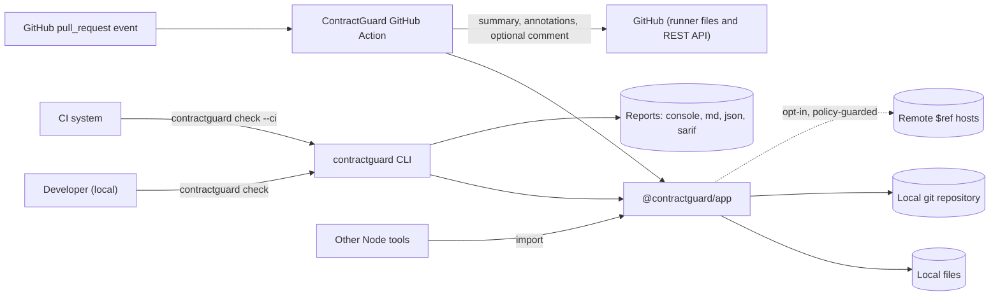
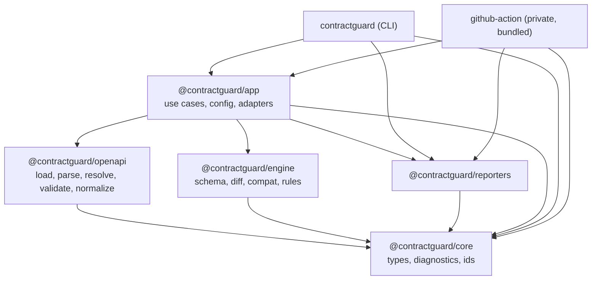
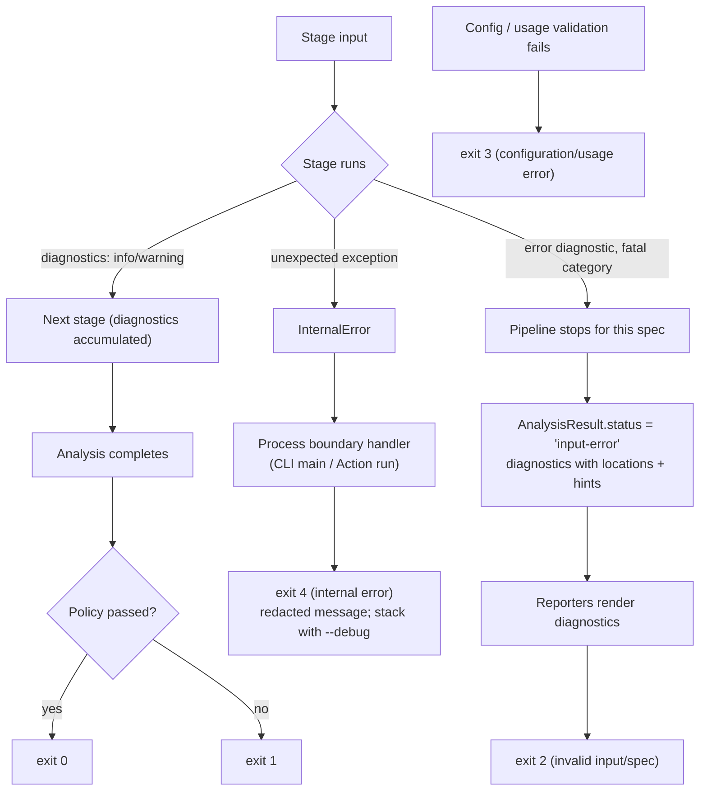
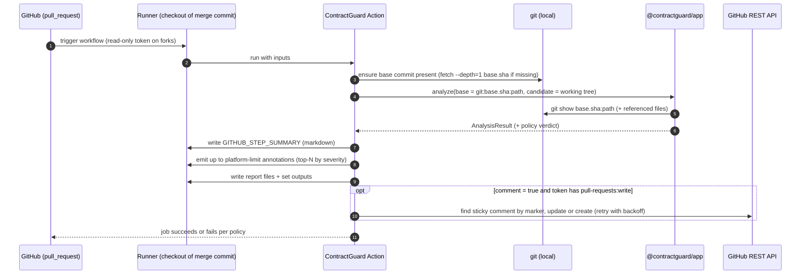
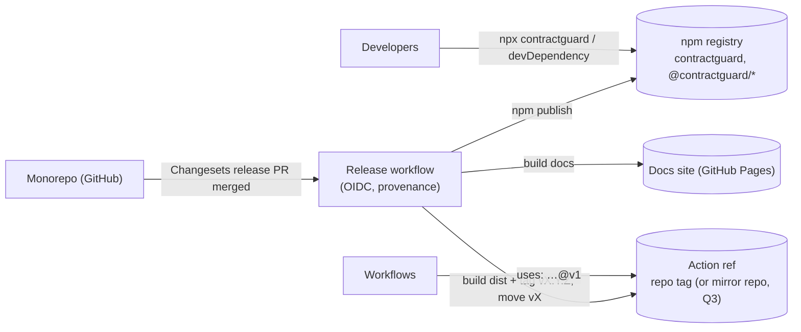
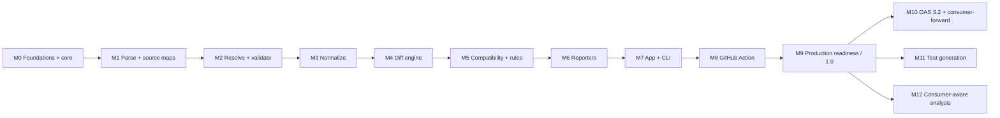

# ContractGuard — Engineering Blueprint (Stage 1)

| | |
|---|---|
| **Status** | Approved 2026-11-15 (D1–D22 with recommended defaults) — implementation in progress |
| **Scope of this document** | Stage 0 investigation results + complete Stage 1 architecture blueprint |
| **Implementation status** | M0–M7 complete (core, OpenAPI front end, diff engine, compatibility engine with the 83-rule catalog, reporters, CLI). See §19 and §19.1. |
| **Date** | 2026-11-15 |
| **Repository state at time of writing** | `github.com/zainkhan-bit/ContractGuard` — empty (no commits); local working copy empty |

> **How to read this document.** Sections follow the order required by the master prompt (§22). Every major decision is recorded as an ADR in §4 and referenced elsewhere as `ADR-NN`. Every compatibility rule is specified in §10.6. Statements marked **[Verified]** were checked against primary or authoritative sources during Stage 0 (see §3.1); statements marked **[Assumption]** are engineering assumptions with a stated safe default.

---

## Table of contents

1. Executive architecture summary
2. Product requirements and scope
3. Engineering assumptions and constraints (incl. Stage 0 findings)
4. Architecture decision records
5. High-level architecture diagrams
6. Module responsibilities
7. Canonical contract model
8. Parser and normalization architecture
9. Semantic comparison algorithm
10. Compatibility rule architecture (incl. full rule catalog)
11. Schema analysis strategy
12. CLI and configuration design
13. Reporting and GitHub architecture
14. Test generation strategy
15. Persistence and caching decisions
16. Security and performance
17. Repository structure
18. Testing strategy and test matrix
19. Implementation roadmap
20. Open-source release strategy
21. Risk register
22. Unresolved architectural questions, recommendations and approval list

---

# 1. Executive architecture summary

ContractGuard is a **deterministic, local-first compatibility analyzer for HTTP API contracts**, starting with OpenAPI 3.0.x and 3.1.x. Given a *baseline* and a *candidate* specification, it produces evidence-backed findings that say **what changed**, **whether it is compatible under an explicitly named compatibility perspective**, **how certain that conclusion is**, and **exactly where in the source documents the evidence lives**.

The architecture is a straight pipeline with hard module boundaries:

```
load → parse (with source maps) → resolve refs → validate → normalize
     → match & diff (perspective-neutral change events)
     → evaluate compatibility (perspective + policy → classified findings)
     → apply policy → render reports → integrate (CLI exit code / GitHub)
```

The five ideas that define the design:

1. **Compatibility is defined formally, as instance-set inclusion with a direction.** For the default *provider-backward* perspective, a request schema must not *narrow* (every request that was valid before must still be accepted) and a response schema must not *widen* (every response the new provider can produce must still satisfy old consumers). Rules describe the *effect* of a change (widens / narrows / incomparable / equivalent / unknown) and its *strength* (structural / enumerated / value-space / additive / behavioral). A perspective then turns effect + direction + strength into a classification using a published table (ADR-08). Adding a new perspective, such as forward compatibility, means writing a new table, not new rules.

2. **Diffing and judging are separate.** The diff engine emits perspective-neutral `ContractChange` events. The compatibility engine is the only module that assigns classifications. This keeps rules out of scattered conditionals and makes every classification traceable to one rule and one table entry.

3. **Schemas are a graph, not a tree.** Each `$ref` is an edge in an arena-allocated `SchemaGraph`. Schema comparison memoizes on node *pairs*, so shared components are compared once and recursive schemas terminate (coinductive comparison, §9.6). Findings are then *projected* onto each operation that uses the changed schema, and grouped in reports by **root cause**. One change in a shared component shows up as one cause with N affected operations, not N unrelated warnings.

4. **Uncertainty is first-class.** Five classifications (breaking, potentially-breaking, non-breaking, informational, undetermined) are kept separate from five severities. Each finding also carries a **basis**: contract-guaranteed, consumer-dependent, policy-dependent, or indeterminate. Unsupported JSON Schema constructs produce *undetermined* findings instead of fabricated certainty.

5. **Untrusted input by default.** Specs are data and are never executed. YAML parsing has alias, size and depth limits. Remote references are off by default. When they are enabled, they go through an SSRF-hardened fetcher, and in CI mode they need an explicit flag or Action input. Settings in the repository config file can only *restrict* network access, never grant it.

**Recommended package layout** (ADR-02): six published workspace packages instead of the nine proposed in the brief. They are `@contractguard/core`, `@contractguard/openapi`, `@contractguard/engine` (schema analysis + diff + compatibility + rules), `@contractguard/reporters`, `@contractguard/app` (use cases, config, I/O adapters) and the `contractguard` CLI. There is also one private, bundled GitHub Action. Test generation and consumer-aware analysis get their own packages only when they are built (post-1.0).

**Runtime and tooling** (ADR-03, ADR-17): Node.js ≥ 24, ESM-only, TypeScript 6.0 in strict mode (TS 7 typecheck job in CI), pnpm 11 workspaces, Vitest 5, fast-check, ESLint + typescript-eslint, Changesets 3, npm trusted publishing with provenance.

**What ContractGuard will not claim**: that a change is safe for a specific real consumer without consumer evidence; that the implementation matches the spec; or anything about semantics that the spec does not express (for example, a field changing meaning from cents to dollars). These limits are written into the risk register (§21) and into report wording.

---

# 2. Product requirements and scope

## 2.1 Product vision

A tool that engineering teams trust enough to put in front of their merge button. Trust comes from three properties, in this order: **correct** compatibility semantics, **explained** findings with evidence, and **predictable** behaviour (deterministic, offline, stable identifiers and exit codes).

## 2.2 Problem statement

APIs evolve. Text diffs of OpenAPI files fail in both directions:

- **False alarms**: moving a schema into `components`, renaming a component, reordering keys, converting `nullable: true` (3.0) into `type: [string, "null"]` (3.1), or spelling out a default (`style: form`) all change the text but not the contract.
- **Missed breaks**: tightening `maxLength` on a request field, adding a value to a response enum consumed by exhaustive `switch` statements, or removing a property from a schema with `additionalProperties: false` are one-line edits with real consequences.

Existing tools help, but they usually express results as a severity level or a binary "breaking" flag. They do not model *which side* of the contract a change affects, or *how certain* the conclusion is (see §3.1.3).

## 2.3 Target users

| Persona | Need | Primary surface |
|---|---|---|
| API provider engineer | Know before merging whether a spec change breaks existing clients, and why | CLI locally, PR check |
| Platform / API governance team | Enforce a consistent policy across many services in a monorepo | Config file, GitHub Action, JSON reports |
| Reviewer | Understand the impact of a PR's API change without reading YAML | PR summary, annotations |
| Tool builder | Embed compatibility analysis in other Node tooling | `@contractguard/app` / `engine` libraries |
| (Future) Consumer team | Know whether a provider change affects *their* usage | Consumer-aware analysis (post-1.0) |

## 2.4 Core user workflows

**W1 — Local check before pushing**
```bash
contractguard check --base git:origin/main:api/openapi.yaml api/openapi.yaml
```
Prints a grouped console report and exits 1 if the policy fails.

**W2 — Configured CI gate (monorepo)**
`.contractguard.yaml` lists N specs, each with a git baseline. In CI, `contractguard check --ci` writes reports (JSON / Markdown / SARIF) and exits according to policy.

**W3 — Pull request integration**
The GitHub Action runs on `pull_request`, compares the PR merge result against the base commit, writes a job summary, emits up to the platform limit of annotations, optionally updates one sticky PR comment, and fails the job per policy.

**W4 — Validate a spec**
`contractguard validate api/openapi.yaml` reports syntax, specification and reference errors with file:line locations.

**W5 — Understand a finding**
`contractguard explain CG-RES-006` prints the rule's semantics, rationale, examples and configuration options, fully offline.

**W6 — Snapshot a baseline**
`contractguard baseline create api/openapi.yaml -o .contractguard/baselines/api.json` writes a bundled, hashed snapshot. This lets you compare against a release without relying on git history.

**W7 — Accept a known break**
Add an `ignore` entry with a mandatory `reason` and optional `expires` date. The finding stays in reports, marked *suppressed*, and stops affecting the exit code.

## 2.5 Functional requirements

IDs are referenced by tests (§18) and milestones (§19).

| ID | Requirement |
|---|---|
| FR-01 | Load OpenAPI 3.0.0–3.0.4 and 3.1.0–3.1.2 documents in JSON or YAML from local files, git revisions, stdin and (opt-in) remote URLs. |
| FR-02 | Detect the specification version from the `openapi` field. Reject Swagger 2.0 and OpenAPI 3.2+ with a specific, actionable diagnostic (3.2 support is planned, §19 M10). |
| FR-03 | Separate errors into **syntax** (not parseable), **specification** (parseable but invalid against the OAS), **reference** (unresolvable or forbidden), **semantic** (valid but contradictory, e.g. duplicate templated paths), and **unsupported construct** classes. |
| FR-04 | Resolve local, relative-file and (opt-in) remote `$ref`s under the security policy (§16). Detect cycles without infinite loops. Support 3.1 `$id` / `$anchor` resolution. |
| FR-05 | Normalize documents into the canonical model (§7), keeping a source location for every canonical element and for every `$ref` hop. |
| FR-06 | Match operations across versions without relying on `operationId` (§9.3). Report probable renames as hints only. |
| FR-07 | Detect every change category listed in master prompt §4.3. |
| FR-08 | Classify each change under a named compatibility perspective (default `provider-backward`). Reason separately about request acceptance and response guarantees. |
| FR-09 | Produce findings with every field required by master prompt §5. |
| FR-10 | Never present an uncertain conclusion as certain. Unsupported or undecidable cases produce *undetermined* findings with an explanation. |
| FR-11 | Apply a configurable policy (fail on classifications / severity threshold / undetermined handling) and map the result to stable exit codes. |
| FR-12 | Render reports as console text, Markdown, JSON (versioned schema) and SARIF 2.1.0. |
| FR-13 | Support rule overrides (severity, and classification for rules flagged overridable), rule disabling, and finding-level suppressions that require a reason. |
| FR-14 | Support include/exclude filters by operation (method + path glob), tag and extension flag. |
| FR-15 | Provide a GitHub Action with job summary, annotations, an optional sticky PR comment, SARIF output and outputs for downstream steps. It must work safely on fork PRs. |
| FR-16 | Provide `explain` documentation for every rule, generated from the same rule catalog the engine uses. |
| FR-17 | Provide the programmatic API (`@contractguard/app`, `@contractguard/engine`) with typed, documented public interfaces. |

## 2.6 Non-functional requirements

| ID | Requirement | Measure |
|---|---|---|
| NFR-01 Determinism | The same inputs + config + tool version give byte-identical JSON/SARIF/Markdown output (timestamps excluded or disabled). | Property tests (shuffled key order), golden files, CI repeat-run check |
| NFR-02 Offline by default | No network access unless remote refs are explicitly enabled (and, in CI mode, also allowed by flag/input). | Network-denied test environment |
| NFR-03 Performance | 1,000 operations / 2,000 component schemas / ~5 MB YAML compared in < 5 s and < 1 GB RSS on a standard GitHub-hosted runner. **[Assumption]**, validated in M7 benchmarks. | `bench/` suite in CI (non-blocking, trend-tracked) |
| NFR-04 Safety | Hostile inputs (alias bombs, deep nesting, huge files, path traversal, SSRF attempts) end with a diagnostic, not a crash, hang or escape. | Security fixture suite (§18.8) |
| NFR-05 Portability | Linux, macOS, Windows. Paths and line endings handled correctly (CRLF source maps). | CI matrix on 3 OSes |
| NFR-06 Type safety | `strict` TypeScript, no `any` in source (lint-enforced), runtime validation at all external boundaries. | Lint + typecheck gates |
| NFR-07 Stability | Rule IDs, finding fingerprints, exit codes, JSON schema and config schema follow the versioning policy in §20.4. | Golden tests + changesets review |
| NFR-08 Explainability | Every finding has an explanation, at least one evidence item and a suggested resolution. | Schema-level test: no finding without evidence |
| NFR-09 Maintainability | Module dependency rules enforced in CI. No circular package dependencies. | dependency-cruiser gate |
| NFR-10 No AI in the analysis path | No AI dependency in any analysis package. Optional AI features (future) may only rephrase explanations, never set classifications. | Dependency allowlist check |

## 2.7 Initial scope (v1.0)

- OpenAPI 3.0.x and 3.1.x; JSON and YAML; multi-file specs with local relative refs.
- Provider-backward perspective (the formal model also defines consumer-forward, but it ships after 1.0; see ADR-08).
- Full rule catalog in §10.6 (83 rules).
- CLI commands: `check`, `validate`, `explain`, `baseline create`, `init`.
- Reporters: console, Markdown, JSON v1, SARIF 2.1.0.
- GitHub Action (`node24` runtime).
- Git-based baselines (`git:<ref>:<path>`) and snapshot baselines.

## 2.8 Explicit exclusions (v1.0)

| Excluded | Reason / plan |
|---|---|
| Swagger / OpenAPI 2.0 | Different model. Clear "unsupported" diagnostic; users can convert first. Revisit on demand. |
| OpenAPI 3.2 | Shipped Sept 2025. Planned for M10 with additive model changes (`query` method, `additionalOperations`, `in: querystring`, `itemSchema`). |
| AsyncAPI, GraphQL, gRPC/protobuf | The canonical model is HTTP-shaped. The architecture keeps `engine` independent of `openapi` so a future adapter could target it, but there are no protocol abstractions before there is a second protocol (master prompt §21). |
| Callbacks and webhooks comparison | Detected and reported as *undetermined*/informational. Full analysis post-1.0. |
| Links, examples, descriptions, `externalDocs` | Not contract semantics. Ignored (examples are never echoed into reports, §16). |
| Dashboard / hosted service / database | Out of scope (master prompt §21). JSON reports are the integration point. |
| Test generation and execution | Architecture designed (§14). Implementation post-1.0 (M11). |
| Consumer-aware analysis | Extension points designed (§10.8). Implementation post-1.0 (M12). |
| AI-generated explanations | Never in the analysis path. Possible future opt-in rephrasing layer. |
| Arbitrary JS configuration / plugins loaded from config | Rejected for security and determinism (ADR-12). |

## 2.9 Success metrics

| Metric | Target for 1.0 |
|---|---|
| Rule correctness on the curated compatibility corpus (§18.4) | 100% expected-classification match (it is the regression suite) |
| Soundness oracle (§18.6) | 0 counterexamples where a *non-breaking* request verdict is contradicted by a sampled instance |
| False-positive rate on real-world spec histories (APIs.guru-derived version pairs, manual triage of a 200-finding sample) | < 5% of findings judged wrong by two reviewers |
| Differential test vs oasdiff on ≥ 500 version pairs | Every disagreement triaged and categorized (our bug / their bug / intentional semantic difference) |
| Self-comparison | `check(A, A)` yields zero non-informational findings across the whole corpus |
| Performance | NFR-03 met |
| Adoption signals (post-release) | Tracked, not gated: npm downloads, Action usage, "false positive" issue rate per rule |

---

# 3. Engineering assumptions and constraints

## 3.1 Stage 0 findings

### 3.1.1 Repository inspection [Verified]

- The local folder (`D:\Git Projects\ContractGuard`) and the GitHub repository (`zainkhan-bit/ContractGuard`) are both empty. The GitHub repo has no commits on `main`.
- **Consequence:** no existing decisions to preserve and nothing to overwrite. Everything in this document is a new proposal.

### 3.1.2 Ecosystem facts that shape the design [Verified, November 2026]

| Topic | Finding | Design consequence |
|---|---|---|
| OpenAPI versions | 3.2.0 was released Sept 2025 (alongside 3.1.2). 3.0.4 and 3.1.1 were released Oct 2024. 3.2 keeps the JSON Schema 2020-12 alignment of 3.1 and adds the `query` method, `additionalOperations`, `in: querystring` and `itemSchema` for streaming. | 3.0/3.1 for v1. The model reserves room for 3.2 constructs (method is a string, parameter location is an open union, media type can carry `itemSchema`). 3.2 is rejected with a precise diagnostic until M10. |
| OAS 3.1 meta-schema validation | The official 3.1 schemas use `$dynamicRef` / `$dynamicAnchor`. Ajv has known problems resolving `$dynamicRef` with the OAS 3.1 schema (downstream projects patch the schema to replace `$dynamicRef` with `$ref`). `@hyperjump/json-schema` provides OpenAPI 3.0 and 3.1 dialects (3.2 being added) and full 2020-12 support. | ADR-05: use `@hyperjump/json-schema` for structural validation, behind an interface so it can be replaced. Confirmed by a spike in M2. |
| YAML parsing | `yaml` (eemeli) v2 supports a `LineCounter` for line/column positions, `keepSourceTokens`, and `maxAliasCount` (default 100) against alias-expansion attacks. | ADR-04: single YAML/JSON parser with source maps. |
| `$ref` libraries | `@apidevtools/json-schema-ref-parser` (v15, ESM) dereferences into plain objects and does not preserve source positions. | ADR-04: own resolver. A graph with source locations and a security policy is core to correctness, not something to delegate. |
| TypeScript | TS 7.0 (native Go port) went GA on 2026-07-08. TS 6.0 (March 2026) was the last JS-based release and deprecates everything 7.0 removes. The TS 7 programmatic API arrives in 7.1. `typescript-eslint` 8.x peer range is `<6.1.0`, so it cannot run with TS 7 yet. | ADR-17: compile and lint with TS 6.0.x. tsconfig uses no deprecated options. Non-blocking CI job typechecks with TS 7. Re-evaluate when typescript-eslint supports 7. |
| Node.js | Node 24 entered Active LTS Oct 2025 and moved to Maintenance Oct 2026 (EOL April 2028). Node 26 became LTS late Oct 2026. Node 22 EOL is April 2027. Node 20 is EOL. | ADR-03: `engines.node >= 24`. CI on 24 and 26. |
| GitHub Actions runtime | Node 20 was removed from Actions runners on 2026-09-23. JavaScript actions must use `runs.using: node24`. | The Action uses `node24`. |
| Annotations | Workflow-command annotations are limited to 10 per type (error/warning/notice) per step and 50 per job. | The Action prioritizes top-N annotations and says how many were omitted. The full detail lives in the job summary. |
| Fork PRs | On `pull_request` from forks, `GITHUB_TOKEN` is read-only regardless of the `permissions:` block, and secrets are not passed. `pull_request_target` runs with elevated trust and must not execute PR code. | The Action works fully read-only. The PR comment is optional and degrades gracefully (§13.6). Docs recommend `pull_request`. |
| SARIF / code scanning | GitHub ingests a subset of SARIF 2.1.0 and uses `partialFingerprints` for alert identity. Uploading needs `security-events: write`, and private repos need GitHub Code Security. | SARIF is an *output*, not the primary GitHub channel. Stable fingerprints are emitted as `partialFingerprints`. |
| Package tooling | pnpm 11 (April 2026) requires Node ≥ 22 and turns on supply-chain defaults (`minimumReleaseAge`, `blockExoticSubdeps`). Vitest 4.1.x is current. Zod 4.x has built-in JSON Schema export. npm trusted publishing (OIDC) has been GA since July 2025, needs npm CLI ≥ 11.5.1, and publishes provenance automatically. | ADR-17 / §20. |

### 3.1.3 Competitive landscape [Verified unless marked]

| Tool | Status | Model | Observed limitations (from public docs) |
|---|---|---|---|
| **oasdiff** (Go) | Active; most mature OSS option; official GitHub Action; used by other products (e.g. CodeRabbit runs it) | 250+ checks, levels ERR / WARN / INFO, `--fail-on`, optional checks, localization | Findings are severity-levelled. The documentation does not describe an explicit directional perspective model or an "undetermined" class. Older docs list gaps (e.g. callbacks, parameter `content`). *[To confirm by differential testing in M9]* |
| **openapi-changes / libopenapi** (pb33f, Go) | Active | Each change carries a binary breaking flag; configurable rules (added/modified/removed per property) | Binary breaking state. No perspective or uncertainty model. |
| **Optic** (TS) | **Archived 2026-01-12** after the Atlassian acquisition | Behaviour diff, CI checks | No longer maintained. Its users need a replacement. |

**Where ContractGuard can be genuinely different** (not "more rules"; oasdiff will have broader coverage than ContractGuard 1.0):

1. A **formal, documented, directional semantics** (inclusion of instance sets) with pluggable perspectives. Every classification is derived from a rule's effect + a perspective table, so it can be explained and audited.
2. **Explicit uncertainty**: five classifications, a separate *basis* field, and *undetermined* instead of guessing.
3. **Root-cause grouping** across shared schemas (one cause → N affected operations), with full `$ref` chain traceability.
4. **Cross-version semantic normalization**: a 3.0 → 3.1 migration with no semantic change produces zero findings.
5. **TypeScript-native library**, embeddable in Node toolchains, with typed public APIs.
6. **Designed-in consumer evidence**: findings are keyed by contract paths that consumer manifests and Pact files can reference.

## 3.2 Engineering assumptions

| # | Assumption | Safe default if wrong |
|---|---|---|
| A1 | Most users run ContractGuard in CI on GitHub, and locally via `npx`. | The core stays CI-agnostic. GitHub-specific code is isolated. |
| A2 | Specs fit in memory (≤ 50 MB total across referenced documents). | Hard limits with diagnostics (`analysis.limits`). Streaming is not planned. |
| A3 | Most real specs are mostly self-contained (local refs plus a few relative files). Remote refs are rare. | Remote refs are opt-in, with a hardened fetcher. |
| A4 | The spec is the contract. ContractGuard does not verify implementations. | Stated in reports and docs. Runtime validation is a separate post-1.0 capability. |
| A5 | Consumers are *tolerant readers* by default (they ignore unknown response properties) but not tolerant of missing required data or unexpected types. | Configurable: `analysis.strictResponseValidation`. |
| A6 | Servers ignore undocumented query/header parameters. | Removing a documented parameter is non-breaking by default but configurable (`analysis.removedRequestParameters`). |
| A7 | The JSON Schema `format` keyword may or may not be validated by providers/consumers. | Format changes are classified as potentially-breaking, never breaking. |
| A8 | Contributors know TypeScript but not compiler theory. | Algorithms are documented with pseudocode and invariants. Complex parts have property tests. |

## 3.3 Constraints

- **C1 — License:** MIT. All runtime dependencies must be MIT/ISC/BSD/Apache-2.0 compatible. Checked in CI with a license allowlist.
- **C2 — No code execution from inputs:** specs and configs are data. No `eval`, no dynamic `import()` of user paths, no JS config files.
- **C3 — Minimal runtime dependencies:** target ≤ 6 direct runtime dependencies across all published packages (current plan: `yaml`, `@hyperjump/json-schema`, `zod`, `picomatch`, and in the Action only `@actions/core` + `@octokit/*`). Every dependency needs a written justification in its ADR.
- **C4 — No AI dependency** anywhere in the analysis path (NFR-10).
- **C5 — Maintainer capacity:** the project starts with a very small maintainer team, so the design prefers fewer packages, fewer moving parts and no persistent services.

---

# 4. Architecture decision records

Format for each ADR: **Problem · Alternatives · Criteria · Decision · Justification · Trade-offs · Consequences**. ADRs will be committed as individual files under `docs/architecture/adr/NNNN-*.md` when approved. Status of all ADRs below: *Proposed*.

---

### ADR-01 — Monorepo vs separate repositories

- **Problem.** Several packages (core, parser, engine, reporters, CLI, Action) evolve together, especially before 1.0.
- **Alternatives.** (a) One repo per package. (b) Single repository with a pnpm workspace. (c) Single package with subpath exports.
- **Criteria.** Atomic cross-package changes, enforceable boundaries, release overhead, contributor onboarding.
- **Decision.** **(b) pnpm-workspace monorepo.** The GitHub Action is developed in the monorepo. Whether to mirror its built `dist` to a dedicated `contractguard-action` repo for Marketplace listing is an open question (Q3, §22).
- **Justification.** Interfaces between parser, engine and reporters will change often before 1.0. Atomic PRs and a single CI are worth far more than independent repo lifecycles. Option (c) cannot enforce dependency direction or give separate `engines`/dependency sets to the CLI and the library.
- **Trade-offs.** Workspace tooling complexity; one release pipeline publishes several packages (handled by Changesets).
- **Consequences.** Boundaries must be enforced by tooling (dependency-cruiser + TS project references) rather than repo walls.

---

### ADR-02 — Package boundaries

- **Problem.** The brief proposes nine packages plus CLI and Action. Too many packages add version churn and boilerplate. Too few blur responsibilities.
- **Alternatives.** (a) The brief's 9 + 2. (b) 6 + 1 (below). (c) 3 packages (core, everything-else, cli).
- **Criteria.** Dependency direction, independent consumers, compile boundaries, release cost, maintainer capacity (C5).
- **Decision.** **(b):**

| Package | Contains (logical modules from brief §7) | Why a separate package |
|---|---|---|
| `@contractguard/core` | A. Core domain: canonical model types, change/finding types, rule & perspective contracts, config *types*, diagnostics, identity/hash/pointer utilities | Zero-dependency foundation everyone shares. Must never import I/O. |
| `@contractguard/openapi` | B. Specification: load, parse, source maps, resolve, validate, normalize | Has the heavy third-party dependencies (`yaml`, `@hyperjump/json-schema`) and I/O ports. The engine must not depend on it (protocol-independent engine). |
| `@contractguard/engine` | C + D + E + rules: schema analysis, diff, compatibility evaluation, rule registry & catalog | These four are tightly coupled. Rules consume change kinds from the differ and helpers from schema analysis, and no external consumer needs one without the others. They are separated as **internal modules** with lint-enforced boundaries (§6.3) and can be split later without breaking the public API. |
| `@contractguard/reporters` | G. Reporting | Pure functions from `AnalysisResult` to text. Other tools may consume them without the CLI. |
| `@contractguard/app` | Application services: `analyze()` use case, config discovery/validation, git/file/snapshot source adapters, policy application, ignore/filter handling | Shared by CLI and Action. Keeps both thin. This is where Node I/O lives. |
| `contractguard` (CLI) | H. CLI | The npm entry point (`npx contractguard`). Argument parsing, console rendering, exit codes. |
| `integrations/github-action` (private) | I. GitHub integration | Bundled into a single `dist/index.js` (actions do not run `npm install`). Not published to npm. |

  Deferred packages (created only when their milestone starts): `@contractguard/testgen` (F, M11) and `@contractguard/consumers` (§10.8, M12).
- **Justification.** Each package boundary is a *dependency-direction* boundary or a *distribution* boundary. Splitting diff/compatibility/rules into separate packages would need lockstep releases with no independent consumer. `config` is not a package of its own: config *types* live in `core` (so the engine can read resolved options) and config *loading* (I/O + zod) lives in `app`.
- **Trade-offs.** `engine` is the largest package. Internal boundaries depend on lint rules rather than package walls.
- **Consequences.** Public API surfaces: `core` (types), `engine` (`diffContracts`, `evaluate`, `ruleCatalog`), `openapi` (`loadContract`), `app` (`analyze`), `reporters` (`render*`). Everything else is internal (§6.4).

---

### ADR-03 — Core runtime

- **Problem.** Pick the supported runtime and module system.
- **Alternatives.** Node ≥ 22 / ≥ 24; Bun/Deno support; CJS+ESM dual vs ESM-only.
- **Criteria.** LTS horizon at 1.0 (mid-2027 estimate), GitHub Action runtime, dependency requirements, maintenance.
- **Decision.** **Node.js ≥ 24, ESM-only.** CI matrix: 24 and 26 on Linux/macOS/Windows. Bun/Deno are not targeted (no Node-specific APIs beyond `node:` built-ins, so they may work, untested).
- **Justification.** Node 22 reaches EOL in April 2027, before the expected 1.0. The Action must run on `node24` anyway. Node 24 has stable `util.parseArgs`, `util.styleText`, `fetch`, and `require(esm)` interop for CJS consumers. ESM-only avoids dual-package hazards. CJS consumers on Node 24 can still `require()` ESM without top-level await (§20.4 forbids top-level await in published entry points).
- **Trade-offs.** Excludes users pinned to Node 22 CI images (they can use the Action or `setup-node`).
- **Consequences.** `"type": "module"`, `"exports"` maps only, `engines.node: ">=24"`.

---

### ADR-04 — Parser architecture

- **Problem.** We need parsing that (1) handles JSON and YAML, (2) keeps exact source positions for every value, (3) resists hostile input, and (4) feeds a reference resolver that builds a graph without duplicating schemas.
- **Alternatives.**
  - (a) `@apidevtools/swagger-parser` / `json-schema-ref-parser` → dereferenced plain objects.
  - (b) `@scalar/openapi-parser` / `@redocly/openapi-core` as an all-in-one.
  - (c) `yaml` (eemeli) for both YAML and JSON, plus our own resolver and normalizer.
- **Criteria.** Source-map fidelity through refs, control over network/file access, cycle handling without object duplication, determinism, dependency weight, ability to model 3.0 vs 3.1 `$ref` semantics exactly.
- **Decision.** **(c).** `yaml` v2 parses both formats with `LineCounter`, `uniqueKeys: true`, `maxAliasCount: 50`, YAML 1.2 core schema, no custom tags, no merge keys. Our `ReferenceResolver` builds a `DocumentSet` and an index of reference edges. The normalizer turns this into the canonical graph.
- **Justification.** Dereferencing libraries (a) lose positions and turn cycles into object cycles. They also bundle their own network fetching, which fights our SSRF policy. All-in-one parsers (b) have the same position/graph mismatch, and their internal models would become our de-facto canonical model. Reference resolution is about 1–2k lines of carefully tested code, and it is central to correctness and security. Owning it is justified.
- **Trade-offs.** We write and maintain the resolver (including 3.1 `$id`/`$anchor`; `$dynamicRef` is resolved for structure but marked unsupported for comparison). Parsing JSON via `yaml` is slower than `JSON.parse`. Acceptable: parsing is never the bottleneck, and one code path means one source-map implementation.
- **Consequences.** We need extensive resolver fixtures (relative paths, Windows paths, URL-encoded pointers, `~0`/`~1` escapes, `$id` re-basing, cycles, missing targets, forbidden targets). See §8.

---

### ADR-05 — Structural specification validation

- **Problem.** "Parses as YAML" ≠ "valid OpenAPI". We need spec-level validation with good locations, and it must not block the pipeline in ways that hide useful findings.
- **Alternatives.** (a) Ajv 2020 with the official schemas. (b) `@hyperjump/json-schema` OpenAPI dialects. (c) Hand-written validation only. (d) Spectral as a dependency.
- **Criteria.** Correct 2020-12 / `$dynamicRef` handling for 3.1, 3.0 support, output with instance locations, dependency weight, license.
- **Decision.** **(b) behind a `SpecValidator` port**, plus a small set of hand-written **semantic validations** that no meta-schema can express (duplicate equivalent path templates, duplicate `operationId`, path template ↔ path parameter consistency, unknown security scheme references, discriminator mapping targets).
- **Justification.** Ajv's documented `$dynamicRef` problems with the OAS 3.1 schema force schema patching (a). Hand-writing all structural validation (c) duplicates the official schema and drifts. Spectral (d) is a linter with a large dependency tree and rule semantics we do not need.
- **Trade-offs.** Hyperjump is less widely used than Ajv. Performance on very large documents must be measured (M2 spike, acceptance: validate a 5 MB spec in < 2 s). Fallback: run structural validation only on the root document skeleton and rely on the normalizer's typed checks.
- **Consequences.** Validation errors become `Diagnostic`s with pointer + source range. By default, spec errors in either document stop analysis (exit 2). `--allow-invalid-spec` continues with warnings and marks the run as *degraded* in all reports.

---

### ADR-06 — Canonical contract representation

- **Problem.** Comparison must not depend on YAML/JSON formatting, key order, `$ref` placement, OAS version spelling or defaults that are written out in one version and implied in the other.
- **Alternatives.** (a) Compare the raw OpenAPI object trees with special cases. (b) Normalize to a canonical, immutable, version-independent model. (c) Compile to a lower-level IR (e.g. JSON Schema only).
- **Criteria.** False-positive elimination, traceability, extensibility to 3.2, clarity for rule authors.
- **Decision.** **(b)** (specified in §7): deeply readonly TypeScript types. User-keyed collections are `ReadonlyMap`s sorted by key (prototype-pollution-safe, deterministic). Every element carries a `SourceRef`, and inlined referenced elements also carry a `via` chain.
- **Justification.** Rules read semantic facts (`allowsNull`, effective `style`, effective security) instead of re-deriving them from spellings. This is the main defence against false positives. (c) would lose HTTP-level concepts (parameters, status codes, security).
- **Trade-offs.** The normalizer is a large component with its own test burden. The canonical model must be versioned internally whenever it evolves (it is not a public serialization format; §7.9).
- **Consequences.** Version adapters (`Oas30Adapter`, `Oas31Adapter`, later `Oas32Adapter`) are the only places that know OAS spelling differences.

---

### ADR-07 — Schema representation: arena graph with pair-memoized comparison

- **Problem.** Schemas are shared (one component used by hundreds of operations) and can be recursive. Tree-expanding them is exponential in the worst case and infinite for cycles.
- **Alternatives.** (a) Tree (inline every `$ref`). (b) Graph keyed by source location (arena `Map<SchemaNodeId, SchemaNode>`, children referenced by id). (c) Hash-consed structural graph (nodes deduplicated by structural hash).
- **Criteria.** Bounded work on shared and recursive schemas, traceability, predictable identity, implementation risk.
- **Decision.** **(b), a hybrid**: nodes are identified by *source location* (`documentUri#pointer`), so traceability is exact. Structural fingerprints are computed lazily as an *attribute* and used for matching heuristics (oneOf branch matching, rename hints), never as identity.
- **Justification.** With source-location identity, every finding maps back to one place in a file. Hash-consing (c) would merge structurally identical schemas defined in different places, losing that. Comparison memoizes on `(baseNodeId, candidateNodeId)` pairs, which bounds work by the number of distinct reachable pairs, not paths (§9.6).
- **Trade-offs.** Two identical inline schemas in different places are compared twice (cheap). The memo table needs memory proportional to the number of compared pairs (bounded by `limits.maxSchemaPairs`).
- **Consequences.** Findings need a *projection* step from pair-level deltas to usage paths (§9.7). Report grouping by root cause comes from this naturally.

---

### ADR-08 — Semantic comparison strategy and compatibility perspectives

- **Problem.** Compatibility depends on direction (request vs response) and on whose compatibility we are asking about. Hard-coding "adding X is safe" rules gives wrong answers and cannot be extended.
- **Alternatives.** (a) Per-change hard-coded classification. (b) Severity levels only (oasdiff-style). (c) A formal model: rules report a change's **effect on the set of valid instances** and its **strength**, and a **perspective** maps (role, effect, strength) to a classification.
- **Criteria.** Correctness, explainability, extensibility to new perspectives, configurability without editing rules.
- **Decision.** **(c).** Definitions:
  - For operation *o*, let **Acc(o)** be the set of requests the provider accepts (operation present, parameters, body, credentials), and **Out(o)** the set of responses the provider may produce (status codes, headers, bodies).
  - **Provider-backward compatibility** (default): Acc_base(o) ⊆ Acc_cand(o) and Out_cand(o) ⊆ Out_base(o) for every baseline operation *o*.
  - **Consumer-forward compatibility** (designed, post-1.0): Acc_cand(o) ⊆ Acc_base(o) and Out_base(o) ⊆ Out_cand(o) (new consumers against the old provider).
  - Each contract area has a **role** under a perspective: *acceptance* (must not narrow) or *guarantee* (must not widen). Provider-backward: requests, operations and credentials → acceptance; responses → guarantee. Consumer-forward swaps them.
  - Rules return `effect ∈ {widens, narrows, incomparable, equivalent, unknown}` and `strength ∈ {structural, enumerated, value-space, additive, behavioral}`. The perspective's classification table (§10.3) gives the default classification.
- **Justification.** One table explains every default classification. Configuration knobs change table cells for specific strengths (e.g. "treat value-space narrowing of requests as breaking") instead of patching rules. New perspectives are new tables.
- **Trade-offs.** Some changes are not naturally set-shaped (serialization style changes, default-value changes). These use strength `behavioral` or a documented rule-level override with written justification (§10.4).
- **Consequences.** Every finding records its perspective, role, effect and strength. The test suite includes metamorphic tests that swap base and candidate (§18.6).

---

### ADR-09 — Rule engine architecture

- **Problem.** Rules must be registered, discoverable, documented, testable in isolation and configurable. They must not spread through the differ as conditionals.
- **Alternatives.** (a) Rules embedded in the differ. (b) Declarative-only rules (data tables). (c) A typed rule registry: each rule declares the change kinds it handles and a pure `assess()` function, plus metadata used for docs, SARIF and `explain`.
- **Criteria.** Separation from diffing, exhaustiveness, documentation generation, determinism.
- **Decision.** **(c)**, with declarative helpers for the common "kind → effect/strength" mapping so that most rules are a few lines of data.
- **Justification.** Pure functions of `(change, context)` are trivially unit-testable and deterministic. Metadata generates `docs/rules/*.md`, `explain` output and SARIF `rules[]` from a single source.
- **Trade-offs.** One extra indirection compared with inline checks.
- **Consequences.** A build-time check (unit test) asserts that every `ChangeKind` is handled by at least one rule or is explicitly listed as "not compatibility-relevant", and that every rule has ≥ 1 positive and ≥ 1 negative fixture. No third-party plugin loading in v1 (master prompt §21: no premature plugin system). The registry is internal but shaped to allow it later.

---

### ADR-10 — Classification, severity and basis

- **Problem.** The brief requires classification separate from severity, and distinguishing guaranteed / possible / policy-dependent / undeterminable outcomes.
- **Decision.**
  - **Classification** (what it means for compatibility): `breaking`, `potentially-breaking`, `non-breaking`, `informational`, `undetermined`.
  - **Basis** (why we believe it): `contract-guaranteed` (follows from the contract alone), `consumer-dependent` (depends on consumer behaviour, e.g. exhaustive enum handling), `policy-dependent` (set by a configuration knob or override), `indeterminate` (engine cannot decide).
  - **Severity** (how much attention it deserves): `critical`, `high`, `medium`, `low`, `info`. Computed deterministically (§10.5) from the rule's severity profile, the classification, the operation's deprecation state and config overrides.
- **Justification.** Gating uses classification. Ordering and triage use severity. Trust comes from basis. Mixing these three is the most common failure of existing tools.
- **Consequences.** `undetermined` findings always have basis `indeterminate`. `breaking` requires `contract-guaranteed` or `policy-dependent` (a breaking verdict may never rest on a guess).

---

### ADR-11 — Configuration format

- **Alternatives.** YAML, JSON, TOML, JS/TS config files, `package.json` key.
- **Decision.** **`.contractguard.yaml`** (also `.contractguard.yml` / `.contractguard.json`), versioned (`version: 1`). Validated with a zod 4 schema that also generates `schemas/config.v1.json` for editor completion. No JS/TS config files.
- **Justification.** YAML matches the domain (OpenAPI users already write YAML). JS config would execute repository code and kill determinism (C2). Zod gives typed parsing, readable errors and JSON Schema export from one definition.
- **Trade-offs.** No computed configuration. Users who need it can generate the YAML.
- **Consequences.** Config discovery, validation and defaults live in `@contractguard/app`. The resolved config type lives in `core`.

---

### ADR-12 — No dynamic extension loading in v1

- **Decision.** No plugin loading from config or CLI. Extension points (rules, perspectives, consumer evidence providers, reporters) exist as **TypeScript interfaces in the programmatic API**. Library users can pass custom rules to `evaluate()`, but the CLI loads only built-ins.
- **Justification.** Security (no code execution from repository config), determinism, and master prompt §21 ("no premature plugin system").
- **Consequences.** A future plugin system needs its own ADR (signed/allowlisted modules, explicit CLI flag).

---

### ADR-13 — Persistence and caching

- **Alternatives.** (a) No persistence. (b) Content-addressed on-disk cache of parse/normalize results. (c) Database for history.
- **Decision.** **(a) for v1.** In-memory memoization only (resolver document cache, schema pair memo, fingerprint cache). No database. Historical comparison uses JSON reports with stable fingerprints, which users store as CI artifacts.
- **Justification.** Master prompt §16: no caching without measured need. Analysis of a large spec is expected to take seconds. A persistent cache adds invalidation risk and correctness bugs for little gain.
- **Consequences.** If M7 benchmarks show parse/normalize dominating repeated runs, §15 specifies the cache design to adopt (keys, invalidation, guarantees).

---

### ADR-14 — CLI architecture

- **Alternatives.** commander / yargs / clipanion / `node:util.parseArgs` with an in-house command table.
- **Decision.** **`node:util.parseArgs` + a small declarative command table** (name, positionals, options with types/defaults/help, handler). Help text and shell-completion scripts are generated from the table. Colour via `node:util.styleText`, respecting `NO_COLOR` / `FORCE_COLOR` / TTY.
- **Justification.** Five commands do not justify a framework dependency (C3). `parseArgs` is stable in Node ≥ 20 and strict (unknown options are errors). The CLI holds no business logic: each handler builds an `AnalysisRequest`, calls `app.analyze()`, renders and maps to an exit code.
- **Trade-offs.** We implement help formatting and "did you mean" suggestions (~200 lines).
- **Consequences.** CLI integration tests run the built binary as a subprocess (§18.9).

---

### ADR-15 — CI integration

- **Alternatives.** (a) JavaScript action wrapping `@contractguard/app`. (b) Composite action running `npx contractguard`. (c) Docker action. (d) GitHub App.
- **Decision.** **(a)** bundled with esbuild to `dist/index.js`, `runs.using: node24`. Publishing channels, in order of reliance: **job summary** (always), **annotations** (top-N), **outputs**, **SARIF file** (for users who upload it), **sticky PR comment** (opt-in; skipped with a notice when the token is read-only). No Checks API in v1. The job itself is the check, and Checks API writes are unavailable on fork PRs.
- **Justification.** (a) starts quickly, needs no network install, can use the library directly and allows rich outputs. (b) depends on registry availability at run time. (c) is slow and Linux-only. (d) needs hosted infrastructure (out of scope).
- **Consequences.** The Action's `dist` must be rebuilt and verified in CI (`git diff --exit-code dist/`).

---

### ADR-16 — Reporting architecture

- **Decision.** Reporters are pure functions `render(result: AnalysisResult, options) → string` in `@contractguard/reporters`. The engine produces structured data only: explanations are composed from rule message templates plus structured parameters, and wording lives with rule metadata (in `engine`), not in reporters. Reporters do layout only. The JSON report is the canonical machine format, with a versioned JSON Schema (`schemas/report.v1.json`). SARIF is derived from the same `AnalysisResult`.
- **Consequences.** Golden-file tests per reporter. No reporter may reach into canonical models or source files. Everything it needs is in `AnalysisResult` (including pre-resolved line/column ranges).

---

### ADR-17 — Toolchain

| Concern | Decision | Notes |
|---|---|---|
| Package manager | pnpm 11 workspaces | Supply-chain defaults on; `minimumReleaseAge` kept at default |
| Compiler | TypeScript 6.0.x, `tsc -b` with project references | TS 7 typecheck job (non-blocking) until typescript-eslint supports TS 7, then switch |
| tsconfig | `strict`, `exactOptionalPropertyTypes`, `noUncheckedIndexedAccess`, `noImplicitOverride`, `verbatimModuleSyntax`, `isolatedDeclarations`, `module/moduleResolution: nodenext`, `target: es2024` | No deprecated options (TS 7-safe) |
| Lint | ESLint 10 flat config + typescript-eslint (type-aware) | `no-explicit-any: error`, `switch-exhaustiveness-check: error`, `no-floating-promises: error`; oxlint+tsgolint is the evaluated alternative |
| Formatting | Prettier | |
| Boundaries | dependency-cruiser | Rules in §6.3 |
| Tests | Vitest (projects mode), `@vitest/coverage-v8`, fast-check | *Amended at M0:* Vitest 5.1 (released after Stage 0) |
| Build of libraries | `tsc` only (no bundler); ESM + `.d.ts` | |
| Build of Action | esbuild → single file | |
| Versioning/changelog | Changesets | *Amended at M0:* Changesets 3.0 |
| Publishing | npm trusted publishing (OIDC) with provenance; npm CLI ≥ 11.5.1 in release job | |

---

### ADR-18 — Error handling model

- **Decision.** Expected failures are values; bugs are exceptions.
  - Pipeline stages return `StageResult<T> = { value?: T; diagnostics: Diagnostic[] }`. A stage *fails* when it emits an `error`-severity diagnostic in a category that the stage policy marks as fatal (§8.8).
  - Exceptions are reserved for invariant violations (`InternalError`) and are caught only at process boundaries (CLI `main`, Action `run`), which map them to exit code 4 with a redacted message (`--debug` prints the stack).
  - Diagnostics have a stable `code` (`CGD-<AREA>-NNN`; numbers ≥ 100 within an area are warnings/info), `category`, `severity`, message, optional `location`, optional `hint`.
  - *Amendment (M0):* argument-validation errors in public helpers (e.g. `ruleId('x')`) throw `RangeError`; this is API misuse by a caller, treated like an invariant violation.
- **Justification.** Users see many errors at once (all reference errors, not just the first), and every error has a location and a fix hint.
- **Consequences.** Lint rule: no `throw` outside `InternalError`/`assert` helpers in library packages (custom ESLint rule or `no-restricted-syntax`).

---

### ADR-19 — Determinism and identity

- **Decision.**
  - All user-keyed collections are sorted by code-unit order (never `localeCompare`). Operations are ordered by `(path, method)`. Findings are ordered by `(classification rank, severity rank, operationKey, site, schemaPath, ruleId)`.
  - No wall-clock data in analysis outputs. `generatedAt` is the only timestamp and is omitted with `--deterministic` (default in golden tests; the Action keeps it).
  - Numbers are compared mathematically, with exact decimal comparison for values beyond 2^53 (§7.7).
  - **Finding fingerprint** = first 32 hex characters of `sha256` over a canonical tuple `(fingerprintVersion, ruleId, perspective, operationKey, siteKey, normalizedSchemaPath, discriminator)`. It deliberately excludes line numbers, file names, values that can grow (e.g. lists of removed enum values) and tool version (§10.7).
  - **No concurrency** in v1 analysis (single-threaded, async only for I/O, which is awaited in sorted order).
- **Consequences.** CI runs the full corpus twice with shuffled key order and different `cwd` and compares outputs byte-for-byte.

---

# 5. High-level architecture diagrams

## 5.1 System context



## 5.2 Package dependency graph (enforced)



Forbidden edges (CI-enforced): `engine → openapi`, `core → *`, `reporters → engine|openapi|app`, any package → `cli`/`action`, and any library package → `node:child_process` / `node:fs` / `node:net` except through the ports defined in `app` and `openapi` (§6.3).

## 5.3 Analysis data flow

```mermaid
flowchart LR
  subgraph IN["Inputs"]
    b["Baseline source<br/>(path, git ref, snapshot)"]
    c["Candidate source"]
    cfg[".contractguard.yaml + flags"]
  end
  subgraph OAS["@contractguard/openapi (per side)"]
    l["SourceLoader"] --> p["DocumentParser<br/>JSON/YAML + PointerIndex"]
    p --> v1["VersionDetector"]
    v1 --> r["ReferenceResolver<br/>DocumentSet + RefEdges"]
    r --> sv["SpecValidator<br/>structural + semantic"]
    sv --> n["Normalizer<br/>Oas30Adapter / Oas31Adapter"]
  end
  subgraph ENG["@contractguard/engine"]
    m["OperationMatcher"] --> d["ContractDiffer<br/>params, bodies, responses, security"]
    d --> sd["SchemaDiffer<br/>pair memo, cycles"]
    sd --> pr["UsageProjector"]
    d --> ev["CompatibilityEvaluator<br/>rules + perspective table"]
    pr --> ev
  end
  subgraph APP["@contractguard/app"]
    pol["PolicyApplier<br/>filters, ignores, overrides, failOn"]
  end
  b --> l
  c --> l
  n -->|"ApiContract (base)"| m
  n -->|"ApiContract (candidate)"| m
  cfg --> pol
  ev -->|"Finding[]"| pol
  pol -->|"AnalysisResult"| rep["@contractguard/reporters"]
  rep --> out["console / md / json / sarif"]
  pol -->|"policy verdict"| exit["Exit code / Action outcome"]
```



## 5.4 Error flow



## 5.5 GitHub pull-request integration sequence



## 5.6 Deployment architecture



ContractGuard has no servers, no database and no telemetry. "Deployment" means npm packages, an Action ref, and a static docs site.

---

# 6. Module responsibilities

## 6.1 Responsibility matrix

| Module | Owns | Must not |
|---|---|---|
| `core/model` | Canonical contract types (§7) | Import anything outside `core` |
| `core/findings` | `ContractChange`, `CompatibilityFinding`, classification/severity/basis enums | Contain rule logic |
| `core/rules` | `RuleDefinition`, `CompatibilityPerspective` interfaces | Contain built-in rules |
| `core/config` | `ResolvedConfiguration` types | Read files or validate input |
| `core/diagnostics` | `Diagnostic`, codes registry, `StageResult` | Format output for terminals |
| `core/ids` | Pointer encode/decode (RFC 6901), stable hashing, canonical JSON, decimal compare, sorted collections | Use non-deterministic APIs |
| `openapi/load` | `SourceLoader` port + file/stdin implementations; remote fetcher (policy-guarded) | Parse content |
| `openapi/parse` | Bytes → `ParsedDocument` (JSON value + `PointerIndex`) with limits | Interpret OpenAPI semantics |
| `openapi/resolve` | `DocumentSet`, reference edges, `$id`/`$anchor` index, cycle detection, access policy | Dereference/inline schemas |
| `openapi/validate` | Structural (meta-schema) + semantic spec validation | Stop the pipeline itself (it reports; the orchestrator decides) |
| `openapi/normalize` | Version adapters → `ApiContract` | Compare anything |
| `engine/schema` | Schema keyword algebra: type sets, numeric/decimal bounds, enum set ops, allOf merging, composition branch matching, format lattice | Know about operations |
| `engine/diff` | Operation/parameter/body/response/security matching and diffing; schema pair differ; usage projection; emits `ContractChange`s | Assign classifications |
| `engine/compat` | Perspective tables, rule registry execution, severity calculation, finding construction, fingerprints | Read config files, apply ignores (policy is in `app`) |
| `engine/rules` | Built-in rule catalog (data + `assess` functions + message templates) | Perform I/O |
| `reporters/*` | Rendering only | Compute classifications, read sources |
| `app/analyze` | Use-case orchestration, stage policy, filters, ignores, overrides, failOn verdict | Render output, parse CLI args |
| `app/config` | Discovery, parsing (yaml), zod validation, defaults, env overrides, trust-boundary enforcement | Execute config |
| `app/sources` | `git:` source (via `execFile('git', [...])`), snapshot source, path source | Use a shell |
| `cli` | Args, help, console rendering, output files, exit codes | Contain compatibility logic |
| `action` | Inputs/outputs, base-commit resolution, summary/annotations/comment/SARIF file | Contain compatibility logic |

## 6.2 Internal module layering inside `engine`

```
engine/schema   ← engine/diff ← engine/compat
      ↑                              ↑
      └──────────── engine/rules ────┘
```

`rules` may import `schema` helpers (e.g. type-set relations) and `core` types. `diff` must not import `rules` or `compat`. `compat` imports `rules` (the catalog) and `core`.

## 6.3 Enforced dependency rules (dependency-cruiser)

1. No cycles at package or module level.
2. The package graph is exactly as in §5.2.
3. `engine/diff` ↛ `engine/compat`, `engine/rules`.
4. `node:fs`, `node:child_process`, `node:net`, `node:dns`, `node:http(s)`, `undici` are allowed only in `openapi/load`, `app/sources`, `app/config`, `cli`, `action`.
5. Only `action` may import `@actions/*` or `@octokit/*`.
6. No production code imports from `test/` or `fixtures/`.

## 6.4 Public vs internal interfaces

| Package | Public (SemVer-governed) | Internal (may change in any release) |
|---|---|---|
| core | All exported types and the pure utilities in `@contractguard/core/ids` | — (core is intentionally all-public, so it must stay small) |
| openapi | `loadContract()`, `validateSpec()`, `SourceLoader`/`SpecValidator` port interfaces, `ReferencePolicy` | Parser, resolver, adapter internals |
| engine | `diffContracts()`, `evaluate()`, `builtinRules`, `perspectives`, `RuleDefinition` (for library users who add rules) | Schema differ, projector, matcher internals |
| reporters | `renderJson`, `renderMarkdown`, `renderSarif`, `renderConsole`, report JSON Schema | Template helpers |
| app | `analyze()`, `loadConfiguration()`, `AnalysisRequest`, source specifiers | Adapters |
| cli | Command names, flags, exit codes, output formats (documented CLI contract) | Everything in source |
| action | `action.yml` inputs/outputs, summary/comment formats are *best effort* (not machine contracts) | Everything in source |

Every public package uses an explicit `exports` map. Deep imports are impossible.

## 6.5 Inter-module contracts (TypeScript signatures)

Parser-side ports (`SourceLoader`, `DocumentParser`, `ReferenceResolver`, `SpecValidator`, `Normalizer`, `VersionAdapter`) are specified in §8.1. Domain types are in §7. The remaining contracts:

```ts
// ---------- @contractguard/openapi (public) ----------
export type SourceSpecifier =
  | { readonly kind: 'path'; readonly path: string }
  | { readonly kind: 'git'; readonly ref: string; readonly path: string }
  | { readonly kind: 'snapshot'; readonly file: string }
  | { readonly kind: 'url'; readonly url: string }
  | { readonly kind: 'stdin'; readonly baseDir?: string };
export interface LoadOptions { readonly loaders: SourceLoaderRegistry; readonly policy: ReferencePolicy; readonly limits: AnalysisLimits; readonly side: 'base' | 'candidate'; readonly allowInvalidSpec: boolean; readonly signal?: AbortSignal }
export function loadContract(spec: SourceSpecifier, options: LoadOptions): Promise<StageResult<ApiContract>>;
export function validateSpec(spec: SourceSpecifier, options: LoadOptions): Promise<StageResult<void>>;

// ---------- @contractguard/engine (public) ----------
export interface DiffOptions { readonly limits: AnalysisLimits; readonly honorExtensibleEnum: boolean; readonly includeEquivalentChanges: boolean; readonly signal?: AbortSignal }
export interface ContractDiff {
  readonly base: ApiContract;
  readonly candidate: ApiContract;
  readonly changes: readonly ContractChange[];          // sorted, perspective-neutral
  readonly stats: { readonly schemaPairsCompared: number; readonly budgetExceeded: boolean };
}
export function diffContracts(base: ApiContract, candidate: ApiContract, options: DiffOptions): ContractDiff;

export interface EvaluateOptions {
  readonly perspective: CompatibilityPerspective;
  readonly rules: RuleRegistry;
  readonly policy: ClassificationPolicy;
  readonly disabled: ReadonlySet<RuleId>;
  readonly overrides: ReadonlyMap<RuleId, RuleOverride>;
}
export function evaluate(diff: ContractDiff, options: EvaluateOptions): readonly CompatibilityFinding[];

export interface RuleRegistry {
  readonly rules: readonly RuleDefinition[];             // sorted by id
  byId(id: RuleId): RuleDefinition | undefined;
  byKind(kind: ContractChange['kind']): readonly RuleDefinition[];
}
export function createRuleRegistry(rules: readonly RuleDefinition[]): RuleRegistry;   // validates: unique ids, id format, docs present
export const builtinRules: readonly RuleDefinition[];
export const perspectives: ReadonlyMap<PerspectiveId, CompatibilityPerspective>;

// ---------- @contractguard/app (public) ----------
export interface AnalysisRequest {
  readonly cwd: string;
  readonly configPath?: string | false;                  // false = --no-config
  readonly adHoc?: { readonly base: string; readonly candidate: string };   // raw specifier strings from the CLI
  readonly specIds?: readonly string[];
  readonly overrides: CliOverrides;                      // flags that override config (failOn, perspective, …)
  readonly trust: { readonly ci: boolean; readonly allowRemoteReferences: boolean };
  readonly signal?: AbortSignal;
}
export interface AnalysisRun { readonly config: ResolvedConfiguration; readonly results: readonly AnalysisResult[]; readonly exitOutcome: 'passed' | 'policy-failed' | 'input-error' }
export function analyze(request: AnalysisRequest): Promise<StageResult<AnalysisRun>>;   // config errors → diagnostics, no results
export function loadConfiguration(request: AnalysisRequest): Promise<StageResult<ResolvedConfiguration>>;
export function parseSourceSpecifier(raw: string, cwd: string): StageResult<SourceSpecifier>;

// ---------- contractguard CLI (internal; the CLI contract itself is §12) ----------
interface CommandDefinition {
  readonly name: string;                                 // "check", "baseline create"
  readonly summary: string;
  readonly positionals: readonly { readonly name: string; readonly optional: boolean; readonly variadic?: boolean }[];
  readonly options: Readonly<Record<string, { readonly type: 'string' | 'boolean'; readonly short?: string; readonly multiple?: boolean; readonly default?: string | boolean; readonly help: string }>>;
  run(args: ParsedArgs, io: CliIo): Promise<ExitCode>;   // ExitCode = 0 | 1 | 2 | 3 | 4 | 130
}
interface CliIo { readonly stdout: NodeJS.WritableStream; readonly stderr: NodeJS.WritableStream; readonly color: boolean; readonly width: number; writeFile(path: string, content: string): Promise<void> }

// ---------- GitHub Action (internal) ----------
interface ActionContext { readonly event: 'pull_request' | 'pull_request_target' | 'push' | 'workflow_dispatch' | (string & {}); readonly baseSha?: string; readonly headSha: string; readonly prNumber?: number; readonly tokenCanWritePullRequests: boolean }
interface GitHubPublisher {
  writeSummary(markdown: string): Promise<void>;
  annotate(findings: readonly CompatibilityFinding[], limits: { readonly perType: number }): void;   // emits workflow commands
  setOutputs(outputs: Readonly<Record<string, string>>): Promise<void>;
  upsertComment(prNumber: number, markerKey: string, body: string): Promise<'created' | 'updated' | 'skipped-readonly' | 'failed'>;
}
```

Which interfaces are public is defined in §6.4. All others are internal and may change without a major release.

---

# 7. Canonical contract model

All types live in `@contractguard/core`. Every canonical object is **deeply readonly** and **frozen in development builds** (`Object.freeze` behind a `CONTRACTGUARD_DEV_FREEZE` flag used in tests; skipped in production for speed).

## 7.1 Identity and traceability primitives

```ts
/** RFC 6901 JSON Pointer, always starting with "#" when used as a URI fragment. */
export type JsonPointer = string & { readonly __brand: 'JsonPointer' };

/** Canonical, absolute document URI: file:///abs/path.yaml, git://<sha>/<path>, snapshot://<hash>, https://host/x.yaml */
export type DocumentUri = string & { readonly __brand: 'DocumentUri' };

export interface SourcePosition { readonly line: number; readonly column: number; readonly offset: number } // 1-based line/column; 0-based UTF-16 offset

export interface SourceRange { readonly start: SourcePosition; readonly end: SourcePosition }

/** Points at a value in a source document. `range` is absent only for synthetic elements. */
export interface SourceRef {
  readonly uri: DocumentUri;
  readonly pointer: JsonPointer;
  readonly range?: SourceRange;     // value range (key range is available via PointerIndex if needed)
}

/** A located element that may have been reached through $ref hops. */
export interface Traced {
  readonly source: SourceRef;              // definition site (where the element's content is written)
  readonly via: readonly SourceRef[];      // $ref sites from the use site to the definition, outermost first; empty if inline
}

export type SchemaNodeId = string & { readonly __brand: 'SchemaNodeId' }; // `${DocumentUri}#${pointer}`, or `${id}~merged` for synthetic allOf merges
export type OperationKey  = string & { readonly __brand: 'OperationKey' }; // "GET /users/{}/posts/{}"
export type RuleId        = string & { readonly __brand: 'RuleId' };       // "CG-REQ-020"
```

**Identity rules**

| Entity | Identity | Stable across | Notes |
|---|---|---|---|
| Document | Canonical `DocumentUri` | Runs on the same checkout | Git sources use the commit SHA, not the branch name, so reports are reproducible |
| Schema node | Source location (`uri#pointer`) | Runs | Not stable across versions (by design); cross-version pairing comes from usage-site matching |
| Operation | `OperationKey` = uppercase method + path template with parameter names replaced by `{}` | Versions | Parameter renames in templates do not change identity |
| Parameter | `in` + normalized name (lower-case for `header`; positional `path:#n` for path params) | Versions | |
| Response | Status key (`200`, `2XX` normalized upper-case, `default`) | Versions | |
| Media type | Normalized media type (lower-case type/subtype, parameters sorted, whitespace removed) | Versions | |
| Security scheme | Component key, plus definition fingerprint for rename detection | Versions | |
| Finding | Fingerprint (§10.7) | Versions, tool patch/minor releases | |

## 7.2 Contract and operations

```ts
export type OasDialect = 'oas30' | 'oas31';            // 'oas32' reserved (M10)

export interface ApiContract {
  readonly modelVersion: 1;                            // internal model version, see §7.9
  readonly spec: { readonly family: 'openapi'; readonly version: string; readonly dialect: OasDialect };
  readonly info: { readonly title: string; readonly version: string };
  readonly servers: readonly Server[];                 // order preserved (order is meaningful for default server)
  readonly operations: ReadonlyMap<OperationKey, Operation>;   // sorted by (path, method)
  readonly securitySchemes: ReadonlyMap<string, SecurityScheme>;
  readonly schemas: SchemaGraph;
  readonly namedSchemas: ReadonlyMap<string, SchemaNodeId>;    // components.schemas name → node (for display/grouping only)
  readonly unsupported: readonly UnsupportedFeature[];          // e.g. callbacks, webhooks present
  readonly source: ContractSource;
}

export interface ContractSource {
  readonly rootUri: DocumentUri;
  readonly documents: readonly { readonly uri: DocumentUri; readonly sha256: string; readonly bytes: number }[];
}

export interface Server extends Traced {
  readonly urlTemplate: string;
  readonly variables: ReadonlyMap<string, { readonly default: string; readonly enum?: readonly string[] }>;
  readonly basePath: string;                           // path component of urlTemplate with variables substituted by defaults
}

export type HttpMethod = 'GET' | 'PUT' | 'POST' | 'DELETE' | 'OPTIONS' | 'HEAD' | 'PATCH' | 'TRACE' | (string & {}); // open for 3.2 QUERY/additionalOperations

export interface Operation extends Traced {
  readonly key: OperationKey;
  readonly method: HttpMethod;
  readonly path: string;                               // as declared, e.g. "/users/{userId}"
  readonly pathSegments: readonly PathSegment[];
  readonly operationId?: string;
  readonly tags: readonly string[];
  readonly deprecated: boolean;
  readonly parameters: ReadonlyMap<ParameterKey, Parameter>;   // path-item params merged; operation-level wins
  readonly requestBody?: RequestBody;
  readonly responses: ReadonlyMap<StatusKey, Response>;
  readonly security: EffectiveSecurity;
  readonly extensions: ReadonlyMap<string, CanonicalJson>;     // x-* (used for filters like x-internal)
  readonly hasCallbacks: boolean;                               // compared as unsupported (§2.8)
}

export type PathSegment =
  | { readonly kind: 'literal'; readonly value: string }
  | { readonly kind: 'template'; readonly name: string; readonly position: number } // whole-segment template
  | { readonly kind: 'mixed'; readonly raw: string; readonly names: readonly string[] }; // e.g. "{id}.json"
```

## 7.3 Parameters, bodies, responses

```ts
export type ParameterLocation = 'path' | 'query' | 'header' | 'cookie' | (string & {}); // 3.2: 'querystring'
export type ParameterKey = string & { readonly __brand: 'ParameterKey' };              // "query:limit", "header:x-request-id", "path:#1"

export interface Parameter extends Traced {
  readonly key: ParameterKey;
  readonly name: string;                    // original spelling
  readonly in: ParameterLocation;
  readonly required: boolean;               // path params always true (normalizer enforces + diagnoses)
  readonly deprecated: boolean;
  readonly allowEmptyValue: boolean;
  readonly serialization: ParameterSerialization;
  readonly value: ParameterValue;
}

export interface ParameterSerialization {
  readonly style: 'matrix' | 'label' | 'simple' | 'form' | 'spaceDelimited' | 'pipeDelimited' | 'deepObject';
  readonly explode: boolean;
  readonly allowReserved: boolean;
  readonly explicit: { readonly style: boolean; readonly explode: boolean; readonly allowReserved: boolean }; // for "representation only" evidence
}

export type ParameterValue =
  | { readonly kind: 'schema'; readonly schema: SchemaEdge }
  | { readonly kind: 'content'; readonly mediaType: MediaTypeKey; readonly content: MediaTypeContent };

export interface RequestBody extends Traced {
  readonly required: boolean;               // OAS default false
  readonly content: ReadonlyMap<MediaTypeKey, MediaTypeContent>;
}

export type MediaTypeKey = string & { readonly __brand: 'MediaTypeKey' };   // "application/json", "multipart/form-data", "application/*"

export interface MediaTypeContent extends Traced {
  readonly mediaType: MediaTypeKey;
  readonly schema?: SchemaEdge;
  readonly encoding: ReadonlyMap<string, EncodingSpec>;   // multipart/form-urlencoded per-property encoding
}

export interface EncodingSpec extends Traced {
  readonly contentType?: string;
  readonly headers: ReadonlyMap<string, Header>;
  readonly serialization?: ParameterSerialization;
}

export type StatusKey = string & { readonly __brand: 'StatusKey' };  // "200" | "4XX" | "default"

export interface Response extends Traced {
  readonly status: StatusKey;
  readonly statusClass: 'informational' | 'success' | 'redirect' | 'client-error' | 'server-error' | 'default';
  readonly headers: ReadonlyMap<string, Header>;          // key: lower-cased header name; Content-Type header ignored per OAS
  readonly content: ReadonlyMap<MediaTypeKey, MediaTypeContent>;
}

export interface Header extends Traced {
  readonly name: string;
  readonly required: boolean;
  readonly deprecated: boolean;
  readonly value: ParameterValue;           // headers use 'simple' style
}
```

## 7.4 Security

```ts
export type SecurityScheme = Traced & { readonly key: string; readonly fingerprint: string } & (
  | { readonly type: 'apiKey'; readonly name: string; readonly in: 'query' | 'header' | 'cookie' }
  | { readonly type: 'http'; readonly scheme: string /* lower-cased */; readonly bearerFormat?: string }
  | { readonly type: 'oauth2'; readonly flows: ReadonlyMap<OAuthFlowKind, OAuthFlow> }
  | { readonly type: 'openIdConnect'; readonly openIdConnectUrl: string }
  | { readonly type: 'mutualTLS' }
);

export type OAuthFlowKind = 'implicit' | 'password' | 'clientCredentials' | 'authorizationCode' | (string & {}); // 3.2: deviceAuthorization
export interface OAuthFlow { readonly authorizationUrl?: string; readonly tokenUrl?: string; readonly refreshUrl?: string; readonly scopes: ReadonlySet<string> }

/** One way to satisfy security: ALL listed schemes, each with the listed scopes. */
export type SecurityAlternative = ReadonlyMap<string /* scheme key */, ReadonlySet<string /* scope */>>;

export interface EffectiveSecurity {
  readonly origin: 'operation' | 'root' | 'none';
  readonly alternatives: readonly SecurityAlternative[];  // OR of ANDs; sorted canonically
  readonly anonymousAllowed: boolean;                       // true if security is absent/[] or contains {}
  readonly source?: SourceRef;
}
```

## 7.5 Schema graph

```ts
export interface SchemaGraph {
  readonly nodes: ReadonlyMap<SchemaNodeId, SchemaNode>;
}

/** An edge to a schema node, remembering how it was reached. */
export interface SchemaEdge {
  readonly target: SchemaNodeId;
  readonly ref?: SchemaReference;           // present when the edge went through $ref
}

export interface SchemaReference {
  readonly raw: string;                     // "$ref" value as written
  readonly resolved: SourceRef;             // target location
  readonly site: SourceRef;                 // where the $ref is written
  readonly kind: 'ref' | 'dynamicRef';      // dynamicRef: resolved structurally, comparison marks unsupported
}

export type JsonType = 'null' | 'boolean' | 'object' | 'array' | 'number' | 'integer' | 'string';

export interface SchemaNode extends Traced {
  readonly id: SchemaNodeId;
  readonly dialect: OasDialect;
  /** 'any' = no constraints at all ({} or true); 'never' = false / not:{} */
  readonly trivial?: 'any' | 'never';
  /** Allowed JSON types including 'null'; undefined = type keyword absent (no type restriction). */
  readonly types?: ReadonlySet<JsonType>;
  readonly nullability: NullabilityInfo;
  /** enum and const folded together: const x ≡ enum [x]. undefined = unconstrained. */
  readonly enumValues?: readonly CanonicalJson[];        // canonical-sorted, deduplicated by JSON Schema equality
  readonly enumOrigin?: 'enum' | 'const' | 'both';
  readonly numeric: NumericConstraints;
  readonly string: StringConstraints;
  readonly array: ArrayConstraints;
  readonly object: ObjectConstraints;
  readonly composition: Composition;
  readonly discriminator?: Discriminator;
  readonly access: { readonly readOnly: boolean; readonly writeOnly: boolean };
  readonly annotations: { readonly deprecated: boolean; readonly default?: CanonicalJson; readonly title?: string };
  /** Keywords present that the engine does not analyze semantically (if/then/else, not, unevaluated*, …). */
  readonly unsupported: readonly UnsupportedKeyword[];
  readonly extensions: ReadonlyMap<string, CanonicalJson>; // x-* e.g. x-extensible-enum
}

export interface NullabilityInfo {
  /** Semantic result after applying dialect rules (§11.3). */
  readonly allowsNull: boolean | 'unconstrained';
  /** How it was expressed, for evidence and "representation-only" detection. */
  readonly origin: 'oas30-nullable' | 'type-includes-null' | 'enum-includes-null' | 'no-type' | 'not-nullable';
}

export interface NumericConstraints {
  readonly minimum?: Bound;                // exclusive flag normalized from 3.0 boolean or 3.1 numeric form
  readonly maximum?: Bound;
  readonly multipleOf?: JsonNumber;
  readonly format?: string;                // int32, int64, float, double, …
}
export interface Bound { readonly value: JsonNumber; readonly exclusive: boolean }

export interface StringConstraints {
  readonly minLength?: number; readonly maxLength?: number;
  readonly pattern?: string;               // compared as text only, never executed (§16)
  readonly format?: string;
  readonly contentMediaType?: string; readonly contentEncoding?: string;
}

export interface ArrayConstraints {
  readonly items?: SchemaEdge;             // 3.0 items / 3.1 items (after prefixItems)
  readonly prefixItems?: readonly SchemaEdge[];   // 3.1; analyzed as unsupported in v1 when changed
  readonly minItems?: number; readonly maxItems?: number;
  readonly uniqueItems: boolean;
}

export interface ObjectConstraints {
  readonly properties: ReadonlyMap<string, PropertyEdge>;   // sorted by name
  readonly required: ReadonlySet<string>;
  readonly additionalProperties: AdditionalProperties;
  readonly patternProperties: ReadonlyMap<string, SchemaEdge>; // presence of changes → undetermined in v1
  readonly minProperties?: number; readonly maxProperties?: number;
}

export interface PropertyEdge extends SchemaEdge { readonly name: string; readonly site: SourceRef }

export type AdditionalProperties =
  | { readonly kind: 'any'; readonly origin: 'default' | 'explicit-true' | 'explicit-empty-schema' }
  | { readonly kind: 'none'; readonly origin: 'explicit-false' }
  | { readonly kind: 'schema'; readonly schema: SchemaEdge };

export interface Composition {
  readonly allOf: readonly SchemaEdge[];   // includes the 3.1 "$ref with siblings" conjunct, flagged origin
  readonly anyOf: readonly SchemaEdge[];
  readonly oneOf: readonly SchemaEdge[];
  readonly not?: SchemaEdge;
  readonly allOfOrigins: readonly ('allOf' | 'ref-sibling')[];
}

export interface Discriminator {
  readonly propertyName: string;
  readonly mapping: ReadonlyMap<string, SchemaEdge>;  // explicit mapping + implicit component-name mapping, resolved
}

export interface UnsupportedKeyword { readonly keyword: string; readonly source: SourceRef }
```

## 7.6 Changes, findings, perspectives and rules

```ts
// ---------- Change events (perspective-neutral, produced by engine/diff) ----------

export type Direction = 'request' | 'response';

export type UsageSite =
  | { readonly kind: 'operation' }
  | { readonly kind: 'parameter'; readonly key: ParameterKey }
  | { readonly kind: 'requestBody'; readonly mediaType?: MediaTypeKey }
  | { readonly kind: 'response'; readonly status: StatusKey; readonly mediaType?: MediaTypeKey }
  | { readonly kind: 'responseHeader'; readonly status: StatusKey; readonly header: string }
  | { readonly kind: 'security' }
  | { readonly kind: 'servers' };

export type SchemaPathSegment =
  | { readonly kind: 'property'; readonly name: string }
  | { readonly kind: 'items' }
  | { readonly kind: 'additionalProperties' }
  | { readonly kind: 'variant'; readonly composition: 'oneOf' | 'anyOf' | 'allOf'; readonly matchKey: string } // matchKey: deterministic branch identity (§11.6)
  | { readonly kind: 'discriminatorMapping'; readonly value: string };

export interface ChangeSubject {
  readonly operationKey?: OperationKey;
  readonly site: UsageSite;
  readonly direction?: Direction;                     // derived from site; absent for operation/servers-level changes
  readonly schemaPath: readonly SchemaPathSegment[];  // empty when not inside a schema
}

export interface LocatedValue<T = CanonicalJson> {
  readonly value?: T;                                  // absent when the element does not exist on that side
  readonly location?: SourceRef;                       // definition site
  readonly via?: readonly SourceRef[];
}

/** Discriminated union; ~60 kinds. Full list is generated into docs/reference/change-kinds.md. Excerpt: */
export type ContractChange =
  | ChangeOf<'operation.removed', {}>
  | ChangeOf<'operation.added', {}>
  | ChangeOf<'operation.deprecated', { readonly deprecated: boolean }>
  | ChangeOf<'operation.operationIdChanged', {}>
  | ChangeOf<'operation.probableRename', { readonly fromKey: OperationKey; readonly toKey: OperationKey; readonly evidence: 'operationId' | 'structural' }>
  | ChangeOf<'path.parameterRenamed', { readonly position: number; readonly from: string; readonly to: string }>
  | ChangeOf<'parameter.added' | 'parameter.removed', { readonly required: boolean; readonly in: ParameterLocation }>
  | ChangeOf<'parameter.requiredChanged', { readonly from: boolean; readonly to: boolean }>
  | ChangeOf<'parameter.locationChanged', { readonly fromIn: ParameterLocation; readonly toIn: ParameterLocation; readonly requiredAfter: boolean }>
  | ChangeOf<'parameter.serializationChanged', { readonly fields: readonly ('style' | 'explode' | 'allowReserved' | 'contentMediaType')[] }>
  | ChangeOf<'requestBody.added' | 'requestBody.removed', { readonly required: boolean }>
  | ChangeOf<'requestBody.requiredChanged', { readonly from: boolean; readonly to: boolean }>
  | ChangeOf<'mediaType.added' | 'mediaType.removed', { readonly mediaType: MediaTypeKey }>
  | ChangeOf<'response.added' | 'response.removed', { readonly status: StatusKey; readonly statusClass: Response['statusClass']; readonly effectiveFallback?: StatusKey }>
  | ChangeOf<'response.bodyRemoved' | 'response.bodyAdded', {}>
  | ChangeOf<'header.added' | 'header.removed', { readonly required: boolean }>
  | ChangeOf<'header.requiredChanged', { readonly from: boolean; readonly to: boolean }>
  | ChangeOf<'schema.typeChanged', { readonly from: TypeSetFact; readonly to: TypeSetFact; readonly relation: SetRelation }>
  | ChangeOf<'schema.nullabilityChanged', { readonly from: boolean; readonly to: boolean }>
  | ChangeOf<'schema.enumChanged', { readonly removed: readonly CanonicalJson[]; readonly added: readonly CanonicalJson[]; readonly extensible: boolean }>
  | ChangeOf<'schema.constraintChanged', { readonly keyword: ConstraintKeyword; readonly relation: 'tightened' | 'relaxed' | 'incomparable' }>
  | ChangeOf<'schema.patternChanged', { readonly from?: string; readonly to?: string }>
  | ChangeOf<'schema.formatChanged', { readonly from?: string; readonly to?: string; readonly relation: SetRelation | 'unknown' }>
  | ChangeOf<'schema.propertyAdded' | 'schema.propertyRemoved', PropertyChangeFacts>
  | ChangeOf<'schema.requiredChanged', { readonly property: string; readonly from: boolean; readonly to: boolean }>
  | ChangeOf<'schema.additionalPropertiesChanged', { readonly from: AdditionalProperties['kind']; readonly to: AdditionalProperties['kind'] }>
  | ChangeOf<'schema.accessChanged', { readonly property: string; readonly readOnly: [boolean, boolean]; readonly writeOnly: [boolean, boolean] }>
  | ChangeOf<'schema.variantAdded' | 'schema.variantRemoved', { readonly composition: 'oneOf' | 'anyOf' | 'allOf'; readonly hasDiscriminator: boolean }>
  | ChangeOf<'schema.discriminatorMappingChanged', { readonly removed: readonly string[]; readonly added: readonly string[] }>
  | ChangeOf<'schema.defaultChanged', {}>
  | ChangeOf<'schema.unsupportedChanged', { readonly keywords: readonly string[] }>
  | ChangeOf<'schema.compositionUnanalyzable', { readonly reason: string }>
  | ChangeOf<'schema.budgetExceeded', { readonly limit: string }>
  | ChangeOf<'schema.representationChanged', { readonly what: string }>   // equivalent; reported only if includeEquivalentChanges
  | ChangeOf<'security.alternativesChanged', SecurityChangeFacts>
  | ChangeOf<'securityScheme.changed', { readonly fields: readonly string[] }>
  | ChangeOf<'securityScheme.renamed', { readonly from: string; readonly to: string }>
  | ChangeOf<'server.removed' | 'server.basePathChanged' | 'server.variableEnumNarrowed', {}>;

export interface ChangeOf<K extends string, F> {
  readonly kind: K;
  readonly subject: ChangeSubject;
  readonly base: LocatedValue;
  readonly candidate: LocatedValue;
  readonly facts: F;
  /** Identity of the definition-level location where the change happens; used for root-cause grouping. */
  readonly causeKey: string;
}

export interface PropertyChangeFacts {
  readonly property: string;
  readonly required: boolean;                          // required on the side where it exists
  readonly parentAdditionalProperties: { readonly base: AdditionalProperties['kind']; readonly candidate: AdditionalProperties['kind'] };
  readonly parentHasUnevaluatedProperties: boolean;    // → undetermined
}
export type SetRelation = 'equal' | 'subset' | 'superset' | 'overlapping' | 'disjoint';  // candidate relative to base
export interface TypeSetFact { readonly types: readonly JsonType[] | 'any' }
export type ConstraintKeyword = 'minimum' | 'maximum' | 'multipleOf' | 'minLength' | 'maxLength' | 'minItems' | 'maxItems' | 'uniqueItems' | 'minProperties' | 'maxProperties';
export interface SecurityChangeFacts {
  readonly unsatisfiedBaseAlternatives: readonly number[];  // indexes of base alternatives with no satisfiable candidate alternative
  readonly scopeAdditions: readonly { readonly scheme: string; readonly scopes: readonly string[] }[];
  readonly anonymousRemoved: boolean;
  readonly relaxed: boolean;
}

// ---------- Findings ----------

export type Classification = 'breaking' | 'potentially-breaking' | 'non-breaking' | 'informational' | 'undetermined';
export type Severity = 'critical' | 'high' | 'medium' | 'low' | 'info';
export type Basis = 'contract-guaranteed' | 'consumer-dependent' | 'policy-dependent' | 'indeterminate';
export type Effect = 'widens' | 'narrows' | 'incomparable' | 'equivalent' | 'unknown';
export type Strength = 'structural' | 'enumerated' | 'value-space' | 'additive' | 'behavioral';
export type Role = 'acceptance' | 'guarantee';
export type PerspectiveId = 'provider-backward' | 'consumer-forward' | (string & {});

export interface EvidenceItem {
  readonly kind: 'base-source' | 'candidate-source' | 'reference-chain' | 'reasoning' | 'assumption' | 'policy';
  readonly text: string;                     // deterministic, template-generated
  readonly location?: SourceRef;
}

export interface CompatibilityFinding {
  readonly fingerprint: string;              // §10.7
  readonly ruleId: RuleId;
  readonly ruleName: string;
  readonly classification: Classification;
  readonly severity: Severity;
  readonly basis: Basis;
  readonly perspective: PerspectiveId;
  readonly assessment: { readonly role?: Role; readonly effect: Effect; readonly strength: Strength };
  readonly subject: ChangeSubject & { readonly method?: HttpMethod; readonly path?: string };  // affected endpoint + method
  readonly location: { readonly base?: SourceRef; readonly candidate?: SourceRef; readonly anchor: SourceRef }; // anchor: best place to annotate (§13.5)
  readonly previous?: CanonicalJson;         // previous contract value (redacted/truncated per §16.6)
  readonly current?: CanonicalJson;          // new contract value
  readonly message: string;                  // one line
  readonly explanation: string;              // multi-sentence
  readonly evidence: readonly EvidenceItem[];  // ≥ 1
  readonly resolution: string;               // suggested fix
  readonly overridable: { readonly classification: boolean; readonly severity: boolean; readonly suppressible: true };
  readonly causeKey: string;                 // grouping key (root cause)
  readonly status: 'active' | 'suppressed';  // set by app policy; suppressed findings carry the ignore entry
  readonly overrides?: { readonly originalClassification?: Classification; readonly originalSeverity?: Severity; readonly by: string };
  readonly suppression?: { readonly reason: string; readonly expires?: string; readonly configPointer: string };
}

// ---------- Perspectives and rules ----------

export interface CompatibilityPerspective {
  readonly id: PerspectiveId;
  readonly title: string;
  readonly description: string;
  roleOf(area: ContractArea): Role;
  classify(input: { readonly role: Role; readonly effect: Effect; readonly strength: Strength }, policy: ClassificationPolicy):
    { readonly classification: Classification; readonly basis: Basis; readonly tableCell: string };
}
export type ContractArea = 'operations' | 'request' | 'response' | 'credentials' | 'servers';

export interface RuleDefinition<K extends ContractChange['kind'] = ContractChange['kind']> {
  readonly id: RuleId;
  readonly name: string;
  readonly area: 'API' | 'REQ' | 'RES' | 'SCHEMA' | 'AUTH' | 'SRV';
  readonly summary: string;
  readonly handles: readonly K[];
  readonly direction?: Direction;            // REQ rules: 'request', RES rules: 'response'
  /** Return null if this rule does not apply to this particular change instance. */
  assess(change: Extract<ContractChange, { kind: K }>, ctx: RuleContext): RuleAssessment | null;
  readonly severityProfile: SeverityProfile;
  readonly overridable: { readonly classification: boolean; readonly severity: boolean };
  readonly options?: readonly RuleOptionSpec[];
  readonly messages: RuleMessages;           // templates for message/explanation/resolution
  readonly docs: { readonly rationale: string; readonly limitations: readonly string[]; readonly examples: readonly RuleExample[] };
}

export interface RuleAssessment {
  readonly effect: Effect;
  readonly strength: Strength;
  readonly area: ContractArea;
  /** Rare: rule-level classification override with mandatory justification (§10.4). */
  readonly classificationOverride?: { readonly classification: Classification; readonly basis: Basis; readonly justification: string };
  readonly evidence: readonly EvidenceItem[];
  readonly params: Readonly<Record<string, string | number | boolean | readonly string[]>>; // fills message templates
}

export interface SeverityProfile { readonly breaking: Severity; readonly potentiallyBreaking: Severity; readonly undetermined: Severity }
export interface RuleContext { readonly perspective: CompatibilityPerspective; readonly options: ResolvedRuleOptions; readonly base: ApiContract; readonly candidate: ApiContract }
```

## 7.7 Canonical JSON values and numbers

```ts
export type CanonicalJson =
  | null | boolean | string
  | JsonNumber
  | readonly CanonicalJson[]
  | { readonly [key: string]: CanonicalJson };   // created with null prototype, keys sorted

/** Exact decimal (implemented as an immutable class so it can never collide with a user object such as {"kind":"number"}).
 *  `text` is canonical: plain notation when the most significant digit is within 10^±30, otherwise normalized scientific
 *  ("1.5e+40"); no trailing zeros; "-0" → "0". Exponents beyond ±1,000,000 are rejected (CGD-PARSE-015). */
export class JsonNumber { readonly text: string; readonly approx: number; compare(o: JsonNumber): -1 | 0 | 1; isMultipleOf(d: JsonNumber): boolean | undefined; /* … */ }
```

- **Equality** follows JSON Schema: numbers equal by mathematical value (`1` ≡ `1.0`), objects key-order-independent, arrays order-sensitive.
- **Ordering** (for deterministic enum sorting): by JSON type, then by value (decimal compare for numbers, code-unit compare for strings, recursive for containers).
- **Why**: `maximum: 9007199254740993` and `9007199254740992` are different constraints. `JSON.parse` would make them equal.

## 7.8 Results, configuration and diagnostics

```ts
export interface AnalysisResult {
  readonly reportVersion: '1.0';
  readonly tool: { readonly name: 'contractguard'; readonly version: string; readonly rulesetVersion: string };
  readonly status: 'completed' | 'completed-degraded' | 'input-error';
  readonly perspective: PerspectiveId;
  readonly specId: string;                               // from config, or derived from candidate path
  readonly base: ContractSummary;
  readonly candidate: ContractSummary;
  readonly findings: readonly CompatibilityFinding[];    // sorted (ADR-19)
  readonly causes: readonly CauseGroup[];                // findings grouped by causeKey, sorted by worst classification
  readonly diagnostics: readonly Diagnostic[];
  readonly summary: { readonly byClassification: Readonly<Record<Classification, number>>; readonly bySeverity: Readonly<Record<Severity, number>>; readonly suppressed: number; readonly affectedOperations: number };
  readonly policy: PolicyVerdict;
  readonly generatedAt?: string;                         // omitted in deterministic mode
}

export interface ContractSummary { readonly specVersion: string; readonly title: string; readonly apiVersion: string; readonly rootUri: DocumentUri; readonly revision?: string; readonly documentsSha256: readonly string[]; readonly operationCount: number }
export interface CauseGroup { readonly causeKey: string; readonly location?: SourceRef; readonly title: string; readonly findingFingerprints: readonly string[]; readonly worst: Classification }
export interface PolicyVerdict { readonly passed: boolean; readonly reasons: readonly { readonly fingerprint: string; readonly rule: string; readonly because: string }[]; readonly undeterminedHandling: 'fail' | 'review' | 'ignore' }

export interface Diagnostic {
  readonly code: string;                                 // "CGD-REF-003"
  readonly category: 'filesystem' | 'parse' | 'specification' | 'reference' | 'semantic' | 'unsupported' | 'comparison' | 'configuration' | 'integration' | 'limit' | 'internal';
  readonly severity: 'error' | 'warning' | 'info';
  readonly side?: 'base' | 'candidate';
  readonly message: string;
  readonly location?: SourceRef;
  readonly hint?: string;
}

/** Fully-resolved configuration (all defaults applied). Produced by app/config, consumed by engine and app.
 *  (This is the brief's "AnalysisConfiguration"; exported under both names.) */
export type AnalysisConfiguration = ResolvedConfiguration;
export interface ResolvedConfiguration {
  readonly version: 1;
  readonly specs: readonly ResolvedSpecConfig[];
  readonly compatibility: { readonly perspective: PerspectiveId };
  readonly policy: { readonly failOn: readonly Classification[]; readonly minSeverity: Severity; readonly undetermined: 'fail' | 'review' | 'ignore' };
  readonly analysis: ClassificationPolicy & { readonly includeEquivalentChanges: boolean; readonly honorExtensibleEnum: boolean; readonly allowInvalidSpec: boolean; readonly limits: AnalysisLimits };
  readonly rules: { readonly disabled: ReadonlySet<RuleId>; readonly overrides: ReadonlyMap<RuleId, RuleOverride>; readonly ignore: readonly IgnoreEntry[] };
  readonly filters: { readonly include: readonly string[]; readonly exclude: readonly string[]; readonly excludeTags: readonly string[]; readonly excludeExtensions: readonly string[] };
  readonly references: ReferencePolicy;
  readonly report: { readonly formats: readonly ('console' | 'markdown' | 'json' | 'sarif')[]; readonly outputDir: string; readonly groupBy: 'cause' | 'operation'; readonly deterministic: boolean };
}

export interface ClassificationPolicy {
  readonly strictResponseValidation: boolean;                           // default false
  readonly constraintTightening: 'potentially-breaking' | 'breaking';   // request value-space narrowing
  readonly responseEnumAdditions: 'potentially-breaking' | 'non-breaking' | 'breaking';
  readonly removedRequestParameters: 'non-breaking' | 'potentially-breaking';
  readonly closedResponseAdditions: 'potentially-breaking' | 'breaking';
}
export interface AnalysisLimits { readonly maxDocumentBytes: number; readonly maxTotalBytes: number; readonly maxDocuments: number; readonly maxDepth: number; readonly maxRefHops: number; readonly maxSchemaPairs: number; readonly timeoutMs: number }
export interface ReferencePolicy { readonly root: string; readonly allowRemote: boolean; readonly allowedHosts: readonly string[]; readonly allowedSchemes: readonly ('https' | 'http')[]; readonly fetchTimeoutMs: number; readonly maxRemoteBytes: number }
export interface RuleOverride { readonly severity?: Severity; readonly classification?: Classification; readonly options?: Readonly<Record<string, unknown>> }
export interface IgnoreEntry { readonly rule?: RuleId; readonly fingerprint?: string; readonly operation?: string; readonly path?: string; readonly reason: string; readonly expires?: string; readonly configPointer: string }
```

## 7.9 Immutability, serialization and versioning rules

1. **Immutability.** The canonical model, changes and findings are never mutated after construction. Transformations create new objects. Stages build with private mutable builders and freeze on output.
2. **The canonical model is not a public serialization format.** It is an in-memory model. It may change in minor releases (`modelVersion` is internal). Persisted data is limited to (a) the JSON report and (b) baseline snapshots, which store the bundled *source* documents rather than the canonical model, so they survive model changes.
3. **JSON report** (`reportVersion: "1.0"`): additive changes are minor versions (`1.1`), removals or semantic changes are a new major (`2.0`). Published JSON Schema at `schemas/report.v1.json`. `Map`/`Set` serialize as sorted arrays/objects.
4. **Source traceability guarantee.** Every finding has `location.anchor`, a `SourceRef` with a non-empty range that exists in the candidate (preferred) or base document. Every element reached through `$ref` carries the `via` chain, so reports can say *"`#/components/schemas/Money/properties/amount` (used by POST /payments → requestBody → application/json → `$ref` at `paths./payments.post.requestBody.content.application~1json.schema`)"*.

---

# 8. Parser and normalization architecture

## 8.1 Stage contracts

```ts
// ---- Ports (interfaces) ----
export interface SourceLoader {
  /** Reads raw bytes for an absolute DocumentUri. Enforces ReferencePolicy before any I/O. */
  load(uri: DocumentUri, ctx: LoadContext): Promise<StageResult<LoadedSource>>;
}
export interface LoadedSource { readonly uri: DocumentUri; readonly bytes: Uint8Array; readonly mediaTypeHint?: 'json' | 'yaml' }
export interface LoadContext { readonly policy: ReferencePolicy; readonly limits: AnalysisLimits; readonly side: 'base' | 'candidate'; readonly signal: AbortSignal }

export interface DocumentParser {
  parse(source: LoadedSource, limits: AnalysisLimits): StageResult<ParsedDocument>;
}
export interface ParsedDocument {
  readonly uri: DocumentUri;
  readonly value: JsonValue;              // null-prototype objects; numbers as JsonNumber
  readonly index: PointerIndex;           // pointer → ranges
  readonly sha256: string;
}
export interface PointerIndex {
  rangeOf(pointer: JsonPointer): { readonly key?: SourceRange; readonly value: SourceRange } | undefined;
  nearestExisting(pointer: JsonPointer): JsonPointer;      // for anchoring removals
}

export interface VersionDetector {
  detect(doc: ParsedDocument): StageResult<DetectedVersion>;   // 'oas30' | 'oas31' | unsupported(2.0/3.2/unknown)
}

export interface ReferenceResolver {
  resolve(root: ParsedDocument, dialect: OasDialect, ctx: LoadContext): Promise<StageResult<DocumentSet>>;
}
export interface DocumentSet {
  readonly root: DocumentUri;
  readonly documents: ReadonlyMap<DocumentUri, ParsedDocument>;
  /** Every $ref occurrence: site → target, with resolution status. */
  readonly references: ReadonlyMap<string /* site uri#ptr */, ResolvedReference>;
  readonly identifiers: ReadonlyMap<string /* absolute $id / $anchor URI */, SourceRef>;  // 3.1 only
}
export type ResolvedReference =
  | { readonly status: 'resolved'; readonly site: SourceRef; readonly target: SourceRef; readonly kind: 'ref' | 'dynamicRef' }
  | { readonly status: 'unresolved' | 'forbidden'; readonly site: SourceRef; readonly raw: string; readonly diagnostic: Diagnostic };

export interface SpecValidator {
  validate(set: DocumentSet, dialect: OasDialect): Promise<StageResult<void>>;
}

export interface Normalizer {
  normalize(set: DocumentSet, version: DetectedVersion, options: NormalizeOptions): StageResult<ApiContract>;
}

/** Version-specific spelling knowledge lives only here. */
export interface VersionAdapter {
  readonly dialect: OasDialect;
  readSchema(raw: JsonObject | boolean, at: SourceRef, ctx: AdapterContext): SchemaNodeDraft;
  readParameter(raw: JsonObject, at: SourceRef, ctx: AdapterContext): ParameterDraft;
  // … readResponse, readSecurityScheme, readServer
}

// ---- Public entry point ----
export async function loadContract(spec: SourceSpecifier, options: LoadOptions): Promise<StageResult<ApiContract>>;
```

## 8.2 Loading

| Source specifier | Example | Loader | Notes |
|---|---|---|---|
| Path | `api/openapi.yaml` | `FileSourceLoader` | Resolved against `cwd` and canonicalized with `realpath`. Must sit inside `references.root` (default: git toplevel, else cwd). |
| Git revision | `git:origin/main:api/openapi.yaml` | `GitSourceLoader` (in `app/sources`) | `execFile('git', ['show', `${sha}:${path}`])`. The ref is resolved to a SHA first (`git rev-parse --verify --end-of-options <ref>^{commit}`). Relative `$ref`s are loaded from the same commit. |
| Snapshot | `snapshot:.contractguard/baselines/api.json` | `SnapshotSourceLoader` | The bundled document set from `baseline create`. Integrity checked against the stored sha256. |
| Stdin | `-` | `StdinSourceLoader` | Single document. Relative refs are an error unless `--stdin-base-dir` is given. |
| Remote | `https://…` | `RemoteSourceLoader` | Only if policy allows (§16.3). |

The git loader validates ref names (`git check-ref-format` semantics + no leading `-`), never builds a shell string, and treats missing git or a missing revision as `CGD-FS-0xx` diagnostics (exit 2).

## 8.3 Parsing

- **One parser** (`yaml` v2) for `.json`, `.yaml`, `.yml`, and content sniffing when the extension is unknown. Options: `{ version: '1.2', schema: 'core', uniqueKeys: true, merge: false, maxAliasCount: 50, prettyErrors: false, lineCounter, keepSourceTokens: true, customTags: [] }`.
- **Limits before parsing**: reject any document over `maxDocumentBytes` (default 20 MB) and stop loading once cumulative bytes exceed `maxTotalBytes` (default 100 MB).
- **Value construction**: a custom AST walk instead of `toJS()`:
  - objects → null-prototype records (so `__proto__`, `constructor` and `prototype` stay ordinary keys and never touch prototypes);
  - numbers → `JsonNumber` built from the scalar's *source text*, so large integers keep full precision;
  - YAML-only constructs that cannot be JSON (non-string keys, `.inf`, `.nan`, binary, timestamps as Date) → diagnostics `CGD-PARSE-010..015`. Timestamps are treated as strings (core schema has no timestamp tag);
  - nesting depth over `maxDepth` (default 256) → `CGD-LIMIT-003`, using an iterative walk with an explicit stack.
- **PointerIndex** is built during the same walk: pointer → (key range, value range). Positions are 1-based line/column with CRLF handled by `LineCounter`; columns count UTF-16 code units (documented; matches editors and GitHub annotations).
- **BOM** is stripped. Invalid UTF-8 → `CGD-PARSE-002`.

## 8.4 Version detection

| `openapi` / `swagger` field | Result |
|---|---|
| `3.0.0` … `3.0.4` (any `3.0.x`) | `oas30` |
| `3.1.0` … `3.1.2` (any `3.1.x`) | `oas31` |
| `3.2.x` | `CGD-SPEC-002 Unsupported OpenAPI version 3.2.x (support planned)` |
| `swagger: "2.0"` | `CGD-SPEC-003 Swagger 2.0 is not supported; convert to OpenAPI 3.x` |
| missing / not a string / other | `CGD-SPEC-001` |
| number instead of string (`openapi: 3.1`) | Accepted with warning `CGD-SPEC-004` (common authoring mistake) |

Base and candidate may have different dialects (e.g. a 3.0 → 3.1 migration). This is supported by design: comparison happens on the canonical model.

## 8.5 Reference resolution

**Algorithm (worklist, deterministic):**

```text
resolve(root, dialect):
  docs   = { root.uri → root }
  queue  = sorted list of $ref sites in root            // sites discovered by a structural walk
  idIndex = dialect == oas31 ? indexIdsAndAnchors(root) : {}
  refs   = {}
  while queue not empty:
    site = queue.popFront()                              // FIFO; queue kept sorted by (uri, pointer) when extended
    raw  = site.value["$ref"]
    base = effectiveBaseUri(site, idIndex)               // 3.1: nearest enclosing $id; 3.0: document uri
    target = resolveUriReference(base, raw)              // RFC 3986
    if not policy.allows(target): refs[site] = forbidden(...); continue
    if target.document not in docs:
        if docs.size >= limits.maxDocuments: refs[site] = forbidden(limit); continue
        doc = loader.load(target.document) → parser.parse(...)   // failure → unresolved(diagnostic)
        docs[doc.uri] = doc;  queue.extendSorted(refSites(doc));  idIndex.merge(indexIds(doc))
    node = lookup(docs[target.document], target.fragment, idIndex)   // JSON pointer or anchor
    refs[site] = node ? resolved(site, node) : unresolved(CGD-REF-001)
  return DocumentSet(docs, refs, idIndex)
```

- **Cycle detection** is not needed during resolution, because resolution records *edges* and never inlines. Cycles are handled later: the normalizer follows ref chains with a visited set (ref → ref → ref loops → `CGD-REF-004 circular reference with no schema content`), and the comparer works coinductively.
- **Ref-to-ref chains** are followed up to `maxRefHops` (default 64), and the chain is recorded in `via`.
- **Fragments**: `#/a~1b/c%20d` is percent-decoded first, then RFC 6901-unescaped. Invalid pointers → `CGD-REF-002`.
- **3.0 semantics**: `$ref` siblings are ignored as the specification requires → `CGD-SPEC-101` warning (one per site) so authors know their siblings had no effect.
- **3.1 semantics**: `$ref` with siblings is a conjunction (the normalizer emits an `allOf` with origin `ref-sibling`). `$id` changes the base URI for nested relative refs. `$anchor` is resolvable. `$dynamicRef`/`$dynamicAnchor` are resolved to their static target for structure and marked `kind: 'dynamicRef'` (comparison → unsupported).
- **Non-schema refs** (parameters, responses, request bodies, headers, examples, links, path items, security schemes are not ref-able in 3.0): resolved by the normalizer through the same `DocumentSet.references` table.

## 8.6 Validation boundaries

| Layer | Checks | Failure category | Fatal by default |
|---|---|---|---|
| Parse | Syntax, encoding, duplicate keys, limits | `parse`, `limit` | Yes |
| Version | Supported version | `specification` | Yes |
| References | Unresolvable, forbidden, invalid pointer, hop limit | `reference` | Yes |
| Structural | OAS meta-schema (hyperjump dialect) | `specification` | Yes (`--allow-invalid-spec` → warning, run marked degraded) |
| Semantic | Equivalent templated paths (`/a/{x}` + `/a/{y}`), duplicate `operationId`, path param declared ↔ templated, unknown security scheme, discriminator mapping to missing schema, `required` lists a property while `additionalProperties: false` and the property is undefined (warning) | `semantic` | Errors yes, warnings no |
| Normalization | Constructs the model cannot represent | `unsupported` | No. They become `unsupported` markers that turn into *undetermined* findings if they change. |

## 8.7 Normalization rules (complete list for v1)

| # | Concern | Rule |
|---|---|---|
| N1 | HTTP method | Upper-case. Keys outside the dialect's method set are ignored with `CGD-SPEC-105`. |
| N2 | Path template | Split on `/`. Whole-segment `{name}` → template segment. Mixed segments (`{id}.json`) kept as `mixed`. `OperationKey` replaces every template name with `{}`. No trailing-slash or case normalization (HTTP-significant). |
| N3 | Parameters | Path-item parameters merged with operation parameters, operation wins on `(name, in)`. Header names lower-cased for keys. The three headers OAS says to ignore as parameters (`Accept`, `Content-Type`, `Authorization`) are dropped with `CGD-SPEC-106`. |
| N4 | Serialization defaults | `style` default per location (`form` for query/cookie, `simple` for path/header). `explode` default `true` iff style is `form`. `allowReserved` default `false`. Explicit-vs-default recorded. |
| N5 | Request body | `required` default `false`. Media types normalized (lower-case, params sorted, `;charset=UTF-8` → `charset=utf-8`). |
| N6 | Responses | Status keys upper-cased (`2xx` → `2XX`). Response headers lower-cased. `Content-Type` response header ignored per OAS. |
| N7 | Security | Effective security = operation `security` if present, else root `security`, else none. `[]` → anonymous. `{}` among alternatives → `anonymousAllowed`. Scopes as sets. Alternatives sorted canonically and deduplicated. |
| N8 | Schema `type` | 3.0: single string → set. `nullable: true` adds `null` **only if `type` is present in the same schema object** (OAS 3.0.3 clarification); otherwise warning `CGD-SPEC-110 nullable without type has no effect`. 3.1: string or array → set. |
| N9 | Enum/const | `const` folded into `enumValues`. Enum deduplicated by JSON Schema equality and canonically sorted. 3.0 `nullable` + enum without `null` → null not allowed (enum wins), recorded in `nullability.origin`. |
| N10 | Numeric bounds | 3.0 `exclusiveMinimum: true` + `minimum: x` → `{value: x, exclusive: true}`. 3.1 numeric `exclusiveMinimum: x` → same. Both inclusive and exclusive present (3.1) → keep the tighter bound. |
| N11 | Defaults that equal "no constraint" | `minLength: 0`, `minItems: 0`, `uniqueItems: false`, `items: {}` (3.1) / missing items, `additionalProperties: true`, `{}` schema → normalized away, with `origin` kept for evidence. |
| N12 | `allOf` | Single-element `allOf` (with no siblings) → its element. 3.1 `$ref`+siblings → `allOf` with `ref-sibling` origin. Merging is done lazily by the engine (§11.5), not here. |
| N13 | Discriminator | Implicit mapping (component name → schema) is made explicit for schemas referenced from `oneOf`/`anyOf` via `#/components/schemas/<Name>`. |
| N14 | readOnly/writeOnly | Kept per node. Projection decides relevance per direction (§9.7). |
| N15 | Booleans as schemas (3.1) | `true` → `trivial: 'any'`. `false` → `trivial: 'never'`. |
| N16 | Unsupported keywords | `if/then/else`, `not`, `dependentSchemas`, `dependentRequired`, `unevaluatedProperties`, `unevaluatedItems`, `propertyNames`, `contains`/`minContains`/`maxContains`, `prefixItems`, `$dynamicRef`, `contentSchema`, 3.0 `xml` (ignored as non-validating) → `unsupported[]` entries (except `xml`, which is annotation-only and ignored). |
| N17 | Annotations ignored for comparison | `description`, `summary`, `example(s)`, `externalDocs`, `xml`, `$comment`, `title` (kept for display/matching only). |
| N18 | Extensions | `x-*` kept as canonical JSON. Only recognized ones have semantics (`x-extensible-enum`, user-configured filter extensions). |

## 8.8 Stage policy (what stops the pipeline)

`app/analyze` applies this table:

| Diagnostic category | Base side | Candidate side |
|---|---|---|
| filesystem, parse, limit | stop (exit 2) | stop (exit 2) |
| specification (version) | stop | stop |
| reference (unresolved/forbidden) | stop | stop |
| specification (structural) | stop unless `allowInvalidSpec` | stop unless `allowInvalidSpec` |
| semantic error | stop unless `allowInvalidSpec` | stop unless `allowInvalidSpec` |
| warnings, unsupported | continue | continue |

Both sides are always loaded and validated before stopping, so users see all input errors in a single run.

## 8.9 Extension mechanism

New input formats (OAS 3.2, eventually Swagger 2.0 or others) plug in at two seams:

1. **`VersionDetector` registry** maps a detected version to a `VersionAdapter`.
2. **`VersionAdapter`** implementations translate spelling to the canonical model.

The canonical model is extended additively (e.g. `MediaTypeContent.itemSchema?: SchemaEdge` for 3.2). Rules for new constructs are added to the catalog. The engine never learns about OAS versions.

---

# 9. Semantic comparison algorithm

## 9.1 End-to-end pipeline

```text
analyze(request):
  cfg   = loadConfiguration(request)                               // exit 3 on failure
  for spec in cfg.specs (sorted by id):
    [baseR, candR] = await both(loadContract(spec.base), loadContract(spec.candidate))   // awaited in fixed order
    if stagePolicy.fatal(baseR ∪ candR): emit input-error result; continue
    diff     = diffContracts(baseR.value, candR.value, cfg.analysis)            // engine/diff
    findings = evaluate(diff, { perspective: cfg.perspective, rules: builtinRules, policy: cfg.analysis, overrides })  // engine/compat
    findings = applyFilters(findings, cfg.filters)                              // app
    findings = applyIgnores(findings, cfg.rules.ignore, today)                  // app → status 'suppressed'
    verdict  = applyPolicy(findings, cfg.policy)                                // app
    results.push(buildResult(...))
  return results
```

## 9.2 `diffContracts` outline

```text
diffContracts(B, C, opts):
  changes = []
  changes += diffServers(B.servers, C.servers)
  changes += diffSecuritySchemes(B.securitySchemes, C.securitySchemes)
  match = matchOperations(B.operations, C.operations)               // §9.3
  for (ob, oc) in match.pairs:            changes += diffOperation(ob, oc)        // §9.4
  for ob in match.removedOnly:            changes += operationRemoved(ob, match.renameHintFor(ob))
  for oc in match.addedOnly:              changes += operationAdded(oc)
  sd = new SchemaDiffer(B.schemas, C.schemas, opts.limits)          // shared memo across ALL operations
  for usage in match.schemaUsages():      changes += project(sd.compare(usage.basePair), usage)   // §9.6, §9.7
  return sortChanges(changes)
```

## 9.3 Operation matching

**Primary key**: `OperationKey` (uppercase method + template path with names erased).

```text
matchOperations(B, C):
  pairs      = [(B[k], C[k]) for k in sorted(keys(B) ∩ keys(C))]
  removed    = sorted(keys(B) − keys(C)); added = sorted(keys(C) − keys(B))
  hints = {}
  // Hint pass 1: operationId (only ids unique on both sides)
  for kb in removed:
     id = B[kb].operationId
     if id and uniqueIn(B,id) and uniqueIn(C,id):
        kc = C.byOperationId(id)
        if kc in added and C[kc].method == B[kb].method: hints[kb] = (kc, 'operationId')
  // Hint pass 2: trailing-slash / case-only differences (literal segments differ only by case or trailing '/')
  for kb in removed without hint: if exists unique kc in added with nearMatch(kb,kc): hints[kb] = (kc, 'structural')
  return { pairs, removedOnly: removed, addedOnly: added, hints }
```

- **Renames are hints, never matches.** On the wire, the old path is gone, so the change is still *operation removed* (breaking). A hint changes the finding to `CG-API-003 Operation path changed (probable rename)`, with both locations and a resolution such as "keep the old path as a deprecated alias". It also suppresses the separate `operation.added` informational finding for the hinted candidate.
- **Parameter renames inside templates** (`/users/{id}` → `/users/{userId}`) keep the same key. The change `path.parameterRenamed` is wire-compatible (informational, CG-API-005).
- **Ambiguities**: equivalent templated paths in one document are a semantic error (§8.6), so keys are unique within a valid document. Overlapping concrete/templated paths (`/users/me` vs `/users/{id}`) are different keys and are matched independently. A note is emitted when a removed concrete path is still covered by a templated path in the candidate ("requests to `/users/me` may now be routed to `GET /users/{}`" → evidence on CG-API-001, classification unchanged).
- **Duplicate operationIds** → semantic error, so pass 1 skips them.
- **Server base paths** are not part of the key. Server changes are compared separately (CG-SRV-*). Rationale: servers are deployment configuration, and folding them into keys would make every base-path change look like N endpoint removals.

**Complexity**: O(n log n) for n operations (sorting); hint passes O(r + a) with hash maps.

## 9.4 Per-operation comparison

```text
diffOperation(ob, oc):
  out = []
  if ob.deprecated != oc.deprecated: out += operation.deprecated
  if ob.operationId != oc.operationId (both present): out += operation.operationIdChanged
  out += diffPathParamNames(ob.pathSegments, oc.pathSegments)
  out += diffParameters(ob, oc)            // §9.4.1
  out += diffRequestBody(ob, oc)           // §9.4.2
  out += diffResponses(ob, oc)             // §9.4.3
  out += diffSecurity(ob.security, oc.security, B.securitySchemes, C.securitySchemes)   // §9.4.4
  if ob.hasCallbacks or oc.hasCallbacks and callbacksDiffer: out += schema.unsupportedChanged(callbacks)
  return out
```

### 9.4.1 Parameters

```text
diffParameters(ob, oc):
  keys = sorted(keys(ob.parameters) ∪ keys(oc.parameters))
  for k in keys:
    pb, pc = ob.parameters[k], oc.parameters[k]
    if pb and not pc: removedByName[pb.name.lower] = pb
    elif pc and not pb: addedByName[pc.name.lower] = pc
    else:
      if pb.required != pc.required: emit parameter.requiredChanged
      if serialization differs (after defaults) or value kind differs: emit parameter.serializationChanged
      registerSchemaUsage(site=parameter k, direction=request, pb.value, pc.value)
  // Correlation: same (case-insensitive) name, different location → location change
  for name in sorted(removedByName ∩ addedByName): emit parameter.locationChanged; drop from removed/added
  for each remaining removed/added: emit parameter.removed / parameter.added
```

### 9.4.2 Request body

- Presence: added/removed (`required` carried as a fact); `required` flag change.
- Media types: match by normalized key. Exact match first; then a removed concrete type (`application/json`) is considered still served if the candidate has a covering range (`application/*` or `*/*`), and vice versa → evidence only; the classification stays with the rule.
- For each matched media type → `registerSchemaUsage(site=requestBody(mt), direction=request)`.
- `encoding` differences for multipart/form-urlencoded → `schema.unsupportedChanged(['encoding'])` in v1.

### 9.4.3 Responses: effective-response comparison

Consumers observe the *effective* response definition for a concrete status code, not keys. OAS precedence: exact code > range (`4XX`) > `default`.

```text
diffResponses(ob, oc):
  keys = sorted(keys(ob.responses) ∪ keys(oc.responses))
  for k in keys:
    rb_explicit, rc_explicit = ob.responses[k], oc.responses[k]
    rb = rb_explicit ?? effective(ob, k)          // effective(): fall back to range, then default
    rc = rc_explicit ?? effective(oc, k)
    if rb_explicit and not rc_explicit:
        emit response.removed(status=k, effectiveFallback = rc?.status)
        if rc: compareResponse(rb, rc, k)        // still compare against the fallback the consumer will now get
    elif rc_explicit and not rb_explicit:
        emit response.added(status=k, effectiveFallback = rb?.status)
        if rb: compareResponse(rb, rc, k)
    else: compareResponse(rb, rc, k)

compareResponse(rb, rc, k):
  headers: match by lower-case name → header.added/removed/requiredChanged + schema usages (direction=response)
  content: presence → response.bodyAdded/bodyRemoved; media types → mediaType.added/removed
  each matched media type → registerSchemaUsage(site=response(k, mt), direction=response)
```

Example: base `{200, default}`, candidate `{200, 404, default}`. For key `404`, base effective = `default`, candidate = explicit `404`. The schemas are compared, and if they are equivalent, no schema findings are produced, only `response.added` (informational, CG-RES-019).

### 9.4.4 Security: credential satisfiability

A consumer that satisfied base alternative *a* (holding exactly schemes(a) with scopes(a)) can still authenticate in the candidate iff some candidate alternative *c* satisfies schemes(c) ⊆ schemes(a) and, for every scheme *s* in *c*, scopes_c(s) ⊆ scopes_a(s), **and** every scheme in *c* has a compatible definition (§10.6 CG-AUTH-004).

```text
diffSecurity(sb, sc):
  if sb.anonymousAllowed and not sc.anonymousAllowed: anonymousRemoved = true
  unsatisfied = [i for i, a in enumerate(sb.alternatives) if not any(satisfies(c, a) for c in sc.alternatives) and not sc.anonymousAllowed]
  scopeAdditions = for a with a "same-schemes" candidate alternative that only adds scopes
  relaxed = every candidate alternative is satisfied by some base alternative and (sc.anon or not sb.anon) and something differs
  emit security.alternativesChanged{unsatisfied, scopeAdditions, anonymousRemoved, relaxed} if anything differs
```

Scheme identity across versions: by key. If a key disappears and a new key with an identical definition fingerprint appears, the scheme is treated as **renamed** (`securityScheme.renamed`, informational). Alternatives are rewritten to the new key before the satisfiability check, so a pure rename produces no breaking finding.

## 9.5 Schema usage registry

Each `registerSchemaUsage(site, direction, baseEdge?, candEdge?)` records a `SchemaUsage { operationKey, site, direction, basePair: (bId, cId) }`. A one-sided usage (schema added or removed at a site) is handled by the site-level change (e.g. `mediaType.added`) and is not projected.

## 9.6 Schema pair comparison (coinductive, memoized)

**Goal:** for each reachable pair `(b, c)`, compute a `PairDelta` that holds the *local* perspective-neutral changes at that pair plus links to child pairs. Comparison does **not** depend on direction. Direction is applied during projection and evaluation.

```ts
interface PairDelta {
  readonly key: string;                       // `${b}|${c}`
  readonly local: readonly LocalSchemaChange[];   // e.g. enumChanged, constraintChanged, propertyRemoved (with facts)
  readonly children: readonly { readonly segment: SchemaPathSegment; readonly pair: string }[];
  hasChangesInSubtree: boolean;               // computed after the walk via SCC condensation
}
```

```text
compare(b, c):                                      // returns pair key
  key = b + "|" + c
  if memo.has(key): return key                      // done or in progress (coinduction)
  if memo.size >= limits.maxSchemaPairs: memo[key] = budgetExceededDelta(); return key
  memo[key] = PairDelta(local=[], children=[])      // placeholder = "assume equal until proven otherwise"
  B, C = view(b), view(c)                           // view(): lazily merged allOf where mergeable (§11.5)
  d = memo[key]
  if B.trivial or C.trivial: d.local += compareTrivial(B, C); return key
  d.local += compareTypes(B, C)                     // type set relation, nullability (§11.2–11.3)
  d.local += compareEnum(B, C)                      // §11.4
  d.local += compareNumeric(B, C) + compareString(B, C) + compareArrayScalars(B, C) + compareObjectScalars(B, C)
  d.local += compareDiscriminator(B, C)
  d.local += compareAccessAndDefaults(B, C)
  d.local += unsupportedDelta(B, C)                 // changed unsupported keywords → schema.unsupportedChanged
  // children
  if B.array.items and C.array.items: d.children += {items, compare(B.items, C.items)}
  for name in sorted(props(B) ∪ props(C)):
     pb, pc = B.object.properties[name], C.object.properties[name]
     if pb and pc: d.children += {property(name), compare(pb.target, pc.target)}
     elif pb: d.local += propertyRemoved(name, facts(B, C))
     else:   d.local += propertyAdded(name, facts(B, C))
  d.local += compareRequiredSets(B, C)              // per-property requiredChanged
  d.local += compareAdditionalProperties(B, C, d)   // may recurse into schema-valued additionalProperties
  for comp in [oneOf, anyOf, allOf(non-mergeable remainder)]:
     m = matchBranches(B[comp], C[comp], B.discriminator, C.discriminator)  // §11.6
     for (x, y, matchKey) in m.pairs: d.children += {variant(comp, matchKey), compare(x, y)}
     for x in m.removed: d.local += variantRemoved(comp, ...)
     for y in m.added:   d.local += variantAdded(comp, ...)
     if m.ambiguous:     d.local += compositionUnanalyzable(...)
  if B.not or C.not and they differ: d.local += unsupportedChanged(['not'])
  return key
```

**Why coinduction is correct here.** When `compare` meets a pair that is already *in progress*, the pair is part of a cycle (e.g. `Node.children.items → Node`). Treating it as "equal so far" is the greatest-fixed-point interpretation used for recursive structural subtyping (Amadio–Cardelli). Any actual difference on the cycle is a *local* change of some pair on the cycle, and every pair on the cycle is visited exactly once, so that local change is recorded at its own pair. Nothing is lost. The assumption only stops infinite re-entry.

**Pruning**: after the walk, compute strongly connected components of the pair graph (Tarjan, iterative) and mark `hasChangesInSubtree` bottom-up over the condensation. Projection skips unchanged subtrees, so its cost is proportional to the number of changes, not the size of the schemas.

**Complexity**:
- Let P = number of distinct reachable pairs. In practice P ≈ number of nodes reachable from usage sites (pairs follow structurally corresponding positions). The worst case is bounded by |N_b| × |N_c| and capped by `maxSchemaPairs` (default 250,000 → CG-SCHEMA-902 when exceeded).
- Per pair: O(k log k) for k properties (sorted merge), O(e log e) for enums, O(v²) for branch matching of v variants (v is small in practice; capped at 64 → beyond that, `compositionUnanalyzable`).
- Total: O(Σ_pairs (k log k + e log e + v²)) + O(P) for the SCC pass. Memory: O(P + Σ local changes).

## 9.7 Usage projection

Projection turns pair deltas into `ContractChange`s with full subject paths, applying direction-specific visibility.

```text
project(rootPairKey, usage):
  out = []
  dfs(rootPairKey, path=[], onPath=∅)
  return out

dfs(pairKey, path, onPath):
  d = memo[pairKey]
  if not d.hasChangesInSubtree or pairKey in onPath: return     // prune; stop recursion on cycles
  onPath' = onPath ∪ {pairKey}
  for ch in d.local:
     if hiddenByAccess(ch, usage.direction): continue           // readOnly props in requests, writeOnly in responses
     out += ContractChange(kind=ch.kind, subject={operationKey: usage.op, site: usage.site, direction: usage.direction, schemaPath: path}, facts=ch.facts, base/candidate located values, causeKey = ch.definitionLocationKey)
  for child in d.children:
     if child.segment is property(p) and hiddenProperty(p, d, usage.direction): continue
     dfs(child.pair, path + [child.segment], onPath')
```

- **Access visibility** (OAS semantics): in **request** direction, properties that are `readOnly` on *both* sides are skipped, and their `required` status is ignored. In **response** direction, `writeOnly` properties are skipped the same way. A property whose access flag *changed* yields `schema.accessChanged` and is evaluated by CG-REQ-037 / CG-RES-026.
- **Cycle-revisit rule**: a pair revisited along the current path is not expanded again, so each change is reported at its *shallowest* path within that usage. Deeper recursive occurrences are summarized in evidence ("also reachable recursively via `children[]`").
- **causeKey** is the definition-level identity of the change: the candidate (else base) `SourceRef` of the schema where the change was found, plus the change kind and the keyword/property. The same component change projected into 40 operations gives 40 findings with **one** `causeKey`. Reports group them (§13.2).

**Projection complexity**: O(U × C̄), where U is the number of usage sites and C̄ is the average number of changed pairs reachable from a site. This is linear in the output size because unchanged subtrees are pruned.

## 9.8 Handling the hard cases (summary)

| Case | Strategy |
|---|---|
| Renamed paths | Removal + addition with a rename hint (CG-API-003). Never silently matched. |
| Renamed operationIds | Ignored for identity. Informational CG-API-007. |
| Moved schemas / renamed components | No effect: pairing follows usage sites, not component names. Zero findings if structure is equal (optional `representationChanged` informational). |
| Reusable component schemas | Compared once per pair (memo). Findings projected per usage and grouped by cause. |
| Equivalent schemas expressed differently | Eliminated by normalization (§8.7) and semantic comparison (type sets, folded const/enum, normalized bounds, allOf merging). |
| Unmatched operations | Reported as removed/added. Hints only. |
| Duplicate identifiers | Semantic validation errors (stop by default), so matching never sees ambiguity in valid input. |
| Recursive dependencies | Coinductive pair memo + projection stop-on-revisit. |
| Missing/invalid references | Fatal reference diagnostics by default. With `--allow-invalid-spec`, unresolved schema edges become `trivial: 'any'` placeholders flagged `unresolved` → any comparison touching them → CG-SCHEMA-903 *undetermined*. |

## 9.9 Expected performance characteristics

| Spec size | Operations | Distinct schema nodes | Expected time (target) | Dominant cost |
|---|---|---|---|---|
| Small | 50 | 200 | < 300 ms (process start dominates) | Startup |
| Medium | 500 | 2,000 | < 1.5 s | Parse + structural validation |
| Large | 1,000 | 5,000 | < 5 s | Structural validation, pair compare |
| Pathological | 5,000 / deep oneOf trees | 50,000 | Budget-limited; CG-SCHEMA-902 rather than a hang | Pair compare |

All analysis is single-threaded. `limits.timeoutMs` (default 120 s) aborts with `CGD-LIMIT-010` via `AbortSignal` checks in the main loops.

---

# 10. Compatibility rule architecture

## 10.1 Rule identifier naming strategy

- **Format:** `CG-<AREA>-<NNN>`. `AREA ∈ {API, SRV, REQ, RES, SCHEMA, AUTH}`.
  - `API`: operation set and operation-level metadata. `SRV`: servers. `REQ`: anything consumers *send* (parameters, request bodies, and schema changes evaluated in request direction). `RES`: anything consumers *receive* (status codes, headers, response bodies, schema changes in response direction). `SCHEMA`: schema outcomes that are direction-independent (incompatible type change, undetermined analysis). `AUTH`: security requirements and schemes.
- **Number blocks** per area: `001–019` structural presence/requirement changes, `020–089` schema-level changes, `090–099` reserved, `900–999` uncertainty / analysis-limit rules.
- **Immutability:** once released, an ID always means the same change category. Retired IDs are never reused (tracked in `docs/rules/retired.md`). Renaming a rule's display name is allowed. Changing what it detects is not.
- **Rule IDs identify the change, not the verdict.** The classification of a given rule depends on the perspective and policy. The catalog below shows *provider-backward* defaults.
- **Diagnostic codes** use a separate namespace, `CGD-<CATEGORY>-<NNN>` (e.g. `CGD-REF-001`), so input errors are never confused with compatibility findings.

## 10.2 Rule execution

```text
evaluate(diff, ctx):
  findings = []
  for change in diff.changes:                                   // already sorted
    rules = registry.byKind(change.kind)                         // precomputed index; sorted by rule id
    for rule in rules:
      if rule.direction and change.subject.direction != rule.direction: continue
      if rule.id in ctx.disabled: continue
      a = rule.assess(change, ruleContext(rule))
      if a == null: continue
      role = ctx.perspective.roleOf(a.area)
      cls  = a.classificationOverride ?? ctx.perspective.classify({role, effect: a.effect, strength: a.strength}, ctx.policy)
      cls  = applyConfigClassificationOverride(rule, cls, ctx.overrides)   // only if rule.overridable.classification
      sev  = computeSeverity(rule, cls, change, ctx)                       // §10.5
      findings.push(buildFinding(rule, change, a, cls, sev, ctx))          // messages from templates, fingerprint §10.7
  assertInvariants(findings)     // every finding has evidence, anchor, valid basis/classification combination
  return sortFindings(findings)
```

**Completeness check** (unit test): every `ContractChange['kind']` is handled by ≥ 1 rule, or listed in `NON_COMPAT_KINDS` (currently: none). Every rule has ≥ 1 positive and ≥ 1 negative fixture in `fixtures/compat/`.

## 10.3 Perspective classification tables

### Provider-backward (default, v1)

Roles: `operations`, `request`, `credentials` → **acceptance** (must not narrow). `response` → **guarantee** (must not widen). `servers` → acceptance.

| Role | Effect | structural | enumerated | value-space | additive | behavioral |
|---|---|---|---|---|---|---|
| acceptance | narrows | **breaking** · CG | **breaking** · CG | **potentially-breaking** · PD (`constraintTightening` → may be `breaking`) | n/a | **potentially-breaking** · CD |
| acceptance | incomparable | as *narrows* | as *narrows* | as *narrows* | n/a | as *narrows* |
| acceptance | widens | non-breaking · CG | non-breaking · CG | non-breaking · CG | non-breaking · CG | non-breaking · CG |
| guarantee | widens | **breaking** · CG | **potentially-breaking** · CD | **potentially-breaking** · CD | non-breaking · CG (`strictResponseValidation` → potentially-breaking · PD) | **potentially-breaking** · CD |
| guarantee | incomparable | as *widens* | as *widens* | as *widens* | as *widens* | as *widens* |
| guarantee | narrows | non-breaking · CG | non-breaking · CG | non-breaking · CG | non-breaking · CG | non-breaking · CG |
| any | equivalent | informational · CG | ← | ← | ← | ← |
| any | unknown | **undetermined** · IND | ← | ← | ← | ← |

CG = contract-guaranteed, CD = consumer-dependent, PD = policy-dependent, IND = indeterminate.

### Consumer-forward (designed now, shipped post-1.0)

The same table with roles swapped: `request`/`operations`/`credentials` → **guarantee** (new consumers must not send anything the old provider rejects), `response` → **acceptance** (new consumers must handle everything the old provider sends). No rule changes are needed. Shipping it requires only the table, documentation and the metamorphic test suite (§18.6).

## 10.4 Rule-level classification overrides

A rule may bypass the table only with a written `justification` that is stored in the rule metadata and printed in `explain`. v1 uses overrides only for:

| Rule | Override | Justification |
|---|---|---|
| CG-RES-004 | `closedResponseAdditions` (default potentially-breaking, PD) | The base schema explicitly promised no extra properties (`additionalProperties: false`). Strict validators would reject the new property. Tolerant readers would not. This is a policy decision, not a contract fact. |
| CG-RES-006 | `responseEnumAdditions` (default potentially-breaking, PD); non-breaking if `x-extensible-enum` is honored | Exhaustive-switch consumers break, tolerant ones do not. |
| CG-REQ-006 | `removedRequestParameters` (default non-breaking, PD) | Servers typically ignore unknown parameters (A6), but behaviour previously controlled by the parameter is lost. |
| CG-SRV-001..003 | potentially-breaking, CD | Servers describe deployments. Consumers may be configured with any of them. |

## 10.5 Severity computation

```text
computeSeverity(rule, cls, change, ctx):
  base = match cls:
    breaking              → rule.severityProfile.breaking
    potentially-breaking  → rule.severityProfile.potentiallyBreaking
    undetermined          → rule.severityProfile.undetermined
    non-breaking          → info
    informational         → info
  if cls in {breaking, potentially-breaking} and operation(change).deprecatedInBase:
      base = downgradeOneLevel(base, floor = low)     // removing/altering deprecated surface is expected
  if ctx.overrides[rule.id].severity: base = that     // explicit config wins (rule.overridable.severity must be true; all rules allow it in v1)
  return base
```

## 10.6 Initial rule catalog (v1.0, 83 rules)

**Conventions for every entry.** Perspective: provider-backward (v1); the default shown is that table's result. **All rules** support: severity override, disabling, and suppression via `ignore` (with a reason). The ✎ mark means the classification is overridable by config. "Request direction" covers parameters, request bodies and their nested schemas; "response direction" covers response headers, bodies and nested schemas. ✔ = positive test (rule must fire), ✘ = negative test (rule must stay silent).

### 10.6.1 API — operations

**CG-API-001 · Operation removed** — An operation in the baseline has no counterpart in the candidate and no rename hint.
- Detect: `operation.removed` without hint. Assessment: narrows / structural / operations → **breaking · critical** (deprecated in base: high).
- ✔ `DELETE /users/{id}` removed. ✔ Method removed from a path that still has other methods.
- ✘ Path parameter renamed (`{id}`→`{userId}`). ✘ Operation moved into a `$ref`'d path item. ✘ Path present but candidate adds methods.
- Limits: cannot know whether the implementation still serves the route (spec ≠ implementation).

**CG-API-002 · Operation added** — New operation in the candidate.
- Detect: `operation.added` (not a rename target). Widens / structural → **non-breaking · info**.
- ✔ New `POST /orders`. ✘ Operation present in both.
- Limits: none relevant.

**CG-API-003 · Operation path changed (probable rename)** — A removed operation matches an added one by unique `operationId` + same method, or by a case/trailing-slash-only difference.
- Detect: `operation.probableRename`. Narrows / structural → **breaking · critical**.
- ✔ `GET /user/{id}` (opId `getUser`) → `GET /users/{id}` (opId `getUser`). ✔ `/users/` → `/users`.
- ✘ Different method with the same operationId. ✘ Duplicate operationIds (hint suppressed).
- Limits: heuristic. Resolution suggests keeping the old path as a deprecated alias.

**CG-API-004 · Operation deprecation changed** — `deprecated` flag toggled.
- Detect: `operation.deprecated`. Equivalent → **informational · info**.
- ✔ `deprecated: true` added. ✔ Removed. ✘ Unchanged.
- Limits: `Deprecation`/`Sunset` headers in responses are not interpreted.

**CG-API-005 · Path parameter renamed** — A template variable name changed at the same position.
- Detect: `path.parameterRenamed`. Equivalent → **informational · info**.
- ✔ `/users/{id}` → `/users/{userId}`. ✘ Segment moved to a different position (different key → removal/addition).
- Limits: SDK generators may expose the name. See option on CG-API-006.

**CG-API-006 · operationId changed ✎** — Same operation, different `operationId`.
- Detect: `operation.operationIdChanged`. Equivalent → **informational · info**. Option `sdkSensitive: true` → potentially-breaking (PD).
- ✔ `getUser` → `fetchUser`. ✘ operationId added where none existed (informational only with `includeEquivalentChanges`).
- Limits: wire-compatible. Generated SDK method names change.

**CG-API-007 · Callback or webhook definitions changed** — Callbacks on an operation differ (not analyzed in v1).
- Detect: `schema.unsupportedChanged` with keyword `callbacks`. Unknown → **undetermined · low**.
- ✔ Callback request schema edited. ✘ Callbacks identical.
- Limits: full callback analysis post-1.0.

### 10.6.2 SRV — servers

**CG-SRV-001 · Server removed** — A server URL template present in the baseline is absent.
- Detect: `server.removed`. Override → **potentially-breaking · medium** (CD).
- ✔ `https://eu.api.example.com` removed. ✘ Server reordered. ✘ Variable default changed only.
- Limits: does not know actual deployments.

**CG-SRV-002 · Server base path changed** — All servers' base paths changed (e.g. `/v1` → `/v2`), so every operation's full URL moves.
- Detect: `server.basePathChanged` (base-path set disjoint). Override → **potentially-breaking · high** (CD).
- ✔ `https://api.x.com/v1` → `https://api.x.com/v2`. ✘ Host change only (→ SRV-001 for the removed host). ✘ New server added alongside.
- Limits: deployments often serve both versions.

**CG-SRV-003 · Server variable values narrowed** — A server variable's `enum` lost values.
- Detect: `server.variableEnumNarrowed`. Override → **potentially-breaking · medium** (CD).
- ✔ `region: enum [us, eu]` → `[us]`. ✘ Enum widened.
- Limits: as SRV-001.

### 10.6.3 REQ — request structure

**CG-REQ-001 · New required request body property** — A property is added to a request schema and is required.
- Detect: `schema.propertyAdded{required: true}`, request direction (readOnly-both-sides excluded). Narrows / structural → **breaking · high**.
- ✔ POST body adds `currency` + `required: [currency]`. ✔ Nested object inside array items.
- ✘ Added optional property. ✘ Added required property that is `readOnly`. ✘ Same change in a response.
- Limits: a server-side default for missing values cannot be seen in the spec.

**CG-REQ-002 · Request parameter became required** — An existing optional parameter is now required.
- Detect: `parameter.requiredChanged{false→true}`. Narrows / structural → **breaking · high**.
- ✔ Query `limit` required: false → true. ✘ true → false. ✘ Path params (always required).
- Limits: none.

**CG-REQ-003 · Request body property became required** — An existing optional property is added to `required`.
- Detect: `schema.requiredChanged{false→true}`, request direction. Narrows / structural → **breaking · high**.
- ✔ `required: [a]` → `[a, b]` with `b` defined in both. ✘ The property is readOnly. ✘ Response direction.
- Limits: as REQ-001.

**CG-REQ-004 · New required request parameter** — A new required query/header/cookie parameter.
- Detect: `parameter.added{required: true}` (not part of a location change). Narrows / structural → **breaking · high**.
- ✔ Header `X-Tenant` required added. ✘ Optional parameter added. ✘ Parameter moved from query to header (→ REQ-007).
- Limits: none.

**CG-REQ-005 · New optional request input** — An optional parameter, or an optional property in a request body schema (including nested), was added.
- Detect: `parameter.added{required: false}` or `schema.propertyAdded{required: false}` in request direction with an open parent (closed parent: same outcome, since adding a defined property to a closed schema also widens). Widens / additive → **non-breaking · info**.
- ✔ Optional `sort` query parameter added. ✔ Optional `note` property added to a POST body. ✘ Required parameter/property added (→ REQ-004 / REQ-001). ✘ Response direction.
- Limits: none.

**CG-REQ-006 · Request parameter removed ✎** — A documented parameter no longer exists.
- Detect: `parameter.removed`. Override → **non-breaking · info** by default (PD). `removedRequestParameters: potentially-breaking` → potentially-breaking · medium.
- ✔ Query `filter` removed. ✘ Parameter moved location (→ REQ-007). ✘ Parameter renamed in a path template.
- Limits: servers may reject unknown parameters (not expressible in OAS). Explanation warns that previously controlled behaviour may be lost.

**CG-REQ-007 · Request parameter location changed** — Same name (case-insensitive), different `in`.
- Detect: `parameter.locationChanged`. If required in the candidate: narrows / structural → **breaking · high**. Otherwise: incomparable / behavioral → **potentially-breaking · medium**.
- ✔ `api_key` query → header (required). ✘ Name differs. ✘ Same location.
- Limits: header names are case-insensitive, other locations are not. Matched accordingly.

**CG-REQ-008 · Request parameter became optional** — Detect: `parameter.requiredChanged{true→false}`. Widens → **non-breaking · info**.
- ✔ `required: true` → `false`. ✘ The reverse.
- Limits: none.

**CG-REQ-009 · Request parameter serialization changed** — Effective `style`, `explode`, `allowReserved` or `content` media type changed.
- Detect: `parameter.serializationChanged` (compares effective values after defaults, N4). Incomparable / structural → **breaking · high**.
- ✔ Query array `explode: true` → `false` (`a=1&a=2` → `a=1,2`). ✔ `style: form` → `spaceDelimited`.
- ✘ Absent `style` → explicit `style: form` for a query param (default, equivalent). ✘ Description changes.
- Limits: for scalar values some style changes are wire-identical (e.g. explode on a primitive). v1 detects the primitive case and suppresses it (evidence notes "no effect for primitive values").

**CG-REQ-010 · Request body became required** — Detect: `requestBody.requiredChanged{false→true}`. Narrows / structural → **breaking · high**.
- ✔ `requestBody.required` absent → true. ✘ true → false.
- Limits: none.

**CG-REQ-011 · Request body became optional** — Detect: `requestBody.requiredChanged{true→false}`. Widens → **non-breaking · info**.
- ✔ true → false. ✘ The reverse.

**CG-REQ-012 · Request body added** — The operation had no request body.
- Detect: `requestBody.added`. Required: narrows / structural → **breaking · high**. Optional: widens → **non-breaking · info**.
- ✔ Required JSON body added to `POST /jobs`. ✔ Optional body (non-breaking). ✘ Body existed on both sides.
- Limits: none.

**CG-REQ-013 · Request body removed** — The operation no longer documents a body.
- Detect: `requestBody.removed`. Incomparable / behavioral → **potentially-breaking · medium** (CD).
- ✔ JSON body removed from `PUT /settings`. ✘ Media type removed but body remains (→ REQ-014).
- Limits: the server may ignore or reject bodies. The behaviour the body controlled is lost.

**CG-REQ-014 · Request media type removed** — Detect: `mediaType.removed`, request body. Narrows / structural → **breaking · high**. Evidence notes when a candidate range (`application/*`) still covers it (classification unchanged).
- ✔ `application/xml` removed. ✘ Charset parameter spelling normalized (`UTF-8` vs `utf-8`).
- Limits: content negotiation behaviour beyond the spec is unknown.

**CG-REQ-015 · Request media type added** — Detect: `mediaType.added`, request body. Widens → **non-breaking · info**.
- ✔ `application/x-www-form-urlencoded` added. ✘ No change.

### 10.6.4 REQ — request schemas

**CG-REQ-020 · Request enum value removed** — Detect: `schema.enumChanged{removed≠∅}`, request direction (`const` = 1-value enum). Narrows / enumerated → **breaking · high**.
- ✔ `status: enum [a,b,c]` → `[a,b]`. ✔ `const: x` → `const: y` (also REQ-021).
- ✘ Reordering. ✘ `[a,b]` → `[a,b,c]`. ✘ Response direction. ✘ `1` vs `1.0` (equal by JSON Schema).
- Limits: unknown whether clients send the removed value.

**CG-REQ-021 · Request enum value added** — Detect: `schema.enumChanged{added≠∅}`, request. Widens → **non-breaking · info**.
- ✔ `[a,b]` → `[a,b,c]`. ✔ Enum removed entirely (widens to unconstrained). ✘ Response direction.

**CG-REQ-022 · Request type narrowed** — The accepted JSON types shrank (relation subset/overlapping, not disjoint).
- Detect: `schema.typeChanged{relation ∈ subset, overlapping}`, request, excluding null-only changes (→ REQ-031). Narrows / structural → **breaking · high**.
- ✔ `type: [string, integer]` → `string`. ✔ `number` → `integer`. ✘ `integer` → `number`. ✘ Disjoint (→ SCHEMA-001).
- Limits: none.

**CG-REQ-023 · Request type widened** — Detect: `typeChanged{superset}`, request. Widens → **non-breaking · info**.
- ✔ `integer` → `number`. ✔ `type` removed (any type). ✘ Narrowing.

**CG-REQ-024 · Request value constraint tightened ✎** — `minimum`/`maximum`/exclusivity, `multipleOf`, `min/maxLength`, `min/maxItems`, `uniqueItems`, `min/maxProperties` became stricter.
- Detect: `schema.constraintChanged{tightened | incomparable}`, request. Narrows / value-space → **potentially-breaking · medium** (PD). `constraintTightening: breaking` → breaking · high.
- ✔ `maxLength: 100` → `50`. ✔ `minimum: 0` → `exclusiveMinimum: 0` (number type). ✔ `multipleOf: 2` → `4`. ✔ `uniqueItems` added.
- ✘ `minimum: 1` ↔ `exclusiveMinimum: 0` for `type: integer` (equivalent after integer normalization). ✘ `maxLength: 50` → `100`. ✘ `multipleOf: 4` → `2`.
- Limits: real client values near the boundary are unknown.

**CG-REQ-025 · Request value constraint relaxed** — Detect: `constraintChanged{relaxed}` or pattern/format removed, request. Widens → **non-breaking · info**.
- ✔ `maxItems: 10` → `20`. ✔ `pattern` removed. ✘ Tightening.

**CG-REQ-026 · Request pattern added** — Detect: `schema.patternChanged{from: none, to: p}`, request. Narrows / value-space → **potentially-breaking · medium** (PD as REQ-024).
- ✔ `pattern: '^[A-Z]{3}$'` added to `currency`. ✘ Pattern removed. ✘ Pattern unchanged.
- Limits: patterns are compared as text only and never executed. A trivially permissive pattern (`.*`) is still flagged. Evidence states this.

**CG-REQ-027 · Request pattern changed** — Both sides have different pattern texts.
- Detect: `patternChanged{from: p1, to: p2}`, request. Unknown → **undetermined · medium**.
- ✔ `^[a-z]+$` → `^[a-z0-9]+$`. ✘ Identical text. ✘ Only response direction.
- Limits: regex language inclusion is not decided in v1 (ECMA-262 regexes with backreferences are not regular).

**CG-REQ-028 · Request format changed** — Detect: `schema.formatChanged`, request. Narrows (format added or narrowed in the lattice, §11.8) → **potentially-breaking · low**. Widens → **non-breaking · info**. Unknown relation → **undetermined · low**.
- ✔ `format: int64` → `int32` (narrows). ✔ `format: email` added (narrows). ✔ `date` → `date-time` (unknown/incomparable → potentially-breaking).
- ✘ `int32` → `int64`. ✘ Unknown custom format unchanged.
- Limits: whether providers validate `format` is unknown (A7).

**CG-REQ-029 · Request property disallowed** — A property that old requests could send is now rejected: removed from a schema with `additionalProperties: false`, or `additionalProperties` restricted (any → none/schema) while the property is not defined in the candidate.
- Detect: `schema.propertyRemoved{parentAdditionalProperties.candidate = none}` or `schema.additionalPropertiesChanged{any → none}`, request. Narrows / structural → **breaking · high**.
- ✔ Closed schema drops `nickname`. ✔ `additionalProperties: true` → `false` (evidence lists affected undefined properties as "any additional property").
- ✘ Removal from an open schema (→ REQ-030). ✘ Response direction.
- Limits: `unevaluatedProperties` in the parent → SCHEMA-900 instead.

**CG-REQ-030 · Request property removed from open schema** — Detect: `propertyRemoved{parentAdditionalProperties.candidate = any}`, request. Widens (the property becomes unconstrained) → **non-breaking · info**, with evidence: "the provider no longer documents this field; it may be ignored."
- ✔ Open schema drops `legacyId`. ✘ Closed schema (→ REQ-029).
- Limits: server-side semantics for undocumented fields are unknown.

**CG-REQ-031 · Request no longer accepts null** — Detect: `schema.nullabilityChanged{true→false}`, request. Narrows / structural → **breaking · high**.
- ✔ 3.0 `nullable: true` removed. ✔ 3.1 `type: [string, 'null']` → `string`. ✔ 3.0 `nullable: true` → 3.1 `type: string` (cross-version).
- ✘ 3.0 `type: string, nullable: true` → 3.1 `type: [string, 'null']` (equivalent). ✘ 3.0 `nullable: true` without `type` → removed (it had no effect, N8).
- Limits: none.

**CG-REQ-032 · Request variant removed** — A `oneOf`/`anyOf` branch has no candidate counterpart.
- Detect: `schema.variantRemoved{composition ∈ oneOf, anyOf}`, request. Narrows / structural → **breaking · high**.
- ✔ `oneOf: [Card, BankTransfer, Wallet]` → `[Card, BankTransfer]`. ✘ Branch renamed but structurally identical (matched by fingerprint).
- Limits: branch matching is heuristic for unnamed inline branches (§11.6).

**CG-REQ-033 · Request oneOf variant added without discriminator** — Detect: `variantAdded{oneOf, hasDiscriminator: false}`, request. Override → **potentially-breaking · medium** (CD; basis: payloads matching both the new and an existing branch become invalid under `oneOf` exclusivity).
- ✔ `oneOf: [A, B]` → `[A, B, C]` with no discriminator. ✘ With discriminator (→ REQ-034). ✘ `anyOf` (→ REQ-034).
- Limits: branch overlap is not computed in v1.

**CG-REQ-034 · Request composition widened** — `anyOf` branch added, `oneOf` branch added with a discriminator, or a non-mergeable `allOf` branch removed.
- Detect: matching variant changes, request. Widens → **non-breaking · info**.
- ✔ `anyOf: [A]` → `[A, B]`. ✘ Variant removed.

**CG-REQ-035 · Request discriminator value removed** — Detect: `schema.discriminatorMappingChanged{removed≠∅}`, request. Narrows / enumerated → **breaking · high**.
- ✔ `mapping: {card: Card, wallet: Wallet}` → `{card: Card}`. ✘ Mapping added. ✘ Implicit mapping made explicit with the same values.
- Limits: none.

**CG-REQ-036 · Request default value changed** — `default` changed on a request parameter or property.
- Detect: `schema.defaultChanged`, request. Incomparable / behavioral → **potentially-breaking · medium** (CD).
- ✔ `limit default: 20` → `50`. ✘ Default added where none existed (informational only with `includeEquivalentChanges`).
- Limits: whether the server actually applies defaults is outside the spec.

**CG-REQ-037 · Request property became read-only** — Detect: `schema.accessChanged{readOnly false→true}`, request. Narrows / behavioral → **potentially-breaking · medium**. Escalates to breaking if the property was required in the base request.
- ✔ `id` gains `readOnly: true`. ✘ readOnly removed. ✘ Response direction.
- Limits: OAS says read-only properties "SHOULD NOT" be sent. Servers differ on whether they reject or ignore them.

**CG-REQ-038 · Request allOf constraint added (unanalyzable)** — A non-mergeable `allOf` branch was added.
- Detect: `variantAdded{allOf}`, request. Narrows / structural, basis indeterminate → **potentially-breaking · medium**.
- ✔ `allOf: [Base]` → `allOf: [Base, {not: …}]`. ✘ Mergeable allOf (analyzed via merged properties).
- Limits: content of the new constraint is not decided.

### 10.6.5 RES — response structure and schemas

**CG-RES-001 · Required response property removed** — Detect: `schema.propertyRemoved{required: true}`, response (writeOnly-both-sides excluded). Widens (guaranteed field may be absent) / structural → **breaking · high**.
- ✔ `User.email` (required) removed from a 200 body. ✔ Removed from a shared component (grouped by cause).
- ✘ Request direction. ✘ Property moved into an `allOf` parent (merged view unchanged). ✘ Component renamed.
- Limits: none.

**CG-RES-002 · Response property became optional** — Detect: `schema.requiredChanged{true→false}`, response. Widens / structural → **breaking · high**.
- ✔ `required: [id, email]` → `[id]`. ✘ Request direction.

**CG-RES-003 · Optional response property removed** — Detect: `propertyRemoved{required: false}`, response. Candidate parent open: widens / value-space (the field is no longer documented, so it may be absent *or* carry any value) → **potentially-breaking · medium** (CD). Candidate parent closed (`additionalProperties: false`): the property can no longer appear at all → narrows → **non-breaking · info**.
- ✔ Optional `avatarUrl` removed from an open schema. ✔ Removed from a closed schema (non-breaking). ✘ Required property (→ RES-001).
- Limits: consumers that never read the field are unaffected (needs consumer evidence, §10.8).

**CG-RES-004 · Property added to closed response schema ✎** — Detect: `propertyAdded`, response, base parent `additionalProperties: none`. Override → **potentially-breaking · medium** (PD). `closedResponseAdditions: breaking` → breaking · high.
- ✔ `additionalProperties: false` schema gains `createdAt`. ✘ Open schema (→ RES-005).
- Limits: whether consumers validate strictly is unknown.

**CG-RES-005 · Response property added ✎** — Detect: `propertyAdded`, response, base parent open. Widens / additive → **non-breaking · info**. `strictResponseValidation: true` → potentially-breaking · low.
- ✔ Open schema gains optional `nickname`. ✔ Gains a required property (still non-breaking for readers: the field was already allowed).
- ✘ Request direction.

**CG-RES-006 · Response enum value added ✎** — Detect: `enumChanged{added≠∅}`, response. Override → **potentially-breaking · medium** (PD via `responseEnumAdditions`). `x-extensible-enum` (when `honorExtensibleEnum`) → non-breaking.
- ✔ `status: [active, suspended]` → `+ deleted`. ✘ Enum removed from request. ✘ Values reordered.
- Limits: exhaustive handling in consumers is unknown.

**CG-RES-007 · Response enum value removed** — Detect: `enumChanged{removed≠∅}`, response. Narrows → **non-breaking · info**.
- ✔ `[a,b,c]` → `[a,b]`. ✘ Request direction.

**CG-RES-008 · Response type widened** — Detect: `typeChanged{superset | overlapping}`, response, excluding null-only (→ RES-009). Widens / structural → **breaking · high**.
- ✔ `integer` → `number`. ✔ `string` → `[string, integer]`. ✘ `number` → `integer`. ✘ Disjoint (→ SCHEMA-001).

**CG-RES-009 · Response value may now be null** — Detect: `nullabilityChanged{false→true}`, response. Widens / structural → **breaking · high**.
- ✔ `type: string` → `[string, 'null']`. ✘ 3.0 → 3.1 representation change only.

**CG-RES-010 · Response type narrowed** — Detect: `typeChanged{subset}`, response. Narrows → **non-breaking · info**.
- ✔ `[string, integer]` → `string`. ✘ Widening.

**CG-RES-011 · Response value constraint relaxed** — Detect: `constraintChanged{relaxed | incomparable}`, response. Widens / value-space → **potentially-breaking · low** (CD).
- ✔ `maxLength: 50` → `255`. ✔ `maximum` removed. ✘ Tightened.
- Limits: consumer buffer sizes and UI limits are unknown.

**CG-RES-012 · Response value constraint tightened** — Detect: `constraintChanged{tightened}`, response. Narrows → **non-breaking · info**.

**CG-RES-013 · Response pattern or format relaxed or changed** — Detect: `patternChanged`/`formatChanged`, response. Removed or widened → **potentially-breaking · low** (CD). Text changed / unknown relation → **undetermined · low**.
- ✔ `format: uuid` removed. ✔ Pattern edited (undetermined). ✘ Pattern added (narrows → non-breaking, reported via RES-012 semantics).

**CG-RES-014 · Response variant added** — Detect: `variantAdded{oneOf | anyOf}`, response. Widens / enumerated → **potentially-breaking · medium** (CD).
- ✔ `oneOf: [Card, Bank]` → `+ Wallet`. ✘ Request direction.

**CG-RES-015 · Response variant removed** — Detect: `variantRemoved{oneOf | anyOf}`, response. Narrows → **non-breaking · info**.

**CG-RES-016 · Success response removed** — A `2XX`-class status key in the base is absent in the candidate.
- Detect: `response.removed{statusClass: success}`. Incomparable / structural → **breaking · critical**. Evidence names the effective fallback (e.g. `default`) and any new success status ("200 → 201").
- ✔ `200` replaced by `201`. ✔ `2XX` removed. ✘ `200` → `2XX` with an equivalent schema (consumers of 200 still covered → only RES-018-type evidence).
- Limits: none.

**CG-RES-017 · Non-success response removed** — Detect: `response.removed{statusClass ∉ success}`. Narrows → **non-breaking · info** (evidence: "the provider may still return it undocumented").
- ✔ `404` removed. ✘ Success response removed.

**CG-RES-018 · Success response added** — Detect: `response.added{success}`. Widens / enumerated → **potentially-breaking · medium** (CD).
- ✔ `202 Accepted` added beside `200`. ✘ Error response added.
- Limits: consumers often treat any 2xx as success.

**CG-RES-019 · Non-success response added** — Detect: `response.added{non-success}`. Widens / additive → **non-breaking · info** (strict → potentially-breaking · low). The schema is compared against the previous effective fallback (§9.4.3).
- ✔ `429` added. ✘ `default` previously covered it with an identical schema (no schema findings, still RES-019 info).

**CG-RES-020 · Response media type removed** — Detect: `mediaType.removed`, response. **Area = request** (consumers *request* it via `Accept`; removal narrows accepted negotiation) → narrows / structural → **breaking · high**.
- ✔ `application/xml` removed from 200. ✘ Normalization-only difference.
- Limits: server negotiation fallbacks are unknown.

**CG-RES-021 · Response media type added** — Same area logic. Widens → **non-breaking · info**.

**CG-RES-022 · Required response header removed** — Detect: `header.removed{required: true}`, response. Widens / structural → **breaking · high**.
- ✔ Required `X-RateLimit-Remaining` removed. ✘ Optional header removed (→ RES-024 family, potentially-breaking · low).

**CG-RES-023 · Response header became optional** — Detect: `header.requiredChanged{true→false}`. Widens / structural → **breaking · high**.

**CG-RES-024 · Response header added or optional header removed** — Added: widens / additive → **non-breaking · info**. Optional removed: widens / value-space → **potentially-breaking · low** (CD).
- ✔ `ETag` added. ✔ Optional `Link` removed.

**CG-RES-025 · Response body removed** — Detect: `response.bodyRemoved`. Incomparable / structural → **breaking · high**.
- ✔ `200` had JSON content, now none. ✘ One of two media types removed (→ RES-020).

**CG-RES-026 · Response property became write-only** — Detect: `accessChanged{writeOnly false→true}`, response. Required → **breaking · high**. Optional → **potentially-breaking · medium**.
- ✔ `password` gains `writeOnly`. ✘ Request direction.

**CG-RES-027 · Response body added** — Detect: `response.bodyAdded`. Widens / additive → **non-breaking · info**.
- ✔ `204` → `200` with body (status change → RES-016). ✔ Existing `200` gains content.

### 10.6.6 SCHEMA — direction-independent outcomes

**CG-SCHEMA-001 · Incompatible type change** — Base and candidate type sets are disjoint (after integer⊂number).
- Detect: `typeChanged{disjoint}` in any direction. Incomparable / structural → **breaking · critical** under provider-backward in both roles.
- ✔ `string` → `object`. ✔ `array` → `string`. ✘ `integer` → `number`. ✘ `[string,null]` → `string`.
- Limits: none.

**CG-SCHEMA-002 · Schema representation changed (equivalent)** — Detect: `schema.representationChanged`. Equivalent → **informational · info**. Emitted only with `includeEquivalentChanges: true`.
- ✔ Inline → `$ref`. ✔ 3.0 nullable → 3.1 type array. ✘ Any semantic change.

**CG-SCHEMA-900 · Unsupported schema construct changed** — Detect: `schema.unsupportedChanged` (keywords per N16, plus parent `unevaluatedProperties` for property changes, multipart `encoding`). Unknown → **undetermined · medium**.
- ✔ `if/then/else` edited. ✔ `not` added. ✘ Unsupported keyword present but unchanged.
- Limits: by definition.

**CG-SCHEMA-901 · Composition not analyzable** — Detect: `schema.compositionUnanalyzable` (ambiguous branch matching, > 64 branches, allOf merge conflict that cannot be compared branch-wise). Unknown → **undetermined · medium**.
- ✔ Two inline anonymous oneOf branches both changed with equal similarity. ✘ Branches matched unambiguously.

**CG-SCHEMA-902 · Analysis budget exceeded** — Detect: `schema.budgetExceeded`. Unknown → **undetermined · high**.
- ✔ `maxSchemaPairs: 10` on a large fixture. ✘ Normal fixture.

**CG-SCHEMA-903 · Unresolved reference in compared schema** — Only reachable with `allowInvalidSpec`. Unknown → **undetermined · high**.

### 10.6.7 AUTH — security

**CG-AUTH-001 · Authentication requirement tightened** — Some base alternative cannot be satisfied in the candidate, or anonymous access was removed, or security was added to an open operation.
- Detect: `security.alternativesChanged{unsatisfied≠∅ or anonymousRemoved}`. Narrows / structural / credentials → **breaking · critical**.
- ✔ `security: []` → `[{bearer: []}]`. ✔ `[{apiKey: []}, {oauth: [read]}]` → `[{oauth: [read]}]`. ✔ Root security added (inherited by operations without their own).
- ✘ Scheme renamed with an identical definition. ✘ Alternative added. ✘ Operation-level `security` equal to root-level (normalized equal).
- Limits: credentials consumers actually hold are unknown. A consumer with both API key and OAuth is unaffected by removing one alternative.

**CG-AUTH-002 · Additional scopes required** — Same schemes, more scopes.
- Detect: `scopeAdditions≠∅` with no unsatisfied alternative otherwise. Narrows / value-space → **potentially-breaking · high** (CD: tokens may already carry the scope).
- ✔ `oauth: [read]` → `[read, write]`. ✘ Scope removed.

**CG-AUTH-003 · Authentication relaxed** — Detect: `relaxed = true`. Widens → **non-breaking · info**. Evidence adds "review the security implications of relaxed authentication".
- ✔ Anonymous allowed added. ✔ Alternative added.

**CG-AUTH-004 · Security scheme changed incompatibly** — A scheme referenced by base requirements changed `type`, apiKey `name`/`in`, http `scheme`, or `openIdConnectUrl`.
- Detect: `securityScheme.changed` with incompatible fields, projected to operations using the scheme. Incomparable / structural → **breaking · high**.
- ✔ apiKey header `X-API-Key` → `X-Api-Token`. ✔ `http basic` → `http bearer`. ✘ `bearerFormat` change only (→ informational evidence on AUTH-005).

**CG-AUTH-005 · OAuth2 flow changed** — Flow removed, or `tokenUrl`/`authorizationUrl`/`refreshUrl` changed, or declared scopes removed from a flow.
- Detect: `securityScheme.changed{fields ⊆ flows}`. Incomparable / behavioral → **potentially-breaking · medium**.
- ✔ `authorizationCode` flow removed. ✔ `tokenUrl` host changed. ✘ Scope description edited.

**CG-AUTH-006 · Security scheme renamed** — Detect: `securityScheme.renamed`. Equivalent → **informational · info**.
- ✔ `ApiKeyAuth` → `apiKey` with identical definition. ✘ Definition changed (→ AUTH-004).

## 10.7 Finding identity and deduplication

```text
fingerprint = hex(sha256(canonicalJson([
  "cg-fp-v1",
  ruleId,
  perspective,
  operationKey ?? "",
  siteKey(subject.site),                  // e.g. "response:200:application/json"
  schemaPathKey(subject.schemaPath),      // e.g. "items/prop:address/prop:zip"; variants use matchKey
  discriminator(change)                   // e.g. property name for propertyRemoved; keyword for constraintChanged; "" if none
])))[0:32]
```

- **Stable across**: line moves, file reformatting, component renames (paths use property names, not component names), reordering, tool upgrades within a major version.
- **Deliberately changes when**: the rule, operation, site or schema path changes, or when a different keyword/property is affected.
- **Aggregation**: one finding per (rule, site, schemaPath, discriminator). Values (e.g. several removed enum values) are aggregated into one finding's `previous`/`current`/evidence, so fingerprints do not churn as lists grow.
- **Deduplication**: identical fingerprints within one run are merged (possible when two change kinds map to the same rule and subject). Evidence is unioned.
- **Historical comparison**: tools can diff two JSON reports by fingerprint (new / resolved / persisting). `ignore` entries can target fingerprints directly.
- **SARIF**: `partialFingerprints: { "contractguard/v1": fingerprint }`.

## 10.8 Consumer-aware compatibility (extension design, post-1.0)

**Principle.** Specs alone cannot prove what a consumer depends on. Consumer evidence *refines* findings. It never invents certainty. Findings are already keyed by contract paths (`operationKey`, `site`, `schemaPath`), which is exactly the join key needed.

```ts
export interface ConsumerEvidenceProvider {
  readonly id: string;                                   // "pact", "manifest"
  load(ctx: EvidenceContext): Promise<StageResult<readonly ConsumerContract[]>>;
}
export interface ConsumerContract {
  readonly consumer: { readonly name: string; readonly version?: string };
  readonly source: SourceRef;
  readonly usages: readonly ConsumerUsage[];
}
export interface ConsumerUsage {
  readonly operation: { readonly method: string; readonly pathPattern: string };   // matched to OperationKey via template matching
  readonly sends?: readonly ContractPath[];              // request fields/params the consumer sets
  readonly reads?: readonly ContractPath[];              // response fields the consumer reads
  readonly handlesStatuses?: readonly string[];
  readonly enumHandling?: 'exhaustive' | 'tolerant';
  readonly confidence: 'declared' | 'derived';           // manifest = declared; Pact examples = derived
}
export type ContractPath = { readonly site: UsageSite; readonly schemaPath: readonly SchemaPathSegment[] };

export interface ConsumerImpactAnalyzer {
  analyze(findings: readonly CompatibilityFinding[], contracts: readonly ConsumerContract[]): readonly ConsumerImpact[];
}
export interface ConsumerImpact {
  readonly fingerprint: string;
  readonly consumers: readonly { readonly name: string; readonly impact: 'affected' | 'unaffected' | 'unknown'; readonly evidence: readonly EvidenceItem[] }[];
}
```

- **Integration point:** `app.analyze()` gains an optional `consumerEvidence` step *after* `evaluate()`. Core findings are unchanged. Impacts are attached in a new `AnalysisResult.consumerImpacts` field (additive, report v1.x).
- **Perspective `consumer-specific:<name>`** (future): re-evaluates findings where consumer evidence turns a *consumer-dependent* basis into a contract-guaranteed one for that consumer (e.g. RES-003 for a consumer that does not read the field → non-breaking for that consumer). Findings without evidence keep their original classification. Unknown stays unknown.
- **Pact mapping:** v3/v4 interactions → match request path against operation templates, derive `sends` from request body/query/header keys and `reads` from response matching rules and body keys. `confidence: derived`.
- **No core dependency:** `@contractguard/consumers` depends on `core` (+ `engine` types). Nothing depends on it.

---

# 11. Schema analysis strategy

## 11.1 Semantic basis

A schema denotes a set of JSON instances, ⟦S⟧. For each pair, the engine computes the relation between ⟦S_base⟧ and ⟦S_cand⟧ **keyword family by keyword family**. JSON Schema keywords constrain independently (conjunctively), so a change in one family affects ⟦S⟧ on its own. Interactions between families (e.g. `minimum` only applies to numbers) are handled by type-scoping each family: a numeric bound change is irrelevant if `number`/`integer` is not an allowed type on either side.

Every construct below lists: **canonical form → comparison → change kinds → uncertainty behaviour**.

## 11.2 Construct-by-construct strategy

| Construct | Canonical form | Comparison semantics | Change kinds | Uncertainty |
|---|---|---|---|---|
| `type` | `types?: Set<JsonType>` (absent = any) | Set relation with `integer ⊂ number`: expand both sides into a lattice and compute equal / subset / superset / overlapping / disjoint (§11.3) | `typeChanged`, `nullabilityChanged` (null split out) | None |
| `nullable` (3.0) / `null` in type (3.1) | `nullability.allowsNull` + origin | Semantic boolean compare. Origin difference alone → `representationChanged` | `nullabilityChanged` | None |
| `enum` / `const` | Sorted, deduplicated canonical values | Set difference by JSON Schema equality | `enumChanged{added, removed, extensible}` | None |
| `minimum`/`maximum`/`exclusive*` | `Bound{value: JsonNumber, exclusive}` | Total order on (value, exclusive). **Integer normalization** when `types ⊆ {integer}`: exclusive bound x → inclusive ⌈x+1⌉ / ⌊x−1⌋ before comparing | `constraintChanged{tightened \| relaxed}` | None |
| `multipleOf` | `JsonNumber` | Exact decimal: new is a multiple of old → tightened; old is a multiple of new → relaxed; else incomparable | `constraintChanged` | None |
| `minLength`/`maxLength`, `minItems`/`maxItems`, `minProperties`/`maxProperties` | integers (0/∞ normalized away) | Numeric compare | `constraintChanged` | None |
| `uniqueItems` | boolean | false → true tightened | `constraintChanged` | None |
| `pattern` | text | Equal text → equal. Added → narrows. Removed → widens. Changed → unknown | `patternChanged` | Changed text → undetermined (REQ-027/RES-013) |
| `format` | text | Lattice §11.8 | `formatChanged{relation}` | Unknown relation → undetermined |
| `properties` | `Map<name, PropertyEdge>` | Sorted merge. Matched → recurse. Added/removed → facts incl. parent `additionalProperties` | `propertyAdded/Removed` | Parent has `unevaluatedProperties` or `patternProperties` → SCHEMA-900 |
| `required` | `Set<string>` | Per-property requiredness. Only properties *visible in the direction* are evaluated (projection) | `requiredChanged` | None |
| `additionalProperties` | `any \| none \| schema` (default origin kept) | any→none: narrows. none→any: widens. schema→schema: recurse into `additionalProperties` segment. any→schema / schema→any: narrows/widens + recurse | `additionalPropertiesChanged` | None |
| `patternProperties`, `propertyNames`, `unevaluatedProperties` | stored | Not analyzed in v1 | `unsupportedChanged` | Undetermined |
| `items` (3.0 single / 3.1 after prefixItems) | edge | Recurse (segment `items`). Absent ≡ any | children | None |
| `prefixItems`, `contains`, `unevaluatedItems` | stored | Not analyzed in v1 | `unsupportedChanged` | Undetermined |
| `allOf` | edges + origins | Lazy merge (§11.5). Mergeable → compared as one object. Non-mergeable remainder → branch-wise with **conjunctive** semantics (branch added = narrows, removed = widens) | children / `variantAdded/Removed{allOf}` | Merge conflicts not branch-comparable → SCHEMA-901 |
| `anyOf` | edges | Branch matching (§11.6), **disjunctive** semantics (added = widens, removed = narrows) | `variantAdded/Removed{anyOf}` + children | Ambiguous matching → SCHEMA-901 |
| `oneOf` | edges | As anyOf, plus exclusivity: added branch without discriminator → potential overlap (REQ-033) | `variantAdded/Removed{oneOf}` + children | Overlap not computed |
| `not` | edge | Not analyzed | `unsupportedChanged` | Undetermined |
| `if`/`then`/`else`, `dependentSchemas`, `dependentRequired` | stored | Not analyzed | `unsupportedChanged` | Undetermined |
| `discriminator` | propertyName + resolved mapping | Mapping values: set difference. `propertyName` change → incomparable (structural) via a synthetic `typeChanged`-like `discriminatorMappingChanged{propertyName}` | `discriminatorMappingChanged` | None |
| `readOnly` / `writeOnly` | flags | Visibility per direction (§9.7). Flag changes → `accessChanged` | `accessChanged` | Readonly-and-required edge cases noted in evidence |
| `default` | canonical JSON | Equality | `defaultChanged` | Behavioural (potentially-breaking) |
| `deprecated` (schema) | flag | Informational evidence only in v1 | — | — |
| `$ref` | `SchemaEdge.ref` | Transparent: comparison follows targets. Different targets with equal structure → no change | — | `dynamicRef` → unsupported |
| Recursive refs | graph cycles | Coinductive pair memo (§9.6) | — | Budget → SCHEMA-902 |
| `true` / `{}` / `false` | `trivial` | any vs constrained: widens/narrows *as a whole*. Reported as a single `typeChanged` / `representationChanged` with an explanatory fact rather than per keyword | `typeChanged` | None |
| `contentMediaType`/`contentEncoding` | text | Changed → incomparable, value-space | `constraintChanged{incomparable}` | — |

## 11.3 Type-set relation with integer ⊂ number

```text
expand(T):  T == undefined → ALL ; else T ∪ ({integer} if number ∈ T)
relation(Tb, Tc):
  A, B = expand(Tb), expand(Tc)
  if A == B: equal
  if A ⊂ B:  superset (candidate accepts more)        // e.g. integer → number
  if B ⊂ A:  subset
  if A ∩ B == ∅: disjoint
  else: overlapping
```

`null` is split off first. If the *only* difference is `null`, the change is `nullabilityChanged`, not `typeChanged`, so explanations are precise.

## 11.4 Enum semantics

- An enum is compared only if present on at least one side. Absent on one side = unconstrained (adding an enum narrows; removing it widens).
- If the enum is present and `types` also changed, both changes are reported independently (each affects ⟦S⟧).
- `x-extensible-enum` (Zalando convention) is honored for responses when `honorExtensibleEnum` is true: added values → non-breaking.

## 11.5 `allOf` merging

```text
view(node):                                              // memoized per node
  if node.composition.allOf empty: return node
  parts = [node without allOf] + [view(target(e)) for e in node.allOf]
  if any part has oneOf/anyOf/not/unsupported, or any part is trivial 'never': return node (non-mergeable; branch-wise)
  merged = conjunction(parts):
     types       = ⋂ types (absent = ALL)                → empty ⇒ trivial 'never' (+ diagnostic CGD-SEM-120)
     enum        = ⋂ enums
     bounds      = tightest per side
     multipleOf  = lcm when both decimal-representable, else keep list → non-mergeable
     properties  = union by name; same name in several parts ⇒ property edge to a synthetic allOf node of those edges
     required    = ∪
     additionalProperties = most restrictive; 'none' in one part with properties defined only in another part
                    ⇒ keep JSON Schema semantics (additionalProperties ignores sibling allOf branches),
                    flag CGD-SEM-121 "allOf + additionalProperties:false is usually a modelling error"
     discriminator = from the part that declares it (conflict → non-mergeable)
  return SchemaNode(id = node.id + "~merged", source = node.source, provenance = parts' sources)
```

**Traceability**: merged properties keep their original `PropertyEdge.site`, so findings point at the branch that defined the property, not at the synthetic node.

## 11.6 Composition branch matching

Deterministic, in priority order. Each step only pairs branches still unmatched:

1. **Discriminator value**: branches mapped by the same discriminator value on both sides.
2. **Reference name**: both branches are `$ref`s to components with the same name.
3. **Title**: equal non-empty `title`.
4. **Structural fingerprint**: equal canonical structural hash (depth-limited to 8, refs hashed by target fingerprint with cycle cut-off).
5. **Sole remaining**: exactly one unmatched branch on each side → pair them.
6. **Similarity**: Jaccard similarity of (property names ∪ type set ∪ required set) ≥ 0.5, best match first, ties broken by lower base index then lower candidate index. If two candidates tie for one base branch at the best score → `ambiguous` (SCHEMA-901), and the branches are reported as removed/added for transparency.

`matchKey` (used in schema paths and fingerprints) = discriminator value, else component name, else title, else `#<baseIndex>`.

Cost: O(v²) per composition with v ≤ 64.

## 11.7 Request vs response visibility

| Direction | Skipped properties (both sides) | `required` evaluated for |
|---|---|---|
| request | `readOnly: true` | properties not readOnly |
| response | `writeOnly: true` | properties not writeOnly |

A property readOnly on one side only is evaluated, and the flag change is reported (REQ-037 / RES-026).

## 11.8 Format lattice

| Family | Relations (⊂ = narrower value space) | Notes |
|---|---|---|
| integer | `int32 ⊂ int64 ⊂ (no format)` | |
| number | `float ⊂ double ⊂ (no format)` | Precision, not range, in practice; documented |
| string date/time | `date`, `date-time`, `time`, `duration` pairwise incomparable; each ⊂ (no format) | |
| string identifiers | `uuid`, `uri`, `uri-reference`, `iri`, `email`, `idn-email`, `hostname`, `ipv4`, `ipv6`: `uri ⊂ uri-reference`, `email ⊂ idn-email`, `uri ⊂ iri`; others incomparable | |
| unknown formats | equal text → equal; any other change → unknown | Undetermined |

Format added = narrows (value-space), removed = widens.

## 11.9 Unsupported and ambiguous constructs: explicit policy

1. **Presence** of an unsupported construct never causes a finding.
2. A **change** to it, or to anything whose semantics it affects (e.g. property added under `unevaluatedProperties`), yields exactly one SCHEMA-900 finding per (pair, keyword), with evidence naming the keyword and both locations.
3. The engine **does not guess** a direction for unsupported constructs.
4. Unsupported keywords are listed in `explain CG-SCHEMA-900` and in `docs/concepts/supported-json-schema.md`, which the test suite verifies against N16.

---

# 12. CLI and configuration design

## 12.1 Command set

| Command | Purpose | Exit codes |
|---|---|---|
| `contractguard check [base] [candidate]` | Compare and apply policy. With no positionals, run all specs in config. With positionals, run an ad-hoc single comparison (config still supplies policy/rules if found) | 0, 1, 2, 3, 4 |
| `contractguard validate <spec...>` | Load + parse + resolve + validate only | 0, 2, 3, 4 |
| `contractguard explain <rule-id>` / `explain --list` | Rule documentation from the catalog | 0, 3 |
| `contractguard baseline create <spec> -o <file>` | Write a bundled snapshot (§12.5) | 0, 2, 3, 4 |
| `contractguard init` | Write a commented `.contractguard.yaml` (detects `openapi.*` files and the default branch) | 0, 3 |
| `contractguard --version`, `--help`, `<cmd> --help` | | 0 |

**Rejected:** a separate `diff` command (it would duplicate `check`; use `check --no-fail`). `test generate` (post-1.0, M11).

## 12.2 Source specifiers (positionals and config)

```
<path>                      api/openapi.yaml
git:<ref>:<path>            git:origin/main:api/openapi.yaml    (ref resolved to a SHA)
snapshot:<file>             snapshot:.contractguard/baselines/api.json
https://…                   only with remote references allowed (§16.3)
-                           stdin (candidate only)
```

## 12.3 Global and `check` options

| Option | Default | Behaviour |
|---|---|---|
| `-c, --config <file>` | discovery | Explicit config path. Discovery: `.contractguard.yaml` → `.yml` → `.json` in cwd, then parent directories up to the git toplevel. `--no-config` disables discovery |
| `--spec <id>` (repeatable) | all | Limit to configured spec ids |
| `-p, --perspective <id>` | `provider-backward` | Only perspectives shipped in this version are accepted |
| `-f, --format <list>` | `console` (TTY) / `console,json` (`--ci`) | Comma-separated: `console,markdown,json,sarif` |
| `-o, --output-dir <dir>` | `.contractguard/reports` | Files: `<specId>.{md,json,sarif}` |
| `--stdout <format>` | — | Print one machine format to stdout (console output then goes to stderr) |
| `--fail-on <list>` | config / `breaking` | Classifications that fail the policy |
| `--min-severity <sev>` | config / `low` | Findings below this severity never fail the policy |
| `--undetermined <fail\|review\|ignore>` | config / `review` | `review`: reported prominently, does not fail |
| `--no-fail` | off | Always exit 0 after a completed analysis (input errors still exit 2) |
| `--ci` | auto if `CI=true` | Non-interactive, no colour unless `FORCE_COLOR`, writes files, enforces CI trust rules (§16.3) |
| `--allow-remote-references` | off | Required in CI mode, in addition to config, for remote refs |
| `--allow-invalid-spec` | off | Continue past structural/semantic spec errors (run marked degraded) |
| `--group-by <cause\|operation>` | `cause` | Console/Markdown grouping |
| `--include-equivalent` | off | Emit CG-SCHEMA-002 |
| `--sarif-all` | off | Include non-breaking and informational findings in SARIF (`note` level) |
| `--deterministic` | off (on in tests) | Omit `generatedAt` |
| `-q, --quiet` / `-v, --verbose` / `--debug` | — | Output levels. `--debug` prints stack traces and stage timings to stderr |
| `--color` / `--no-color` | auto | Also respects `NO_COLOR`, `FORCE_COLOR` |

Unknown options are errors (exit 3) with a "did you mean" suggestion.

## 12.4 Exit codes (stable contract)

| Code | Meaning |
|---|---|
| 0 | Analysis completed and the policy passed (or `--no-fail`) |
| 1 | Analysis completed and the policy failed |
| 2 | Invalid input: unreadable file, syntax error, unsupported version, unresolved/forbidden reference, invalid specification, limit exceeded |
| 3 | Configuration or usage error: invalid config file, unknown flag, bad specifier syntax, unknown rule id |
| 4 | Internal error (bug) or unexpected execution failure (e.g. git missing when a `git:` source is used is **2**, not 4) |
| 130 | Interrupted (SIGINT) |

With multiple specs, the exit code is the **maximum severity of outcome** with this precedence: 4 > 3 > 2 > 1 > 0.

## 12.5 Expected outputs

**Console (grouped by cause, abbreviated):**

```
ContractGuard 1.0.0 · perspective: provider-backward · spec: payments
base:      git:origin/main@3f2a9c1 api/openapi.yaml (OpenAPI 3.0.3, 42 operations)
candidate: working tree api/openapi.yaml (OpenAPI 3.1.0, 43 operations)

✖ BREAKING  CG-RES-001  Required response property "email" removed            high
  cause:    components/schemas/User.yaml#/properties/email (deleted)
  affects:  GET /users/{id} → 200 application/json
            GET /users → 200 application/json → items
            + 3 more operations
  why:      Consumers rely on "email" being present (it was required). Responses may now omit it.
  fix:      Keep "email" (optionally deprecate it), or release this change as a new API version.

▲ POTENTIALLY BREAKING  CG-RES-006  Response enum value added: "refunded"     medium
  …
? UNDETERMINED  CG-REQ-027  Request pattern changed for "reference"            medium
  …

Summary: 1 breaking · 1 potentially breaking · 3 non-breaking · 2 informational · 1 undetermined (1 suppressed)
Policy: FAILED (fail-on: breaking) — exit 1
Reports: .contractguard/reports/payments.{json,md,sarif}
```

**`validate`**: one diagnostic per line, `file:line:col  severity  CODE  message (hint)`, then a summary.

**`baseline create`**: snapshot JSON `{ format: "contractguard-snapshot", version: 1, createdWith, root, documents: [{ uri, sha256, content }], sha256 }`. Documents are stored *as source text* (not the canonical model), so snapshots survive tool upgrades.

## 12.6 Configuration file (`.contractguard.yaml`, schema version 1)

```yaml
version: 1                                  # required; only 1 is valid

specs:                                      # required, ≥1 entry
  - id: payments                            # required, unique, [a-z0-9-]+
    candidate: services/payments/openapi.yaml
    base: git:origin/main:services/payments/openapi.yaml   # any source specifier
  - id: users
    candidate: services/users/openapi.yaml
    base: snapshot:.contractguard/baselines/users.json

compatibility:
  perspective: provider-backward            # enum of shipped perspectives

policy:
  failOn: [breaking]                        # subset of classifications; [] = never fail
  minSeverity: low                          # findings below are never gating
  undetermined: review                      # fail | review | ignore

analysis:
  strictResponseValidation: false
  constraintTightening: potentially-breaking   # | breaking
  responseEnumAdditions: potentially-breaking  # | non-breaking | breaking
  removedRequestParameters: non-breaking       # | potentially-breaking
  closedResponseAdditions: potentially-breaking # | breaking
  honorExtensibleEnum: true
  includeEquivalentChanges: false
  allowInvalidSpec: false
  limits:
    maxDocumentBytes: 20MB                  # size strings: KB, MB
    maxTotalBytes: 100MB
    maxDocuments: 500
    maxDepth: 256
    maxRefHops: 64
    maxSchemaPairs: 250000
    timeoutMs: 120000

rules:
  disable: [CG-SRV-002]
  overrides:
    CG-API-006: { classification: potentially-breaking }  # only rules marked ✎
    CG-RES-018: { severity: low }
  ignore:
    - rule: CG-RES-001
      operation: "GET /users/{id}"          # method + path (template names ignored)
      path: "response:200:application/json/prop:email"   # optional site/schema-path key
      reason: "Field moved to /users/{id}/contact (ADR-34); clients notified 2026-10-01"
      expires: 2027-01-31                   # after this date the ignore stops applying; a warning is emitted 30 days before
    - fingerprint: 3a9f0c1e2b7d4a66c9e1f0a2b3c4d5e6
      reason: "Accepted in API review #182"

filters:
  include: ["*:/payments/**"]               # "<METHOD|*>:<path-glob>" (picomatch on the template path)
  exclude: ["*:/internal/**"]
  excludeTags: [internal]
  excludeExtensions: [x-internal]           # operations with x-internal: true

references:
  root: .                                   # file refs may not escape this directory (default: git toplevel)
  allowRemote: false
  allowedHosts: []                          # exact host names; no wildcards in v1
  allowedSchemes: [https]
  fetchTimeoutMs: 10000
  maxRemoteBytes: 5MB

report:
  formats: [console, markdown, json]
  outputDir: .contractguard/reports
  groupBy: cause
  deterministic: false
```

### Validation and defaults

| Property | Type | Default | Validation |
|---|---|---|---|
| `version` | literal `1` | — (required) | other → `CGD-CONFIG-001` |
| `specs[].id` | string | derived from candidate file stem if a single spec is given via CLI | unique, `^[a-z0-9][a-z0-9-]{0,62}$` |
| `specs[].candidate` / `base` | source specifier | — (required) | parsed by the specifier grammar; paths resolved relative to the config file |
| `compatibility.perspective` | enum | `provider-backward` | must be a shipped perspective |
| `policy.failOn` | Classification[] | `[breaking]` | known values, no duplicates |
| `policy.minSeverity` | Severity | `low` | |
| `policy.undetermined` | enum | `review` | |
| `analysis.*` | see `ClassificationPolicy` | as shown | enums |
| `analysis.limits.*` | size/int | as shown | positive, upper bounds (e.g. maxDocumentBytes ≤ 1GB) |
| `rules.disable` | RuleId[] | `[]` | must exist in the catalog (unknown → `CGD-CONFIG-010` with suggestion) |
| `rules.overrides` | map | `{}` | classification override only for ✎ rules (`CGD-CONFIG-011`) |
| `rules.ignore[]` | entries | `[]` | `reason` required (≥ 10 chars). At least one of `rule`/`fingerprint`. `expires` ISO date |
| `filters.*` | string[] | `[]` | glob syntax validated |
| `references.*` | | as shown | `allowedHosts` must be non-empty if `allowRemote` |
| `report.*` | | as shown | |

Invalid configuration → all errors listed with JSON pointer + line/column in the config file, exit 3. Unknown keys are errors (typos must not silently disable policy).

### Environment variables (deliberately minimal)

| Variable | Effect |
|---|---|
| `CONTRACTGUARD_CONFIG` | Config path (same as `--config`) |
| `CI` | Enables `--ci` defaults |
| `NO_COLOR` / `FORCE_COLOR` | Colour control |
| `CONTRACTGUARD_LOG_LEVEL` | `quiet \| normal \| verbose \| debug` |

Policy and analysis settings **cannot** be set through environment variables, so a CI run's verdict is fully determined by committed config plus explicit flags.

### Trust boundary

The config file is committed in the repository and may come from an untrusted PR. Settings that *expand capabilities* (`references.allowRemote`, `allowedHosts`, `references.root` outside the repo) take effect in CI mode only if the matching CLI flag / Action input is also set. Settings that *restrict* always apply.

---

# 13. Reporting and GitHub architecture

## 13.1 Reporter interface

```ts
export interface RenderOptions { readonly groupBy: 'cause' | 'operation'; readonly deterministic: boolean; readonly maxFindings?: number; readonly linkBase?: string }
export function renderJson(results: readonly AnalysisResult[], o: RenderOptions): string;
export function renderMarkdown(results: readonly AnalysisResult[], o: RenderOptions): string;
export function renderSarif(results: readonly AnalysisResult[], o: RenderOptions & { readonly srcRoot: string }): string;
export function renderConsole(results: readonly AnalysisResult[], o: RenderOptions & { readonly color: boolean; readonly width: number }): string;
```

All reporters are pure and deterministic, and are covered by golden tests.

## 13.2 Markdown report structure

1. Title + verdict badge line (`❌ Policy failed: 2 breaking changes`).
2. Context table: spec id, perspective, base and candidate (revision, OAS version, operation counts), tool version.
3. Summary counts by classification and severity, suppressed count, affected operations.
4. **Breaking** → **Potentially breaking** → **Undetermined (needs review)** → **Non-breaking** (collapsed `<details>`) → **Informational** (collapsed). Within each: grouped by cause. Each group shows rule id + name, previous → new value, explanation, affected operations (method, path, site, schema path), evidence with `file:line` links (`linkBase` turns them into GitHub blob links at the right SHA), and the recommended action.
5. Suppressed findings (with reasons and expiry).
6. Diagnostics (warnings).
7. Footer: how to reproduce locally (`contractguard check …`), docs link.

Size management: Markdown for the GitHub job summary is capped at 1 MiB (GitHub limit). The reporter truncates lower-priority sections first and states what was omitted. The full JSON report is always written to a file.

## 13.3 JSON report

The canonical, versioned (`reportVersion`) machine format. Its JSON Schema (`schemas/report.v1.json`) is published in `@contractguard/reporters` and on the docs site. Contents = `AnalysisResult[]` serialized with sorted keys, and `Map`/`Set` as sorted arrays. Stability rules are in §7.9.

## 13.4 SARIF 2.1.0

- One `run` per spec. `tool.driver = { name: "ContractGuard", semanticVersion, informationUri, rules[] }`, with rules generated from the catalog (`id`, `name`, `shortDescription`, `fullDescription`, `helpUri`, `properties.tags`).
- `result.level`: breaking → `error`, potentially-breaking / undetermined → `warning`, others → `note`. Non-breaking/informational are excluded unless `--sarif-all`.
- `result.locations[0]` = finding `anchor` (candidate file, region from source range). `relatedLocations` = base location + `$ref` chain.
- `partialFingerprints["contractguard/v1"]` = fingerprint. `runAutomationDetails.id = "contractguard/<specId>/"` so multiple specs can be uploaded as distinct categories.
- Base-only locations (in removed files or previous revisions) cannot be shown by code scanning. They are placed in `relatedLocations` with a message, and the primary location anchors to the nearest existing candidate element.

## 13.5 Anchor resolution (where to point annotations)

| Finding situation | Anchor |
|---|---|
| Element exists in the candidate | Candidate value range |
| Element removed (property, operation, response) | Nearest existing ancestor in the candidate (`PointerIndex.nearestExisting`), e.g. the parent `properties` map or the path item |
| Whole document gone in the candidate (removed file) | Candidate root document's referencing `$ref` site |
| Change inside a shared component | The component definition (cause). Affected operations listed in the message |

## 13.6 GitHub Action design

**`action.yml` (inputs/outputs):**

| Input | Default | Meaning |
|---|---|---|
| `config` | discovery | Path to `.contractguard.yaml` |
| `base-ref` | `${{ github.event.pull_request.base.sha }}`, else `HEAD^` on push | Baseline revision for specs whose `base` is `git:@base:<path>` (special token `@base` = this input) |
| `specs` | — | Newline-separated `<candidate-path>` list when no config exists (base = `git:@base:<same path>`) |
| `fail-on` / `min-severity` / `undetermined` | from config | Policy overrides |
| `annotations` | `true` | Emit annotations |
| `summary` | `true` | Write job summary |
| `comment` | `false` | Create or update a sticky PR comment (needs `pull-requests: write`; skipped on read-only tokens) |
| `sarif-file` | — | Write SARIF to this path (user uploads it with `github/codeql-action/upload-sarif`) |
| `allow-remote-references` | `false` | CI trust opt-in (§12.6) |
| `working-directory` | `.` | |
| `token` | `${{ github.token }}` | Used only for the optional comment |

| Output | Meaning |
|---|---|
| `result` | `passed` / `failed` / `input-error` |
| `breaking`, `potentially-breaking`, `undetermined`, `non-breaking` | Counts across specs |
| `report-json` | Path of the JSON report |
| `fingerprints` | Space-separated fingerprints of gating findings |

**Event handling**

| Event | Base | Candidate |
|---|---|---|
| `pull_request` (recommended) | `pull_request.base.sha` | Working tree = `refs/pull/N/merge` checkout (what would be merged) |
| `push` | `github.event.before` (unless all zeros) | Working tree |
| `workflow_dispatch` / other | `base-ref` input (required) | Working tree |
| `pull_request_target` | Supported only with a warning. The Action reads PR content **as data only** and never executes it, but docs recommend `pull_request` | |

**Base commit resolution**: if `git cat-file -e <sha>^{commit}` fails, the Action runs `git fetch --no-tags --depth=1 origin <sha>`. This works with the default shallow `actions/checkout` and needs only `contents: read`. If fetching fails → input error with a hint to use `fetch-depth: 0`.

**Changed-spec discovery & monorepos**: for each configured spec, the dependency set (root + all resolved `$ref` documents, on both sides) is computed during loading. If `git diff --name-only <base>...HEAD` shows no file of that set changed, the spec is reported as "no API changes" without comparison (fast path, always correct because the inputs are identical). Monorepos list one entry per service in `specs`.

**Publishing**

1. **Job summary** (`GITHUB_STEP_SUMMARY`): the Markdown report (truncated per §13.2).
2. **Annotations**: sorted by (classification, severity). At most 10 `error` (breaking) and 10 `warning` (potentially-breaking/undetermined) per step, the documented platform limit. If more exist, the final annotation of each type says "+N more — see job summary". Anchors per §13.5, paths relative to the workspace.
3. **Outputs and report files** (always).
4. **Sticky comment** (opt-in): body starts with `<!-- contractguard:report v1 -->`. The Action lists PR comments (paginated), updates the marked one or creates it. A failed comment write produces a warning and never changes the job outcome.

**Least privilege (documented recommended workflow)**:

```yaml
permissions:
  contents: read          # always sufficient for analysis
  pull-requests: write    # only if comment: true (ignored on fork PRs: token is read-only)
  # security-events: write — only in a separate job that uploads SARIF
```

**Fork PR security**: works fully with a read-only token and no secrets. Never checks out or executes PR-provided code beyond reading files. CI trust rules prevent PR config from enabling network access. `pull_request_target` is not recommended.

**Network failure, rate limits, retries, idempotency**: analysis needs no network (git objects are local or fetched once). GitHub REST calls (comment only) use `@octokit/plugin-retry` + `@octokit/plugin-throttling`: up to 3 retries with exponential backoff on 5xx/secondary rate limit, honoring `retry-after`. The comment upsert is idempotent through the marker. Re-running the workflow produces the same summary and comment content (deterministic report, except the timestamp line).

**Packaging**: `integrations/github-action/dist/index.js` built by esbuild (target node24, ESM, minified, with a `licenses.txt` of bundled dependencies). CI fails if a rebuild changes `dist/`.

---

# 14. Test generation strategy (architecture only; implementation post-1.0, M11)

## 14.1 Three clearly separated capabilities

| Capability | Needs a running service? | Executes anything? | Command (future) |
|---|---|---|---|
| **1. Contract-derived offline generation** | No | No (writes files only) | `contractguard test generate` |
| **2. Tests that need a target service** | Yes | Only the user's own test runner, run by the user | (user runs generated tests) |
| **3. Runtime response validation** | Yes, or recorded traffic | Validates data, never code | `contractguard test run --target <url>` (explicit allowlist) |

ContractGuard never sends requests to arbitrary URLs and never executes generated code itself. Capability 3 requires an explicit `--target` that must also match a `testing.allowedTargets` config entry.

## 14.2 Package and data flow

`@contractguard/testgen` depends on `core` (+ `engine/schema` helpers via a public subpath). It consumes the **canonical model**, not raw specs.

```
ApiContract ──► CaseGenerator ──► TestCase[] (data) ──► Emitter(vitest | jest | json-fixtures | http-file) ──► files
                   ▲ seed
```

```ts
export interface TestCase {
  readonly id: string;                         // hash(operationKey, kind, path, seed) — stable
  readonly operationKey: OperationKey;
  readonly kind: 'valid-request' | 'missing-required' | 'wrong-type' | 'enum-violation' | 'boundary-min' | 'boundary-max' | 'content-type' | 'response-schema' | 'status-expectation';
  readonly request?: { readonly path: string; readonly query: Record<string, string>; readonly headers: Record<string, string>; readonly body?: CanonicalJson; readonly contentType?: string };
  readonly expect: { readonly statusClass?: 'success' | 'client-error'; readonly statuses?: readonly string[]; readonly responseSchemaRef?: SourceRef };
  readonly trace: { readonly source: SourceRef; readonly rule?: string; readonly seed: number };
}
export interface Emitter { readonly id: string; emit(cases: readonly TestCase[], o: EmitOptions): readonly { readonly path: string; readonly content: string }[] }
```

## 14.3 Determinism and seeds

- An in-house PRNG (`mulberry32`, implemented in `core/ids`, so outputs do not depend on a third-party library version), seeded per case with `hash(userSeed, operationKey, caseKind, schemaPath)`. Adding an operation does not change other operations' cases.
- Generation rules per keyword: minimal valid instance, boundary values (`min`, `min-ε` with integer/decimal awareness), enum members (first, last, invalid sentinel `"__cg_invalid__"`), missing-required (one case per required property), wrong-type (first JSON type not allowed).
- `pattern` generation: only for a safe subset (character classes, quantifiers, anchors, alternation without backreferences or lookaround). Otherwise the case is skipped with a reason ("pattern not supported for generation").
- **Property-based mode**: the emitter can output `fast-check` arbitraries per schema for users who want PBT in their own suites.

## 14.4 Traceability

Every emitted test carries a comment and metadata with `trace.source` (file:line), the generating rule, and the seed, so a failing test points back to the contract clause.

---

# 15. Persistence and caching decisions

**Decision (ADR-13): no persistent storage and no persistent cache in v1. No database.**

| Data | Lifetime | Mechanism |
|---|---|---|
| Parsed documents, document set | One run | In-memory maps |
| Schema views (merged allOf), fingerprints | One run | Per-node memo |
| Schema pair deltas | One run | Pair memo (bounded by `maxSchemaPairs`) |
| Findings history | User-managed | JSON reports (CI artifacts), diffable by fingerprint |
| Baselines | User-managed | Snapshot files (`baseline create`) or git |

**If benchmarks (M7) show parse/validate/normalize dominating repeated runs** (e.g. monorepos with 50 specs, where only one changed), the approved design is:

- **What is cached:** only `loadContract()` outputs (canonical model + diagnostics), serialized with `v8.serialize`. Never findings (they depend on rules, policy and perspective, and are cheap to recompute).
- **Key:** `sha256(toolVersion, modelVersion, canonical ReferencePolicy, dialect, sorted list of (documentUri, documentSha256))`. Document hashes are computed from bytes before parsing.
- **Invalidation:** implicit through the key (any byte, version or policy change → new key). LRU eviction by total size (default 200 MB) in `.contractguard/cache/` or `$XDG_CACHE_HOME/contractguard`.
- **Correctness guarantee:** the cache is a pure function memo of deterministic inputs, verified by a CI job that runs the corpus with the cache cold, warm and disabled and asserts identical reports. Corrupt entries (deserialization failure or checksum mismatch) are deleted and recomputed.
- **Not in v1** because a large spec is expected to analyze in seconds without it.

No concurrency is introduced either (ADR-19). If needed later, per-spec worker threads are the natural unit (specs are independent), with results merged in sorted order.

---

# 16. Security and performance

## 16.1 Assets and trust boundaries

| Asset | Threat if compromised |
|---|---|
| Developer / CI machine | Code execution, file disclosure, SSRF into internal networks (e.g. cloud metadata endpoints) |
| Repository secrets / tokens | Exfiltration, writing to the repo |
| Integrity of CI verdicts | A malicious PR makes a breaking change pass |
| ContractGuard supply chain | A compromised dependency or release hits every user |

Trust levels: **CLI flags / Action inputs** (trusted: written by the workflow owner) > **committed config** (semi-trusted: may come from a PR) > **spec documents and everything they reference** (untrusted).

## 16.2 Threat model and mitigations

| # | Threat / attack surface | Mitigation | Test |
|---|---|---|---|
| T1 | YAML alias expansion ("billion laughs") | `maxAliasCount: 50`; size limits; value construction counts nodes against a budget | `security/yaml-bomb.yaml` must fail with `CGD-LIMIT-*` in < 1 s |
| T2 | Deeply nested documents → stack overflow | Iterative AST walk; `maxDepth: 256`; comparison recursion depth guarded (explicit stack in DFS/SCC) | 10,000-level nesting fixture |
| T3 | Huge files / many files | `maxDocumentBytes`, `maxTotalBytes`, `maxDocuments` checked *before* reading/parsing | Oversized and many-refs fixtures |
| T4 | Code execution via YAML tags | YAML 1.2 core schema, `customTags: []`, no JS types; no `eval`/`Function`/dynamic import anywhere (lint rule) | Fixtures with `!!js/function`, `!!python/object` → parse error |
| T5 | Prototype pollution | Null-prototype objects; canonical model uses `Map`; `__proto__`/`constructor` keys treated as plain data | Fixture with `__proto__` property names in schemas and paths |
| T6 | Path traversal via `$ref: ../../../../etc/passwd` | Resolve, `realpath`, require the target under `references.root`; deny symlink escape; deny device files and FIFOs (`fs.stat` is a regular file); Windows: reject UNC paths and alternate data streams | Traversal, symlink, `C:\`, `\\server\share`, `file.yaml:stream` fixtures |
| T7 | SSRF via remote `$ref` | Off by default. When enabled: scheme allowlist (`https`), exact host allowlist, DNS resolution with **all** resolved IPs checked against a deny list (loopback, RFC 1918, link-local incl. 169.254.169.254, CGNAT, ULA, multicast, IPv4-mapped IPv6), connection pinned to the vetted IP (custom `lookup` on an undici `Agent`), no redirects (or each hop re-vetted, max 3), `fetchTimeoutMs`, `maxRemoteBytes` streaming cap, no credentials or cookies sent | Local test server on 127.0.0.1 behind an allowlisted name must be refused; redirect-to-metadata refused |
| T8 | Malicious PR enables network access via committed config | CI trust rule: capability expansion requires a trusted flag/input (§12.6) | Integration test: config `allowRemote: true` without flag in CI mode → remote ref is forbidden |
| T9 | ReDoS through spec `pattern`s | Patterns are **never executed** in v1 analysis (text comparison only). Future testgen/runtime validation: safe-subset generator, and validation through a linear-time engine or with time budgets | Static check: no `new RegExp(` on spec-derived strings in analysis packages (lint rule) |
| T10 | Command injection via git refs/paths | `execFile` with argument arrays, `--end-of-options`, ref validation, no shell | Refs like `--upload-pack=…`, `;rm -rf`, `$(...)` → rejected |
| T11 | Secrets in logs/reports | Reports never include `example`/`examples`. `default`/`enum` values are included (they are contract) but truncated to 200 chars. Values whose key name matches a secret-like pattern (`password|secret|token|apikey|authorization`) are redacted as `"[redacted]"` in `previous`/`current`. The GitHub token is masked (`core.setSecret`) and never logged. Debug logs print pointers, not values | Golden tests with secret-looking defaults |
| T12 | Terminal/Markdown injection from spec strings | Console output strips control characters (ANSI escapes from spec content are escaped). Markdown output escapes `|`, `<`, backticks and HTML. Annotation messages escape `%`, `\r`, `\n` per workflow-command rules | Fixtures with ANSI sequences, HTML, `::set-output` strings in descriptions/titles |
| T13 | Fork PR token abuse | Action works read-only. Comment step skipped when the token cannot write. Docs recommend `pull_request` | Workflow test in a sandbox repo with a fork PR |
| T14 | Supply-chain compromise of dependencies | ≤ 6 runtime deps (C3); lockfile; pnpm 11 `minimumReleaseAge` and `blockExoticSubdeps`; `pnpm audit` + Dependabot/Renovate; license allowlist; third-party GitHub Actions pinned by SHA | CI gates |
| T15 | Compromised release | npm trusted publishing (OIDC) with provenance; no long-lived npm tokens; protected release environment with required reviewers; Action `dist` reproducible from source in CI; OpenSSF Scorecard workflow | Release workflow review |
| T16 | Resource exhaustion in comparison | `maxSchemaPairs`, composition branch cap (64), `timeoutMs` with `AbortSignal` checks | Pathological combinatorial oneOf fixture → CG-SCHEMA-902 within budget |

## 16.3 Remote reference policy (summary)

1. Default: **forbidden** (`CGD-REF-010 remote references are disabled; download the file or enable references.allowRemote`).
2. Local use: `references.allowRemote: true` + non-empty `allowedHosts`.
3. CI mode: the above **and** `--allow-remote-references` / Action input `allow-remote-references: true`.
4. Every remote document is recorded in `ContractSource.documents` with its sha256, so reports show exactly what was fetched.

## 16.4 Reliability

- **Failure isolation per spec:** one spec's input error does not stop the analysis of other specs (the exit code reflects the worst outcome).
- **Graceful degradation:** unsupported constructs → undetermined findings, not crashes. `--allow-invalid-spec` → degraded runs, clearly labelled.
- **Internal invariant checks** (`assert*`) are active in all builds for cheap invariants (e.g. every finding has an anchor). Expensive checks run in test builds only.
- **Crash reporting:** internal errors print a short message, the tool version, and a link to the bug template asking for `--debug` output. No telemetry.

## 16.5 Performance architecture

- **Single pass, single thread, bounded memory.** Parsing O(bytes). Resolution O(docs + refs). Matching O(n log n). Schema comparison O(pairs) with memo. Projection O(output).
- **Shared memo across operations** is the key optimization (a component used by 500 operations is compared once).
- **Lazy work:** allOf merged views and structural fingerprints are computed on demand and memoized.
- **No premature caching or concurrency** (§15).
- **Benchmarks** (`bench/`, run by `pnpm bench`, tracked in CI as a non-blocking job with trend comparison): synthetic generators (N operations, depth D, sharing factor S, recursion) plus 5 large real-world specs from the corpus. Budgets in §9.9. A > 20% regression on the main branch opens an issue automatically.

## 16.6 Safe logging rules

| Level | Content |
|---|---|
| normal | Summary, findings, diagnostics |
| verbose | + stage names, document list (URIs + sizes) |
| debug | + stage timings, memo sizes, internal error stacks; never raw document content or token values |

---

# 17. Repository structure

```text
contractguard/
├── packages/
│   ├── core/                       @contractguard/core
│   │   ├── src/
│   │   │   ├── model/              canonical contract types (§7.1–7.5)
│   │   │   ├── findings/           changes, findings, classifications (§7.6)
│   │   │   ├── rules/              RuleDefinition, CompatibilityPerspective interfaces
│   │   │   ├── config/             ResolvedConfiguration types
│   │   │   ├── diagnostics/        Diagnostic, codes registry, StageResult
│   │   │   ├── ids/                pointer, canonical JSON, decimal, hashing, PRNG, sorting
│   │   │   └── index.ts
│   │   ├── test/
│   │   └── README.md
│   ├── openapi/                    @contractguard/openapi
│   │   ├── src/
│   │   │   ├── load/               SourceLoader port, file/stdin/remote loaders, ReferencePolicy enforcement
│   │   │   ├── parse/              yaml-based parser, PointerIndex, limits
│   │   │   ├── version/            VersionDetector
│   │   │   ├── resolve/            ReferenceResolver, DocumentSet, $id/$anchor index
│   │   │   ├── validate/           SpecValidator (hyperjump adapter) + semantic checks
│   │   │   ├── normalize/          Normalizer + adapters/oas30.ts, adapters/oas31.ts
│   │   │   └── index.ts            loadContract, validateSpec
│   │   └── test/
│   ├── engine/                     @contractguard/engine
│   │   ├── src/
│   │   │   ├── schema/             type lattice, bounds, enum ops, allOf merge, branch matching, format lattice
│   │   │   ├── diff/               operation matcher, contract differ, schema pair differ, projector
│   │   │   ├── compat/             evaluator, perspectives/, severity, fingerprints, finding builder
│   │   │   ├── rules/              api.ts, srv.ts, req.ts, res.ts, schema.ts, auth.ts, catalog.ts
│   │   │   └── index.ts            diffContracts, evaluate, builtinRules, perspectives
│   │   └── test/
│   ├── reporters/                  @contractguard/reporters
│   │   ├── src/{json,markdown,sarif,console}/
│   │   ├── schemas/report.v1.json
│   │   └── test/golden/
│   ├── app/                        @contractguard/app
│   │   ├── src/
│   │   │   ├── analyze/            use case, stage policy, filters, ignores, policy verdict
│   │   │   ├── config/             discovery, zod schema, defaults, trust boundary; emits schemas/config.v1.json
│   │   │   ├── sources/            git, snapshot, path specifiers
│   │   │   └── index.ts
│   │   └── test/
│   └── cli/                        contractguard (bin: contractguard)
│       ├── src/{commands,args,output,main.ts}
│       └── test/                   subprocess tests
├── integrations/
│   └── github-action/              private
│       ├── action.yml
│       ├── src/
│       ├── dist/                   committed bundle (CI-verified)
│       └── test/
├── fixtures/                       shared test corpus (not published)
│   ├── specs/                      valid specs by feature (oas30/, oas31/, multi-file/)
│   ├── compat/                     compatibility cases: <rule-or-topic>/<case>/{base,candidate}.yaml, case.yaml, expected.json
│   ├── invalid/                    syntax, spec, reference, semantic errors with expected diagnostics
│   ├── security/                   hostile inputs (§16.2)
│   └── reports/                    golden report outputs
├── bench/                          generators + benchmark runner
├── examples/
│   ├── basic-api/                  minimal spec + config + workflow
│   ├── breaking-changes/           annotated before/after pairs (doubles as docs material)
│   └── monorepo/                   multiple services + one config
├── docs/
│   ├── architecture/               this blueprint, adr/, diagrams
│   ├── concepts/                   perspectives, classification, basis, supported JSON Schema, uncertainty
│   ├── rules/                      generated from the catalog (one page per rule) + retired.md
│   ├── cli/                        generated command reference + config reference (from zod schema)
│   ├── integrations/               GitHub Action, other CI (GitLab, Azure, Jenkins recipes)
│   └── reference/                  report schema, change kinds, diagnostic codes (generated)
├── scripts/                        generate-docs, check-catalog, check-dist, release helpers
├── .github/
│   ├── workflows/                  ci.yml, release.yml, codeql.yml, scorecard.yml, docs.yml, bench.yml
│   ├── ISSUE_TEMPLATE/             bug, false-positive, false-negative, rule-proposal, feature
│   ├── PULL_REQUEST_TEMPLATE.md
│   └── dependabot.yml
├── .changeset/
├── package.json                    private root: scripts, devDependencies, packageManager
├── pnpm-workspace.yaml
├── tsconfig.base.json              shared strict options
├── tsconfig.json                   solution file with project references
├── eslint.config.js
├── .dependency-cruiser.cjs
├── vitest.config.ts                projects: one per package + integration
├── .prettierrc
├── .node-version                   24
├── .gitignore / .gitattributes     (fixtures with CRLF kept byte-exact via -text)
├── LICENSE                         MIT
├── README.md
├── CONTRIBUTING.md
├── CODE_OF_CONDUCT.md
├── SECURITY.md
└── GOVERNANCE.md                   (added at 1.0)
```

**Changes from the brief's proposal and why**

| Proposal | Change | Reason |
|---|---|---|
| `apps/cli` | `packages/cli` | It is a published npm package like the others. One folder convention, one build pipeline |
| `schema-engine`, `diff-engine`, `compatibility-engine`, `rules` | Merged into `engine` with internal modules | ADR-02 |
| `config` package | Types in `core`, loading in `app` | ADR-02 / ADR-11 |
| `test-generator` | Deferred to M11 as `testgen` | No placeholder packages (master prompt §3) |
| `fixtures/expected-findings` | Expected results stored next to each case | Locality: a case is one folder |

**Per-package conventions**: `src/` (code), `test/` (unit + package integration tests, Vitest), `README.md` (purpose + public API summary). Public exports only via `src/index.ts` and the `exports` map. Docs for public APIs are generated with TypeDoc into `docs/reference/api/` at M9.

---

# 18. Testing strategy and test matrix

## 18.1 Test pyramid and locations

| Level | Location | Runner | What |
|---|---|---|---|
| Unit | `packages/*/test/unit` | Vitest | Pure functions: pointer, decimal, type lattice, bounds, branch matching, perspective tables, severity, fingerprints, config schema |
| Component | `packages/*/test/component` | Vitest | Parser with source maps; resolver over fixture trees; normalizer per construct; differ per area; reporters |
| Fixture-based compatibility | `packages/engine/test/compat.test.ts` driven by `fixtures/compat/**` | Vitest | Every case: load both specs → analyze → compare with `expected.json` |
| Golden reports | `packages/reporters/test/golden` | Vitest | Byte-exact Markdown / JSON / SARIF / console (no colour) |
| Property-based | `packages/*/test/property` | Vitest + fast-check | §18.6 |
| Security | `packages/openapi/test/security`, `app/test/security` | Vitest | §16.2 fixtures |
| CLI | `packages/cli/test` | Vitest spawning the built binary | Arguments, exit codes, stdout/stderr separation, files written |
| Action | `integrations/github-action/test` | Vitest with a mocked runner environment + a sandbox repo workflow (`.github/workflows/action-e2e.yml`) | Inputs/outputs, summary, annotations limit handling, comment upsert idempotency, fork read-only path |
| Differential | `scripts/differential/` (CI weekly, non-blocking) | Node script | ContractGuard vs oasdiff on corpus pairs → triage report |
| Real-world corpus | `scripts/corpus/` (CI weekly) | Node script | Self-comparison, determinism, crash-freedom on hundreds of public specs, downloaded at run time (licenses respected, not vendored) |
| Performance | `bench/` | Node script | §16.5 |

## 18.2 Compatibility fixture format

```
fixtures/compat/request/enum-value-removed/
├── base.yaml
├── candidate.yaml
├── case.yaml          # description, perspective, config overrides, tags (rule ids covered)
└── expected.json      # exact list of expected findings (subset fields) + "noOtherFindings": true
```

```json
{
  "noOtherFindings": true,
  "findings": [
    { "ruleId": "CG-REQ-020", "classification": "breaking", "severity": "high",
      "operationKey": "POST /orders", "site": "requestBody:application/json",
      "schemaPath": "prop:status", "anchor": "candidate.yaml:24:15" }
  ]
}
```

`noOtherFindings: true` makes negative assertions explicit. A tool (`pnpm fixture:update <case>`) regenerates `expected.json` for review, and diffs are reviewed like code.

## 18.3 Specification fixtures (parser/normalizer)

Per construct: 3.0 and 3.1 variants; JSON and YAML variants (identical canonical output asserted); CRLF variants (source positions asserted); multi-file with relative refs, nested directories, `$id` re-basing (3.1), URL-encoded pointers, `~0`/`~1`; cycles (direct, mutual, through arrays/additionalProperties/allOf); ref-to-ref chains; unresolved/forbidden refs.

## 18.4 Compatibility corpus coverage targets

- ≥ 1 positive + ≥ 1 negative case per rule (enforced by the catalog check), ≥ 3 for every rule with conditional classification.
- Cross-version cases (3.0 base → 3.1 candidate) for every normalization rule N1–N18.
- Shared-component cases asserting cause grouping (one cause, N findings).
- Total ≥ 250 cases at 1.0.

## 18.5 Schema edge cases (must-have list)

`nullable` without `type` (3.0) · `nullable` + enum without null · `type: [string, "null"]` vs `nullable` cross-version · `exclusiveMinimum` boolean vs numeric · integer bounds equivalence · `multipleOf` decimals (0.1 vs 0.01) · large integers beyond 2^53 · `const` vs single `enum` · `items` absent vs `{}` · `additionalProperties` absent vs `true` vs `{}` vs `false` · allOf merge with conflicting property types (→ never) · allOf + additionalProperties false · oneOf with/without discriminator, implicit mapping · anyOf branch reorder · recursive tree (`children: items: $ref: Node`) changes deep inside · mutually recursive schemas · readOnly required property in request · writeOnly property in response · `$ref` with siblings (3.0 ignored, 3.1 conjunction) · boolean schemas `true`/`false` (3.1) · property named `__proto__` · unicode property names and normalization (no NFC normalization; code-unit comparison, documented) · unsupported keyword changes (each of N16).

## 18.6 Property-based and metamorphic tests

| Property | Generator | Assertion |
|---|---|---|
| **Formatting invariance** | Random valid spec → random key order, JSON↔YAML, flow/block style, quoting | Identical canonical model and identical findings |
| **Self-comparison** | Random spec | `analyze(A, A)` → zero findings except informational |
| **Representation invariance** | Random spec → move inline schemas to components / inline component refs / rename components | Zero non-informational findings |
| **Direction duality** | Random schema pair (B, C) in request position | Every *narrows* change in (B→C) appears as *widens* in (C→B) at the same path, and vice versa |
| **Perspective duality** | Random pair | provider-backward(B→C) classification for role r equals consumer-forward(B→C) with swapped roles (table-level property, M10) |
| **Monotonicity** | Spec + random "safe" mutation (add optional request property, add response status 4XX, widen request enum…) | No *breaking* finding |
| **Soundness oracle (key test)** | Random schema pair from the supported subset; sample instances valid under base using a seeded generator | If the engine reports no narrowing for a *request* pair, every sampled base-valid instance validates against the candidate (validated by `@hyperjump/json-schema`); symmetric check for responses. Any counterexample is a bug, and fast-check shrinks it into a regression fixture |
| **Determinism** | Same inputs, runs with different cwd/TZ/locale (`LANG`, `TZ` env) | Byte-identical JSON |
| **Fingerprint stability** | Random spec + reformat/reorder/line shifts | Same fingerprints |

Seeds are logged on failure and replayable (`FC_SEED`). CI runs a fixed number of runs per property (e.g. 200), and a nightly job runs 10× more.

## 18.7 Regression strategy

- Every bug fix adds a fixture (compat or spec) that fails before the fix.
- Every false-positive/false-negative issue (dedicated issue templates) ends in a fixture plus a rule docs update, or a documented "won't fix: by design" entry in the rule's limitations.
- Golden-file changes require an explicit `UPDATE_GOLDEN=1` run and are visible in PR review.
- Real-world corpus results are snapshotted (counts by rule per spec pair). Unexpected shifts beyond a threshold fail the weekly job and open an issue.

## 18.8 Security cases

Each row of §16.2 has ≥ 1 fixture. Network-related tests run against a local HTTP server bound to 127.0.0.1 with a fake DNS resolver, and CI runs the unit suite with outbound network blocked to prove offline-by-default behaviour (NFR-02).

## 18.9 CLI validation

Golden help text; every exit code path (0–4, 130 via signal in POSIX CI); `--stdout json` purity (stdout parses as JSON, all human text goes to stderr); `NO_COLOR` honoured; Windows path handling (`git:` specifiers with backslashes rejected with a hint); config discovery from nested directories; unknown flag suggestions.

## 18.10 CI validation (repository CI)

| Job | OS / Node | Blocking |
|---|---|---|
| lint (eslint, prettier --check, dependency-cruiser, license check) | ubuntu / 24 | yes |
| typecheck (TS 6) | ubuntu / 24 | yes |
| typecheck (TS 7 `@typescript/native`) | ubuntu / 24 | no |
| unit + component + compat + golden + property | ubuntu, macos, windows × 24, 26 | yes |
| coverage (v8) | ubuntu / 24 | yes: ≥ 90% lines/branches in `core`, `engine`; ≥ 85% elsewhere |
| CLI subprocess tests | 3 OS × 24 | yes |
| Action dist check + action tests | ubuntu / 24 | yes |
| determinism double-run | ubuntu / 24 | yes |
| security suite (network blocked) | ubuntu / 24 | yes |
| catalog completeness + docs generation up to date | ubuntu / 24 | yes |
| bench | ubuntu / 24 | no (trend) |
| corpus + differential | weekly | no (opens issues) |
| CodeQL, OpenSSF Scorecard | scheduled | yes for CodeQL high findings |

## 18.11 Test matrix: representative changes and expected results (provider-backward, defaults)

| # | Change | Location | Expected rule | Classification | Severity |
|---|---|---|---|---|---|
| 1 | Operation removed | `DELETE /users/{id}` | API-001 | breaking | critical |
| 2 | Operation removed (was deprecated) | | API-001 | breaking | high |
| 3 | Path param renamed `{id}`→`{userId}` | | API-005 | informational | info |
| 4 | Component `User` renamed to `Account`, same structure | | — (none) | — | — |
| 5 | 3.0 `nullable: true` → 3.1 `type: [T, null]` | any | — (CG-SCHEMA-002 only with includeEquivalent) | — | — |
| 6 | New required body property | request | REQ-001 | breaking | high |
| 7 | New optional body property | request | REQ-005 | non-breaking | info |
| 8 | Optional query param → required | request | REQ-002 | breaking | high |
| 9 | Required query param removed | request | REQ-006 | non-breaking | info |
| 10 | Query param moved to header (required) | request | REQ-007 | breaking | high |
| 11 | Query array `explode` true → false | request | REQ-009 | breaking | high |
| 12 | Request enum value removed | request | REQ-020 | breaking | high |
| 13 | Request enum value added | request | REQ-021 | non-breaking | info |
| 14 | `maxLength` 100 → 50 | request | REQ-024 | potentially-breaking | medium |
| 15 | same, `constraintTightening: breaking` | request | REQ-024 | breaking | high |
| 16 | `minimum: 1` ↔ `exclusiveMinimum: 0`, integer | request | — | — | — |
| 17 | Property removed from closed request schema | request | REQ-029 | breaking | high |
| 18 | Property removed from open request schema | request | REQ-030 | non-breaking | info |
| 19 | Request no longer accepts null | request | REQ-031 | breaking | high |
| 20 | `integer` → `number` | request | REQ-023 | non-breaking | info |
| 21 | `integer` → `number` | response | RES-008 | breaking | high |
| 22 | `string` → `object` | either | SCHEMA-001 | breaking | critical |
| 23 | Required response property removed | response | RES-001 | breaking | high |
| 24 | Response property required → optional | response | RES-002 | breaking | high |
| 25 | Optional response property removed | response | RES-003 | potentially-breaking | medium |
| 26 | Response property added (open schema) | response | RES-005 | non-breaking | info |
| 27 | Response property added (closed schema) | response | RES-004 | potentially-breaking | medium |
| 28 | Response enum value added | response | RES-006 | potentially-breaking | medium |
| 29 | Response enum value added with `x-extensible-enum` | response | RES-006 | non-breaking | info |
| 30 | Response enum value removed | response | RES-007 | non-breaking | info |
| 31 | `200` → `201` | response | RES-016 (+ RES-018 for 201) | breaking | critical |
| 32 | New `429` response | response | RES-019 | non-breaking | info |
| 33 | Response `application/xml` removed | response | RES-020 | breaking | high |
| 34 | oneOf variant added (response) | response | RES-014 | potentially-breaking | medium |
| 35 | oneOf variant added, no discriminator (request) | request | REQ-033 | potentially-breaking | medium |
| 36 | `pattern` text changed | request | REQ-027 | undetermined | medium |
| 37 | `if/then/else` edited | any | SCHEMA-900 | undetermined | medium |
| 38 | Security added to public endpoint | credentials | AUTH-001 | breaking | critical |
| 39 | Extra OAuth scope required | credentials | AUTH-002 | potentially-breaking | high |
| 40 | apiKey header name changed | credentials | AUTH-004 | breaking | high |
| 41 | Security scheme renamed, same definition | | AUTH-006 | informational | info |
| 42 | Shared `Money.amount` maxLength tightened, used by 12 operations | request | REQ-024 ×12, **1 cause group** | potentially-breaking | medium |
| 43 | Change deep inside recursive `Node` schema | response | one finding at shallowest path | per rule | per rule |
| 44 | Server base path `/v1` → `/v2` | servers | SRV-002 | potentially-breaking | high |
| 45 | Spec has unresolved `$ref` | input | — (exit 2, `CGD-REF-001`) | — | — |

Non-breaking and informational findings are always produced (complete JSON record) but collapsed in Markdown/console output and excluded from SARIF by default, so they inform without adding review noise.

---

# 19. Implementation roadmap

Milestones are ordered by **architectural dependency**, not by visible features. Each one ends with working, tested functionality and a short demo script in its PR. No milestone creates placeholder packages. A package is created by the first milestone that puts real code in it.



### M0 — Repository foundations and core domain

- **Objective:** a buildable, lint-clean, CI-verified workspace with the real `@contractguard/core` package.
- **Modules:** root tooling; `core` (model types, findings/rules/config types, diagnostics, ids utilities).
- **Prerequisites:** blueprint approved; ADRs committed.
- **Deliverables:** pnpm workspace, tsconfig (strict), ESLint/Prettier/dependency-cruiser, Vitest projects, CI workflow (3 OS × Node 24/26), Changesets, LICENSE/README/CONTRIBUTING/SECURITY/CoC; `core` with pointer encode/decode, canonical JSON + equality/ordering, decimal compare, sha256 helpers, sorted-map utilities, PRNG, diagnostic codes registry.
- **Tests:** unit tests for every utility, incl. property tests (pointer round-trip, canonical JSON order-independence, decimal compare vs. a BigInt reference).
- **Acceptance:** CI green on all OSes; coverage ≥ 95% on `core`; `pnpm build` produces ESM + `.d.ts`; dependency rules enforced (a deliberately bad import fails CI in a test branch).
- **Future dependencies:** all later milestones import `core`. Type changes after M0 go through review because they ripple.

### M1 — Document loading and parsing with source maps

- **Objective:** turn bytes into `ParsedDocument`s with exact positions, safely.
- **Modules:** `openapi/load` (file, stdin), `openapi/parse`, `openapi/version`.
- **Prerequisites:** M0.
- **Deliverables:** YAML/JSON parser on `yaml` v2 with limits; `PointerIndex` (incl. `nearestExisting`); `JsonNumber` precision; version detector; diagnostics `CGD-PARSE-*`, `CGD-LIMIT-*`, `CGD-SPEC-001..004`.
- **Tests:** JSON≡YAML equivalence; CRLF/BOM/UTF-16 column fixtures; duplicate keys; YAML-only constructs; T1–T5 security fixtures; position accuracy against hand-annotated fixtures.
- **Acceptance:** all security fixtures end with diagnostics in < 1 s; positions exact on the annotated corpus; a 20 MB spec parses in < 3 s.
- **Future dependencies:** M2 resolver needs `PointerIndex` and the loader port.

### M2 — Reference resolution and structural validation

- **Objective:** a complete, policy-enforced `DocumentSet`, plus validation diagnostics.
- **Modules:** `openapi/resolve`, `openapi/validate`, `openapi/load` (ReferencePolicy; remote loader *behind* policy, off by default).
- **Prerequisites:** M1.
- **Deliverables:** resolver (relative files, fragments, `$id`/`$anchor` for 3.1, ref chains, hop limit, root confinement); **hyperjump spike report** (correctness on official 3.0/3.1 examples, error-location quality, performance on 5 MB) with go/no-go recorded as an ADR-05 update; semantic validations (§8.6); remote loader with SSRF protections (T7).
- **Tests:** resolver fixture tree (≥ 40 cases), traversal/symlink/UNC/SSRF tests (T6, T7), validation fixtures with expected diagnostics.
- **Acceptance:** zero false validation errors on the official OAS example documents and a 50-spec real-world sample; SSRF suite passes; validation of a 5 MB spec in < 2 s, or the documented fallback adopted.
- **Future dependencies:** M3 consumes `DocumentSet` and must never re-resolve.

### M3 — Normalization to the canonical model

- **Objective:** `loadContract()` returns a correct, traceable `ApiContract` for 3.0 and 3.1.
- **Modules:** `openapi/normalize` (+ adapters).
- **Prerequisites:** M2.
- **Deliverables:** all normalization rules N1–N18; schema graph with edges and `via` chains; effective security; parameter merging; unsupported markers; public `loadContract`, `validateSpec`.
- **Tests:** per-rule normalization fixtures in 3.0 and 3.1; cross-version equivalence fixtures (3.0 and 3.1 renderings of the same API → canonical models equal modulo dialect/origin fields); property tests for formatting invariance; traceability test (every node's `source.range` resolves inside its document).
- **Acceptance:** formatting-invariance and traceability properties hold for 500 generated specs; real-world sample normalizes without internal errors.
- **Future dependencies:** the canonical model is the engine's only input. Changes after M3 need fixture updates in M4/M5.

### M4 — Diff engine (perspective-neutral)

- **Objective:** a complete, deterministic stream of `ContractChange`s.
- **Modules:** `engine/schema`, `engine/diff`.
- **Prerequisites:** M3.
- **Deliverables:** operation matcher with hints; parameter/body/response (effective responses)/security (satisfiability) differs; schema pair differ with coinductive memo, allOf views, branch matching, SCC pruning; usage projector with access visibility and cause keys; budgets.
- **Tests:** unit tests for the type lattice, bounds (incl. integer normalization), multipleOf, enum ops, format lattice, branch matching; component tests asserting change lists for ≥ 100 spec pairs; recursion/sharing tests (memo hit counts asserted); budget tests.
- **Acceptance:** self-comparison yields zero changes on the corpus; representation-invariance property holds; a 1,000-operation synthetic pair diffs in < 2 s.
- **Future dependencies:** change kinds are the contract with M5. Adding kinds later requires catalog updates.

### M5 — Compatibility engine and rule catalog

- **Objective:** classified, explained, fingerprinted findings.
- **Modules:** `engine/compat`, `engine/rules`.
- **Prerequisites:** M4.
- **Deliverables:** provider-backward table; consumer-forward table implemented *internally* for metamorphic tests only (not user-selectable until M10); all 83 rules with messages, docs metadata and options; severity computation; fingerprints; catalog completeness check; `explain` data model.
- **Tests:** ≥ 250 compatibility fixtures (§18.4); test matrix §18.11 as an executable suite; soundness oracle; direction duality; fingerprint stability properties.
- **Acceptance:** 100% of fixtures pass; oracle finds no counterexample in 10,000 nightly runs; every finding has ≥ 1 evidence item and an anchor.
- **Future dependencies:** rule IDs become public at the first release. Changes after that follow §20.4.

### M6 — Reporters

- **Objective:** human and machine outputs from `AnalysisResult`.
- **Modules:** `reporters`.
- **Prerequisites:** M5 (data model complete).
- **Deliverables:** JSON + published `report.v1.json` schema; Markdown (with cause grouping, truncation); SARIF (validated against the SARIF 2.1.0 schema and checked against GitHub's ingestion rules); console renderer (colour/no colour, width-aware).
- **Tests:** golden files for each reporter over ~20 representative results; JSON output validated against its schema; SARIF schema validation in tests.
- **Acceptance:** goldens stable across OSes; the Markdown job-summary path respects the 1 MiB cap.
- **Future dependencies:** report schema v1 frozen at 1.0.

### M7 — Application layer and CLI

- **Objective:** a usable `contractguard` binary.
- **Modules:** `app` (analyze, config, sources), `cli`.
- **Prerequisites:** M6.
- **Deliverables:** config schema (zod) + generated `config.v1.json`; discovery; trust-boundary enforcement; git/snapshot/path sources; filters, ignores (with expiry warnings), overrides, policy verdicts; commands `check`, `validate`, `explain`, `baseline create`, `init`; exit codes; benchmark suite with budgets.
- **Tests:** config validation fixtures (every error path); git source tests against temporary repositories (incl. Windows); CLI subprocess suite (§18.9); T8/T10 security tests; benchmarks.
- **Acceptance:** NFR-03 met on the benchmark suite; all exit-code paths covered; `npx` install-and-run smoke test from a packed tarball on 3 OSes.
- **Future dependencies:** CLI flags and exit codes become public contracts at the first release.

### M8 — GitHub Action

- **Objective:** PR integration with safe defaults.
- **Modules:** `integrations/github-action`.
- **Prerequisites:** M7.
- **Deliverables:** `action.yml`; base resolution and fetch; changed-spec fast path; summary, annotations (limits), outputs, SARIF file, opt-in sticky comment with retries/throttling; esbuild bundle + dist check; example workflows.
- **Tests:** unit tests with a mocked runner environment (env files, workflow-command output); an end-to-end workflow in a sandbox repo covering a same-repo PR, a fork PR (read-only path), a push event, and a re-run (idempotent comment).
- **Acceptance:** all E2E scenarios green; minimum permissions verified (`contents: read` suffices without comment).
- **Future dependencies:** Marketplace publication decision (Q3).

### M9 — Production readiness (1.0)

- **Objective:** a tool external teams can depend on.
- **Deliverables:** docs site (concepts, rules generated from the catalog, CLI/config reference, Action guide, recipes for other CIs); examples; release automation (Changesets + trusted publishing + Action tagging); real-world corpus and oasdiff differential triage report; security review against §16 (internal checklist + external review if available); performance report; `GOVERNANCE.md`; 1.0 stability commitments (§20.4).
- **Tests:** full matrix; weekly corpus/differential jobs operational.
- **Acceptance (production-readiness gate):** every §2.9 success metric met; zero open bugs labelled `correctness` or `security` at P1; docs reviewed by someone who did not write the code; a dry-run release from a tag reproduces the published artifacts.

### Post-1.0

| Milestone | Scope | Architectural impact |
|---|---|---|
| **M10** | OpenAPI 3.2 (adapter, `query` method, `additionalOperations`, `querystring`, `itemSchema`); consumer-forward perspective made user-selectable | Additive model fields; new adapter; new rules for new constructs |
| **M11** | `@contractguard/testgen` offline generation + emitters (§14) | New package; reads canonical model only |
| **M12** | `@contractguard/consumers` (manifests, Pact) + consumer impact in reports (§10.8) | New package; additive report fields |
| Later | Callbacks/webhooks analysis; pattern inclusion for a regular subset; oneOf overlap analysis; persistent cache (if benchmarks justify it); additional CI integrations | Rules and engine extensions only |

---

## 19.1 Implementation log (amendments found while building)

Decisions and deviations discovered during implementation. Each entry names the milestone and the section it amends.

- **M1 · §8.2/R6 — YAML parse speed.** The `yaml` library parses at roughly 0.9 s/MB; strict JSON documents take a dedicated RFC 8259 fast path (~20 MB in ~2 s). Duplicate-key detection is done by ContractGuard (the library's check is quadratic).
- **M1/M4 · §8.3 — pointer index is a trie.** Storing a full JSON pointer string per value is quadratic in nesting depth on Node 26, which flattens concatenated strings. The index stores (parent, token) per node and materializes pointers only for diagnostics: 100k-level nesting costs ~140 ms / 50 MB on Node 24 and 26.
- **M2 · ADR-05 — structural validation spike: GO.** `@hyperjump/json-schema` validates a 5.4 MB 3.1 document in ~0.8 s offline. Only the root document is validated structurally.
- **M3 · §8.4 — semantic checks live in the normalizer.** SEM-001…005/106 are detected while normalizing instead of in a separate stage; the stage policy of §8.8 is unchanged.
- **M4 · §9.6 — keyword families are type-scoped on both sides.** Numeric/string/array/object keywords are compared only when both sides admit the family's type; otherwise the type change describes the difference.
- **M4 · §11.5 — integer-only bounds are normalized during comparison** (`exclusiveMaximum: 9` ≡ `maximum: 8`), not only during normalization, so merged `allOf` views compare correctly.
- **M5 · §10.6 — `schema.representationChanged` is emitted for nullability spelling changes** (3.0 `nullable` ↔ 3.1 `type: [.., 'null']`), so CG-SCHEMA-002 has a source. It reports only with `includeEquivalentChanges`.
- **M5 · §10.6 — CG-RES-016 stays silent for `200 → 2XX`.** Consumers of 200 are covered by the range; schema differences are still compared at the range.
- **M5 · §10.6 — CG-SCHEMA-900 also covers property additions/removals under a parent with `patternProperties`**, not only `unevaluatedProperties`.
- **M5 · §10.6 — AUTH-004 is reported once per scheme** (not projected per operation); its explanation lists the operations whose baseline security uses the scheme.
- **M5 · §18.6 — consumer-forward duality gaps (to resolve in M10).** Direction duality holds for value-space-accurate rules and is enforced by tests. Known gaps, pinned by tests: RES-004/005 label response property additions "widens/additive" (reader-centric, so `strictResponseValidation` applies); some reverse changes have no catalog rule (request property became optional, response no longer nullable); RES-006 classifies by provider-backward policy. Consumer-forward must not become user-selectable until these are resolved.

- **M6 · §7.6/§13 — `assembleResult()` lives in the engine.** Summary counts, cause groups and the policy verdict are pure domain logic, so the CLI (M7) only adds I/O. Policy defaults follow §12.6 (`failOn: [breaking]`, `minSeverity: low`, `undetermined: review`).
- **M6 · §13.2 — Markdown section counts are finding counts** (matching the summary table and the verdict); groups inside a section are causes. Baseline locations are shown as text, never linked, because `linkBase` points at the candidate revision.
- **M6 · §13.2 — truncation order** under the size cap: informational, non-breaking, suppressed, diagnostics, undetermined, potentially breaking, breaking; a hard cut on a character boundary is the last resort.
- **M6 · §13.4 — SARIF** uses the 2.1.0 property `automationDetails` (type `runAutomationDetails`); rule tags are `contractguard` + area. Removed elements anchor to the candidate root (line 1) with the baseline in `relatedLocations`; precise nearest-ancestor anchors (§13.5) need the candidate pointer index and are resolved in the app layer (M7).
- **M6 · §13.3 — `report.v1.json`** accepts any `1.x` `reportVersion`, so additive minor versions validate against the v1 schema. Golden files are excluded from Prettier and are LF-only.
- **M7 · §6 — `@contractguard/app` holds every use case** (`analyze`, `validateSource`, `createBaseline`) plus configuration and sources, so the CLI and the Action (M8) share one implementation and differ only in I/O. The app package builds with `isolatedDeclarations: false`; the zod schema stays private behind typed functions (`parseConfigFile`, `configJsonSchema`).
- **M7 · §12.6 — `references.root` is a filesystem path** (default: the git root, else the config directory). In CI a root outside the repository is clamped to the repository, and `allowRemote` from a committed file takes effect only with `--allow-remote-references` (T8); otherwise a warning explains why it was ignored.
- **M7 · §12.2 — git sources** are `git:<ref>:<path>` with the path relative to the working directory. Refs are validated against a strict pattern before git runs, every call uses `execFile` with an argument array and `--end-of-options`, and documents are read with `git show <sha>:<path>` so relative `$ref`s resolve inside the same commit (T10). Without `origin/HEAD`, `init` falls back to `origin/main`, `origin/master`, `main`, `master`.
- **M7 · §12.2 — snapshots** (`baseline create`) bundle every loaded document with per-document and whole-file SHA-256 checksums; a hand-edited snapshot is rejected. stdin (`-`) is candidate-only and self-contained.
- **M7 · §13.5 — removed-element anchors** are resolved in `analyze()` with the candidate document's `nearestExisting` pointer, so SARIF and annotations land on the closest surviving ancestor (e.g. `#/paths` for a removed path).
- **M7 · §12.4 — `validate --allow-invalid-spec`** reports specification errors as warnings when the document still loads, matching what `check --allow-invalid-spec` does. Sizes accept `MiB`-style spellings as well as `MB` (both binary).
- **M7 · §18.9 — release smoke test.** CI packs every package, installs the tarballs into an empty project and runs `npx contractguard` on Linux, macOS and Windows (`scripts/pack-smoke.mjs`).

# 20. Open-source release strategy

## 20.1 Licensing

MIT for all packages and the Action, with a single `LICENSE` at the root and per-package copies on publish. Runtime dependency licenses are checked in CI against an allowlist (MIT, ISC, BSD-2/3, Apache-2.0, 0BSD). The Action bundle ships a generated `licenses.txt`. Contributions are accepted under the DCO (`Signed-off-by`), with no CLA, to keep the barrier low. *(Approval item.)*

## 20.2 Repository documents

| Document | Contents |
|---|---|
| `README.md` | One-paragraph pitch → 30-second quick start (`npx contractguard check git:origin/main:openapi.yaml openapi.yaml`) → example output → GitHub Action snippet → what makes it different (perspectives, uncertainty, cause grouping) → supported versions → docs links → contributing → license |
| `CONTRIBUTING.md` | Setup (`corepack enable`, `pnpm install`), architecture map (links to this blueprint), how to add a rule (catalog entry + fixtures + docs, step by step), fixture workflow, commit/DCO, changesets, review expectations |
| `CODE_OF_CONDUCT.md` | Contributor Covenant (current version), with an enforcement contact |
| `SECURITY.md` | Supported versions, private reporting via GitHub Security Advisories, response targets (acknowledge ≤ 3 business days, fix or mitigation ≤ 30 days for high severity), disclosure policy |
| `GOVERNANCE.md` (1.0) | Maintainer roles, decision process (ADRs for architecture), rule-change policy |
| Issue templates | **Bug**; **False positive** (spec snippets before/after, rule id, why it is wrong); **False negative** (expected rule/classification); **Rule proposal** (semantics, perspective table placement, examples, limitations); **Feature** |
| PR template | Checklist: tests/fixtures added, changeset added, docs regenerated, breaking-change note, ADR link if architectural |

## 20.3 Documentation site

VitePress (Vite is already in the toolchain via Vitest), deployed to GitHub Pages from `docs/`. Sections: Getting started · Concepts (perspectives, classification vs severity vs basis, uncertainty, cause grouping, supported JSON Schema) · Rules (generated, one page per rule with examples) · CLI & config reference (generated) · GitHub Action · Other CI recipes · Library API (TypeDoc) · Architecture & ADRs · FAQ ("Why is X only potentially breaking?").

## 20.4 Versioning policy

SemVer per package, with packages versioned **in lockstep** (Changesets `fixed` group) so users never reason about compatibility matrices between `@contractguard/*` versions.

| Surface | Breaking change (major) | Minor | Patch |
|---|---|---|---|
| CLI | Removing/renaming flags or commands, changing exit-code meanings, changing default formats | New flags/commands | Fixes |
| Config schema | New `version` required; removing keys | New optional keys | — |
| JSON report | `reportVersion` major | Additive fields (`1.x`) | — |
| Rule semantics | Changing a rule's *default classification* or what it detects | **New rules** (they may produce new findings; pin versions in CI), new options | Message wording, evidence detail, fixing a rule to match its documented semantics |
| Fingerprints | Changing the fingerprint algorithm (`cg-fp-v2`) | — | — |
| Library APIs | Exported type/function changes | Additions | Fixes |
| Node support | Dropping a Node major | — | — |

The Action follows the same version, with moving major tags (`v1`). Users are told that fixing a rule that previously missed something (a false negative) is a *patch*, even though it can newly fail a build. This trade-off is unavoidable for an analyzer and is stated in the README.

## 20.5 Changelog and release automation

- **Changesets**: every PR that changes behaviour adds a changeset. Categories in the generated changelog: Breaking, Rules (new/changed classification), Features, Fixes, Docs.
- **Release workflow** (`release.yml`, on merge of the Changesets "Version Packages" PR):
  1. Build and full test suite (same as CI).
  2. `pnpm publish -r` via **npm trusted publishing (OIDC)**, npm CLI ≥ 11.5.1, `id-token: write`, provenance generated automatically; protected `release` environment with required reviewer.
  3. Build the Action `dist`, verify it is reproducible, tag `vX.Y.Z`, move `vX`.
  4. Create the GitHub Release with changelog notes; deploy docs.
- Pre-releases: `next` dist-tag from a `next` branch (`changeset pre enter next`).

## 20.6 Examples and GitHub Actions snippets

- `examples/basic-api`: single spec, config, workflow.
- `examples/breaking-changes`: curated before/after pairs for every rule area (also used as doc screenshots and smoke tests).
- `examples/monorepo`: three services, one config, path filters.
- Optional dedicated example repository (`contractguard-example`) with a real PR that shows the Action output (linked from the README).

Recommended workflow (documented):

```yaml
name: API contract
on:
  pull_request:
    paths: ["**/openapi*.yaml", "**/openapi*.json", ".contractguard.yaml"]
permissions:
  contents: read
  pull-requests: write   # only needed for comment: true
jobs:
  contract:
    runs-on: ubuntu-latest
    steps:
      - uses: actions/checkout@<pinned-sha>
      - uses: <owner>/contractguard@v1
        with:
          comment: true
          sarif-file: contractguard.sarif
```

## 20.7 Community health

Good-first-issue labels on rule proposals with ready fixtures; a monthly triage of false-positive reports; public roadmap via GitHub Projects; rule changes discussed in issues before implementation.

---

# 21. Risk register

Likelihood/impact: L = low, M = medium, H = high.

| # | Risk | L | I | Mitigation | Detection | Architectural consequence |
|---|---|---|---|---|---|---|
| R1 | **False positives erode trust** (teams disable the gate) | M | H | Formal model; conservative defaults (value-space → potentially-breaking); basis field; corpus triage; FP issue template | FP issue rate per rule; corpus triage sample | Classification table and policy knobs are designed to be tuned without code changes |
| R2 | **False negatives** (missed breaks) | M | H | Soundness oracle; differential testing vs oasdiff; fixtures per rule; undetermined instead of silence | Oracle counterexamples; differential disagreements | Diff/compat separation makes missing change kinds visible (catalog completeness check) |
| R3 | Users read "non-breaking" as a guarantee about real behaviour | H | M | Report wording ("under provider-backward perspective, per the specification"); docs on spec ≠ implementation | Support questions | Perspective + basis printed on every finding |
| R4 | Hyperjump validator too slow or incorrect on edge cases | M | M | M2 spike with go/no-go; `SpecValidator` port; fallback to skeleton validation | Benchmarks; fixture failures | Validation is a replaceable adapter |
| R5 | Canonical model needs breaking changes for 3.2 or other protocols | M | M | Open unions (`HttpMethod`, `ParameterLocation`); model not a public format; additive fields | M10 design review | Model versioned internally; snapshots store source |
| R6 | Performance on huge or pathological specs | M | M | Pair memo, pruning, budgets, timeouts, benchmarks | Bench trends; user reports | Budgets produce undetermined findings instead of hangs |
| R7 | Source positions wrong (CRLF, unicode, tabs) → bad annotations | M | M | `LineCounter`, annotated position fixtures, 3-OS CI | Golden annotation tests | `PointerIndex` is the only position authority |
| R8 | TypeScript 7 / typescript-eslint transition churn | H | L | TS 6 + TS 7 typecheck job; tsconfig without deprecated options | CI job | Toolchain choice isolated in ADR-17 |
| R9 | Supply-chain compromise | L | H | Minimal deps, trusted publishing, provenance, pinned actions, pnpm 11 defaults, Scorecard | Audits, Scorecard | No dynamic plugin loading (ADR-12) |
| R10 | Maintainer bandwidth (single maintainer) | H | H | Fewer packages; generated docs; strict scope; rule contribution guide with fixtures | Issue backlog age | ADR-02 package minimization |
| R11 | oasdiff's breadth makes ContractGuard look incomplete | H | M | Position on correctness/explainability; publish the differential report; prioritize rules by real-world frequency from the corpus | Feature requests | Rule registry makes additions cheap |
| R12 | GitHub platform limits (annotations, summary size, fork tokens) change | M | L | Limits centralized in one config module; graceful degradation | Action E2E tests | GitHub code isolated in the Action |
| R13 | Remote refs needed by many users (multi-repo specs) | M | M | Hardened opt-in fetcher; recommend bundling or snapshots | Issues | Policy enforced in the loader port |
| R14 | Semantics disputes (e.g. "is adding a 4xx breaking?") | H | L | Policy knobs; documented table; FAQ | Issues | Perspective tables + rule overrides |
| R15 | Rule semantics drift between code and docs | M | M | Docs generated from rule metadata; examples executed as fixtures | Docs CI check | Single source of truth in the catalog |
| R16 | Deterministic output broken by a dependency or platform (locale, Node version) | L | M | No locale APIs; determinism CI job across OS/TZ/LANG | Double-run job | ADR-19 |

## 21.1 Where compatibility cannot be determined with certainty

These limits are stated in the docs (`docs/concepts/uncertainty.md`), in rule limitations, and through *basis* values:

1. **Actual consumer behaviour**: which fields are read, whether enums are handled exhaustively, whether unknown properties are tolerated, which status codes are handled. → *consumer-dependent* basis; consumer evidence (M12) can refine it.
2. **Implementation vs specification**: the provider may already behave differently from either spec version (drift). ContractGuard compares documents only.
3. **Semantics not expressed in the spec**: units (cents → dollars), meaning of fields, ordering guarantees, pagination behaviour, idempotency, rate limits, side effects. Not detectable.
4. **Regular-expression inclusion** between changed patterns (ECMA-262 with backreferences is not regular). → *undetermined*.
5. **`format` enforcement**: whether providers or consumers validate formats. → *potentially-breaking*.
6. **`oneOf` overlap / exclusivity** after branch additions. → *potentially-breaking*.
7. **Default values**: whether the server applies documented defaults. → *behavioral*, potentially-breaking.
8. **Credentials held by consumers** (extra scopes, multiple schemes). → AUTH-002 potentially-breaking.
9. **Deployment topology** (servers, base paths, gateways rewriting paths). → SRV rules potentially-breaking.
10. **Unsupported JSON Schema constructs** (`if/then/else`, `not`, `unevaluated*`, `patternProperties`, `prefixItems`, `$dynamicRef`, …). → *undetermined*.
11. **Extension semantics** (`x-*`), except explicitly recognized ones.
12. **Callbacks and webhooks** in v1. → *undetermined*.

---

# 22. Unresolved architectural questions and recommendations

## 22.1 Open questions (with recommended defaults)

| # | Question | Recommendation (safe default) | Impact if changed later |
|---|---|---|---|
| Q1 | Minimum Node version: ≥ 24 (recommended) or ≥ 22 for wider CI compatibility until April 2027? | **≥ 24.** Node 22 is EOL before 1.0 and the Action runs on node24 regardless | Low. Lowering is easy before 1.0; raising later is a major |
| Q2 | Structural validator: confirm `@hyperjump/json-schema` subject to the M2 spike? | **Yes**, with the documented fallback | Low (port interface) |
| Q3 | GitHub Action location: monorepo subpath (`owner/ContractGuard/integrations/github-action@v1`) or a mirrored dist-only repo (`owner/contractguard-action@v1`) required for Marketplace listing? | **Subpath until M9, mirror repo at 1.0** (Marketplace needs `action.yml` at a repo root) | Low: users change one `uses:` line |
| Q4 | npm names: unscoped `contractguard` for the CLI plus the `@contractguard` scope — availability must be checked and reserved | **Reserve both now** (pending verification; not checked during Stage 0) | Medium: renaming after release is disruptive |
| Q5 | Default for value-space request tightening: potentially-breaking (recommended) or breaking? | **potentially-breaking**, configurable | Low (policy knob) |
| Q6 | Default for response enum additions: potentially-breaking (recommended) or non-breaking? | **potentially-breaking**, configurable; honor `x-extensible-enum` | Low |
| Q7 | Contribution terms: DCO (recommended) or CLA? | **DCO** | Medium (hard to add a CLA later) |
| Q8 | Should `check` fail on *undetermined* findings by default? | **No (`review`)**: surfaced prominently, not gating; teams can choose `fail` | Low |
| Q9 | Report the 3.0 → 3.1 migration itself (version change) as informational? | **Yes**, as an informational evidence line in the summary, not a finding | None |
| Q10 | Docs site domain (custom domain vs GitHub Pages default) | **GitHub Pages default** until adoption warrants a domain | Low |
| Q11 | Scope of `explain` for fingerprints (look up a finding from a stored JSON report)? | **Defer** to post-1.0 | None |

## 22.2 Recommendations beyond the brief

1. **Start M0–M2 with the riskiest unknowns first**: the hyperjump spike (M2) and the source-position accuracy suite (M1) should be timeboxed early because they gate everything downstream.
2. **Build the compatibility fixture corpus in parallel with M3/M4**, written from the rule catalog before rules exist (test-first). Cases double as documentation examples.
3. **Publish the classification table and the formal definitions early** (docs/concepts) and invite feedback from API governance practitioners before 1.0. Semantics disputes are cheapest before release.
4. **Keep `--allow-invalid-spec` hidden from the README** quick start: degraded runs are a power-user escape hatch, not a workflow.

## 22.3 Architectural decisions requiring your approval

Please approve, amend or reject each item. Implementation (Stage 2) starts only after approval.

| # | Decision | Section |
|---|---|---|
| D1 | pnpm-workspace monorepo | ADR-01 |
| D2 | Six packages (`core`, `openapi`, `engine`, `reporters`, `app`, `contractguard` CLI) + private bundled Action; `testgen`/`consumers` deferred | ADR-02, §17 |
| D3 | Node.js ≥ 24, ESM-only (Q1) | ADR-03 |
| D4 | Own parser pipeline on `yaml` v2 + own reference resolver (no dereferencing library) | ADR-04, §8 |
| D5 | `@hyperjump/json-schema` for structural validation behind a port, subject to the M2 spike (Q2) | ADR-05 |
| D6 | Canonical, immutable, version-independent model; not a public serialization format | ADR-06, §7 |
| D7 | Schema graph identified by source location; coinductive pair-memoized comparison; usage projection with root-cause grouping | ADR-07, §9.6–9.7 |
| D8 | Formal instance-set compatibility model; effect × strength × role → classification tables; provider-backward default; consumer-forward designed, shipped post-1.0 | ADR-08, §10.3 |
| D9 | Typed rule registry; diff and compatibility strictly separated; no plugin loading in v1 | ADR-09, ADR-12 |
| D10 | Classification / severity / basis model and severity computation | ADR-10, §10.5 |
| D11 | Rule ID scheme `CG-<AREA>-<NNN>` and the 83-rule v1 catalog with its default classifications (incl. Q5, Q6) | §10.1, §10.6 |
| D12 | Fingerprint algorithm and aggregation policy | §10.7 |
| D13 | `.contractguard.yaml` v1 schema, zod-validated, no JS config, minimal env vars, CI trust boundary | ADR-11, §12.6 |
| D14 | CLI command set (`check`, `validate`, `explain`, `baseline create`, `init`) and exit codes 0/1/2/3/4/130 | ADR-14, §12 |
| D15 | Reporters: JSON (versioned schema) canonical; Markdown, SARIF 2.1.0, console derived | ADR-16, §13 |
| D16 | GitHub Action: JS action on node24, summary + annotations + outputs + SARIF file + opt-in sticky comment; no Checks API in v1; location per Q3 | ADR-15, §13.6 |
| D17 | No persistence, no persistent cache, no concurrency in v1 (cache design pre-approved only if benchmarks justify it) | ADR-13, §15 |
| D18 | Security posture: remote refs off by default, SSRF-hardened fetcher, limits, patterns never executed | §16 |
| D19 | Toolchain: TS 6.0 (+ TS 7 check), ESLint/typescript-eslint, Prettier, dependency-cruiser, Vitest 4, fast-check, Changesets, esbuild for the Action | ADR-17 |
| D20 | Roadmap M0–M9 to 1.0; post-1.0 M10–M12 | §19 |
| D21 | MIT + DCO; lockstep SemVer; trusted publishing with provenance (Q7) | §20 |
| D22 | npm package names (pending availability check, Q4) | §22.1 |

---

**Approved on 2026-11-15** with the recommended defaults for all of D1–D22 and Q1–Q11. Stage 2 is in progress.
